# One phone scores, another streams

Stream a game from a **camera phone** on a tripod while the scorer keeps score on their own phone at the table. The two phones are paired by scanning a code. The score, the clock, fouls and timeouts reach the stream within a second or two. The scorer can also call a break or take the scoreboard off the picture from the table.

This guide also covers how the league's own **logo**, **banner** and **break picture** appear on its streams, and the **countdowns** viewers see at timeouts and between periods.

It works in **LigaPass 1.0.0 (19)** and newer, on Android.

In the pictures, a **yellow ring** marks what to tap next.

**Contents**

1. [What you need](#what-you-need)
2. [Before the game: your league's look](#1-before-the-game-your-leagues-look)
3. [On the scoring phone: show the code](#2-on-the-scoring-phone-show-the-code)
4. [On the camera phone: scan and go live](#3-on-the-camera-phone-scan-and-go-live)
5. [From the scoring phone: breaks and the scoreboard](#4-from-the-scoring-phone-breaks-and-the-scoreboard)
6. [What viewers see](#5-what-viewers-see)
7. [More on the camera phone](#6-more-on-the-camera-phone)
8. [If something goes wrong](#if-something-goes-wrong)
9. [Good to know](#good-to-know)

---

## What you need

- **Two Android phones with LigaPass 1.0.0 (19) or newer**, from Google Play, **both online**.
- **The scoring phone**, signed in as the game's scorer.
- **The camera phone**, signed in to **the same account**, or to another account allowed to score this game.
- **A season whose plan includes live streaming.**
- **For the camera phone:** a tripod or stand that holds it sideways, a charger, and a good connection. At 720p a stream uses about 1.2 GB an hour.
- **Where the stream goes:** a Facebook Page or YouTube channel you connect, or a stream key. See [Go live with no stream key](../go-live-connect/README.md) or [Try live streaming in the demo](../live-stream-demo/README.md).

> **Not in the demo.** The demo runs on one phone, offline, so it has no camera phone. Try this with a real league. The pictures were drawn from the app with the made-up demo league; its logo, banner and break picture are made up too.

---

## 1. Before the game: your league's look

The league's owner or commissioner sets this once, for every game the league streams. Open the league's page and tap **Live stream**. At the top is a preview of how a game looks on the stream.

**Step 1.** Scroll to **League pictures** and tap **Choose** next to each:

- **League logo:** shown beside the scoreboard. A square picture suits it.
- **Banner:** a strip across the foot of the picture, for example the league's name, its sponsors or its schedule. 1920 × 200 pixels suits it.
- **Break picture:** fills the picture at a break. 1280 × 720 pixels suits it.

Each picture is kept at once and shows from the next stream. Its **On the stream** switch hides it without taking it off.

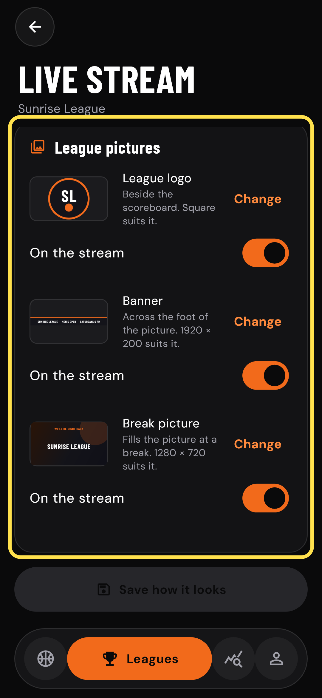

**Step 2.** Under **Scoreboard → Look**, choose a **Dark** or **Light** scoreboard.

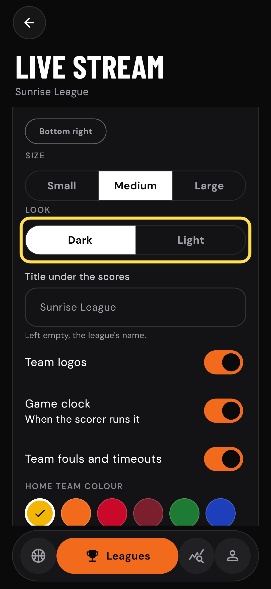

**Step 3.** Under **Breaks**, set how long the stream's countdown runs:

- **A timeout:** the countdown stops early if the clock starts again.
- **Between periods.**
- **Halftime.**

Then tap **Save how it looks** at the foot of the page.

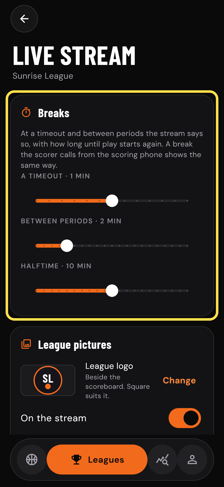

**Step 4.** Tap **At a break** in the preview to see the break picture with the countdown over it.

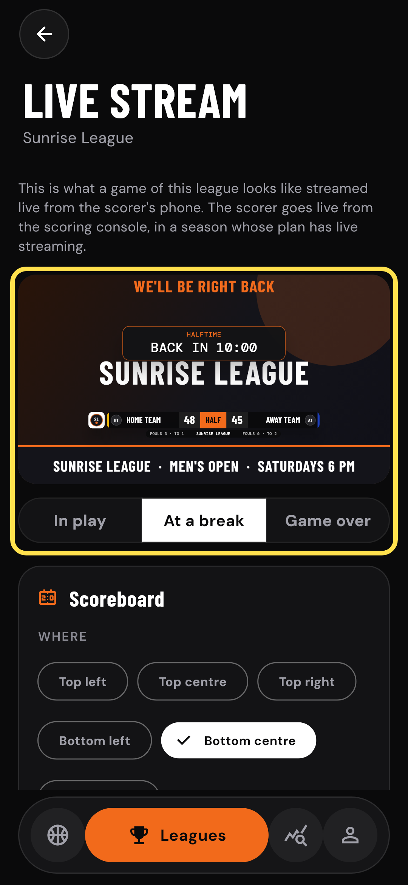

---

## 2. On the scoring phone: show the code

**Step 5.** Open the game's scorer console as usual, sideways. Tap the **Camera phone** button at the top.

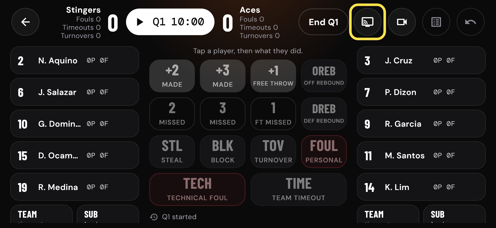

**Step 6.** The **Camera phone** sheet shows a code for this game. Below it, the sheet says **"No camera phone yet."** Leave it open for the camera phone to scan.

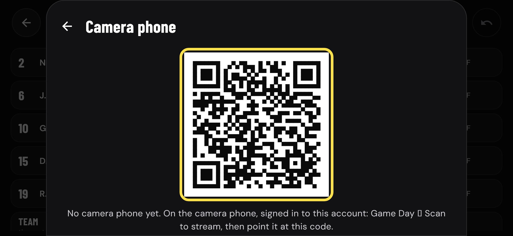

---

## 3. On the camera phone: scan and go live

**Step 7.** On the camera phone, open **Game Day** and tap the **Scan to stream** button at the top right. Point the phone at the code on the scoring phone.

- The first time, allow LigaPass to use the camera.
- If the game isn't on this phone yet, LigaPass fetches it first, so the phone must be online.

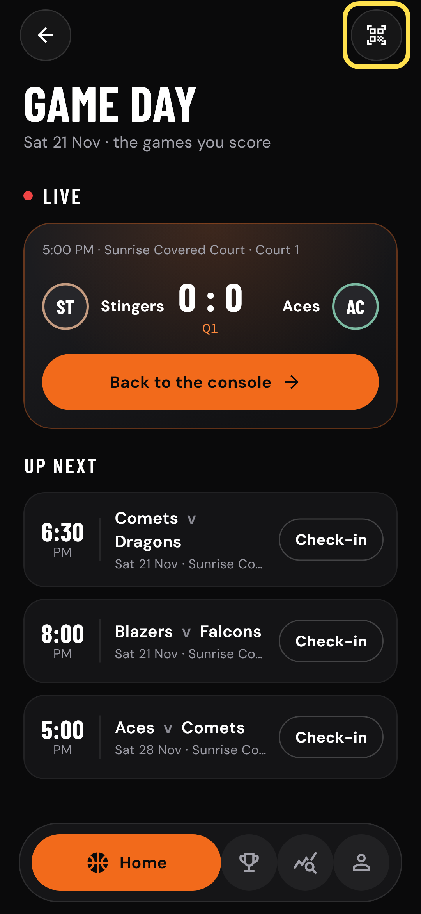

**Step 8.** The camera opens for this game, without the scorer console. **Turn the phone sideways** and put it on the tripod. The scoreboard over the picture follows the scoring phone, and the panel says **"Following the scoring phone, live."**

Go live as usual:

- With **Facebook** or **YouTube** connected, see [Go live with no stream key](../go-live-connect/README.md).
- With a **stream key**, see [Try live streaming in the demo](../live-stream-demo/README.md#4-go-live-from-the-phone).

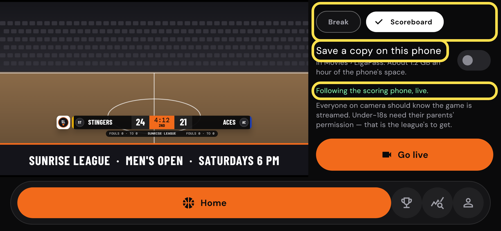

> Nothing tapped on the camera phone changes the game's record. The score comes only from the scoring phone.

---

## 4. From the scoring phone: breaks and the scoreboard

**Step 9.** Back on the scoring phone, the **Camera phone** sheet now says **"The camera phone is LIVE"** and how long it has been on air. While the camera phone is live, the console's Camera phone button turns green. From the sheet you can:

- **Break 1 min**, **Break 2 min** or **Break 5 min:** the stream shows a break with a countdown, then goes back to the game by itself.
- **Break until I end it:** a break with no countdown. Tap **End break** when play starts again.
- **Scoreboard on the picture:** turn it off to take the scoreboard off the stream, for example for an interview. Turn it on to bring it back.

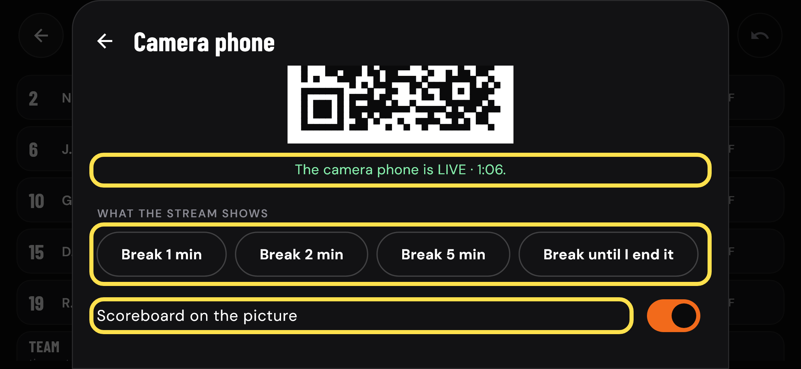

You don't need to call a break for **timeouts** or **between periods**. The stream shows those by itself, with a countdown, as soon as you record them on the console.

---

## 5. What viewers see

**In play:** the camera's picture with the scoreboard, the league logo beside it and the banner across the foot. If the league has sponsors, they take turns in a corner.

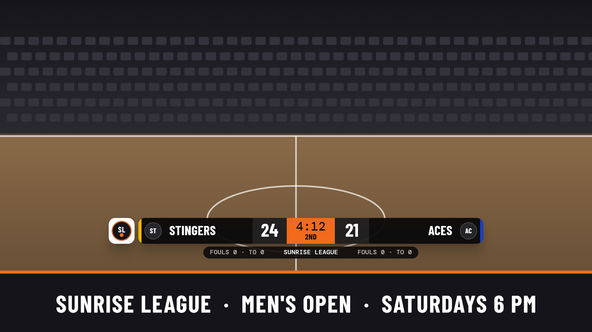

**At a break:** the break picture fills the screen, with what the break is and how long until play starts again (here **BREAK · BACK IN 2:00**). At a timeout it says **TIMEOUT** and the team's name. Between periods and at halftime it says so. If the league has no break picture, the sponsors show big instead.

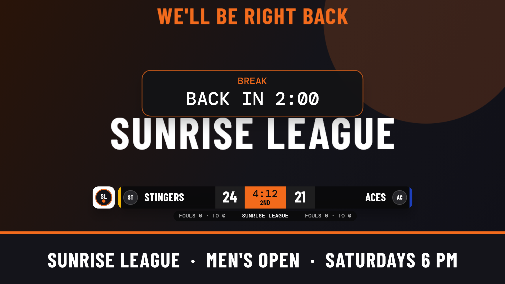

---

## 6. More on the camera phone

- **Zoom:** pinch on the camera picture to zoom in. A button shows how far you are zoomed; tap it to go back to no zoom.
- **Switch camera:** the button with the turning arrows switches between the back and front cameras.
- **Break** and **Scoreboard:** the same controls as on the scoring phone, so whoever holds the camera can call a break too.
- **Save a copy on this phone:** turn it on to keep a recording of what is streamed, in **Movies › LigaPass**. A copy takes about 1.2 GB of the phone's space an hour at 720p. It is off until you turn it on, and the phone remembers your choice.

**Another way to open the camera:** on the camera phone, open the game's page and tap **Stream this game**. You don't need to scan anything. The phone still has to be signed in to an account allowed to score the game.

---

## If something goes wrong

| What you see | What to do |
|---|---|
| There is no **Camera phone** button on the console, or no **Scan to stream** on Game Day | Update LigaPass from Google Play on both phones. You also need a season whose plan includes live streaming. The demo doesn't have it. |
| **"That is not a LigaPass stream code."** | Scan the code on the scoring phone's **Camera phone** sheet. |
| **"That game is not on this phone. Sign in with an account of its league, and try again once this phone is online."** | Check that the camera phone is online and signed in to an account of this league, then scan again. |
| **"Only an account that scores this game can stream it."** | Sign in on the camera phone with the scorer's account, or another account allowed to score this game. |
| **"This game's season has no live streaming."** | The season's plan doesn't include live streaming. Ask the league's owner. |
| The sheet still says **"No camera phone yet"** | Check that the camera phone has the camera open and is online. It reports in every few seconds. |
| The score on the stream lags | Check both phones' connections. With both online, the stream follows within a second or two. |

---

## Good to know

- **The score always comes from the scoring phone.** If the camera phone loses its connection for a moment, it catches up when it reconnects.
- **Both phones need the internet.** The phones talk through LigaPass's servers, not directly, so they don't need to be on the same Wi-Fi.
- **Everyone on camera should know the game is streamed.** Players under 18 need their parents' permission, and getting it is the league's job.

---

*These pictures were drawn from the app itself, using the made-up demo league. The court stands in for a real camera picture. The league logo, banner and break picture are made up.*

[All guides](../README.md)
