# Run a league season as the commissioner

This guide is for the **commissioner**: the person who runs a league's season day to day. It covers teams and rosters, the schedule, confirming results, the standings and leaders, and the season's awards. It uses the app's built-in demo, a made-up league, so you can try every step without an account or a real league. It takes about 20 minutes.

In the pictures, a **yellow ring** marks what to tap next.

**Contents**

1. [Before you start](#before-you-start)
2. [Find your way around a season](#1-find-your-way-around-a-season)
3. [Teams and rosters](#2-teams-and-rosters)
4. [The schedule](#3-the-schedule)
5. [Confirm a result](#4-confirm-a-result)
6. [Standings, leaders and records](#5-standings-leaders-and-records)
7. [Season awards](#6-season-awards)
8. [Scoring options for the season](#7-scoring-options-for-the-season)
9. [About the demo](#about-the-demo)

---

## Before you start

Open LigaPass. On the sign-in screen, tap **Try the demo — no account needed**, then **Start the demo**. The [getting started guide](../getting-started/README.md#try-the-demo) shows these two screens.

**Step 1.** Choose who to be. Tap **COMMISSIONER** (Rosa Mendoza). No password is needed.

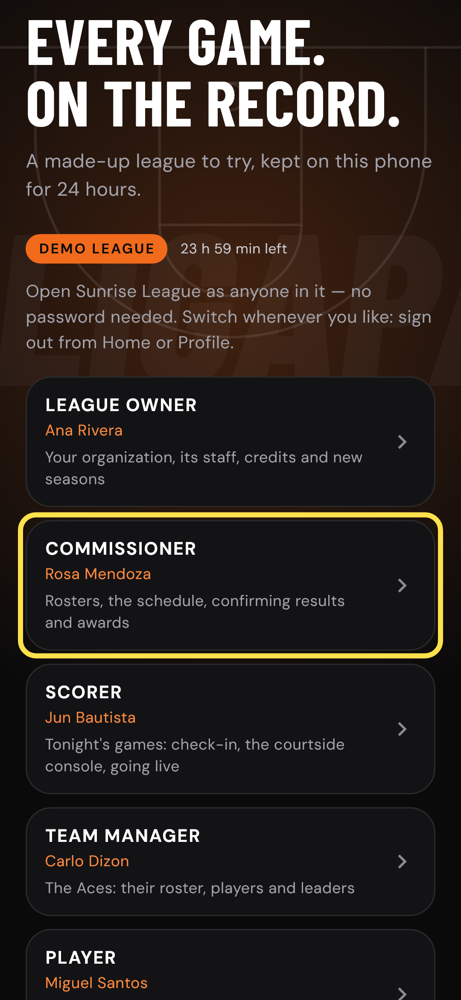

---

## 1. Find your way around a season

**Step 2.** Home shows the three modules open to a commissioner: **Leagues**, **Game Day** and **Players & Stats**. Tap **Leagues**.

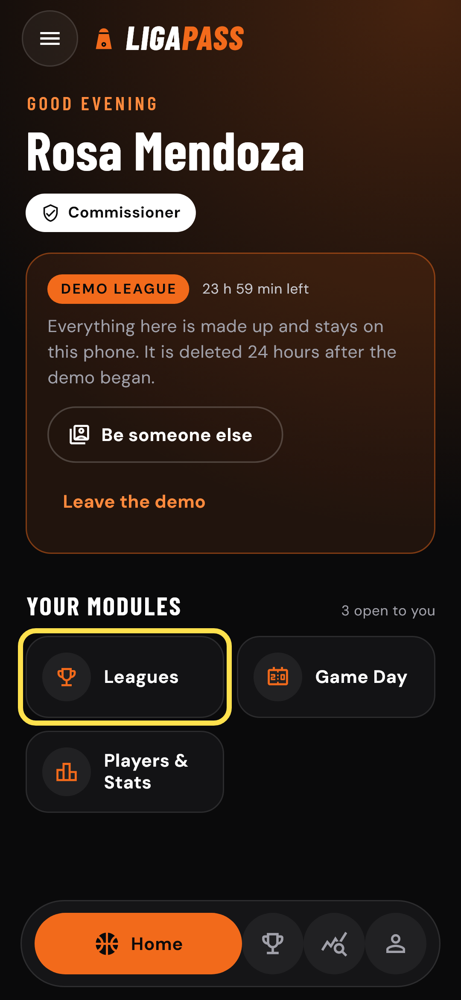

**Step 3.** The Leagues page lists your organization and its leagues. Tap **Sunrise League**.

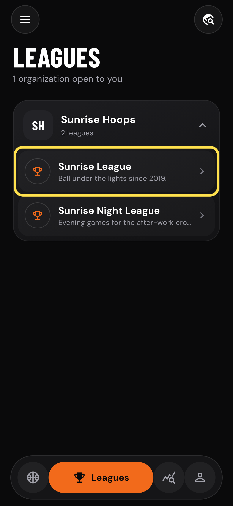

**Step 4.** The league's page lists its divisions, each with its seasons. Under **DIVISIONS**, tap the season under **Men's Open** (in the pictures, **2026 Season 1**).

- **People** is the list of who can open the league. Add the league's scorers and team managers here.
- **Live stream** sets up the sponsors and the layout for streamed games. See the [live streaming guide](../live-stream-demo/README.md).

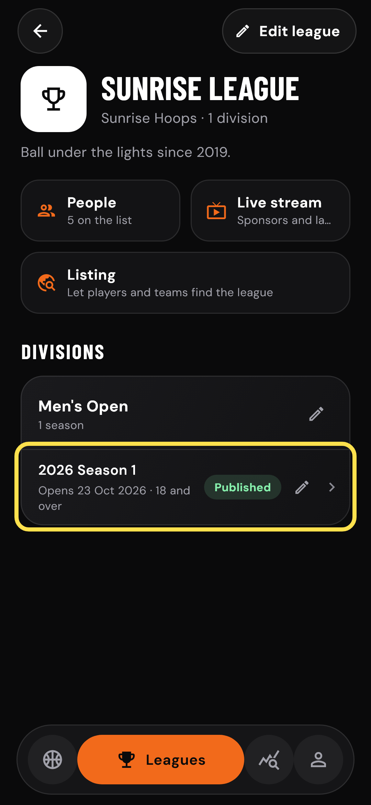

**Step 5.** This is the season's page. Everything about the season is in the row of tabs at the top. Swipe the row sideways to see them all.

| Tab | What it is for |
|---|---|
| **Rules** | The season's team places, age rule, roster size, game length and award rules. **Edit rules** is at the foot. |
| **Teams** | The teams in the season and their rosters. |
| **Schedule** | Every game. Add games here. |
| **Standings** | The table. |
| **Leaders** | The award races and the statistical leaders. |
| **Season** | The season at a glance, games coming up, latest results, the Player of the Week, records, head-to-head and player comparisons. |
| **Fees** | Charges, payments and expenses, when the season's plan includes league fees. |

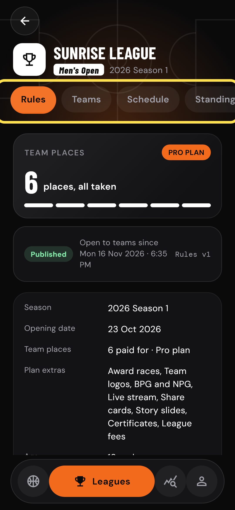

---

## 2. Teams and rosters

### Enter a team

**Step 6.** Tap the **Teams** tab. The card at the top shows how many team places the season has and how many are taken. Tap **Enter a team**.

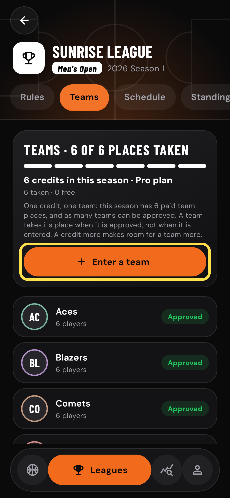

**Step 7.** Type the team's name under **Team name** (the demo uses "Thunder"), then tap **Enter team**.

- **A team you already have:** to bring back a team from an earlier season, type at least 3 letters of its name here instead.
- **TEAM LOGO** and **Team manager** are optional. A manager, coach and captain can also be named later on the team's page.

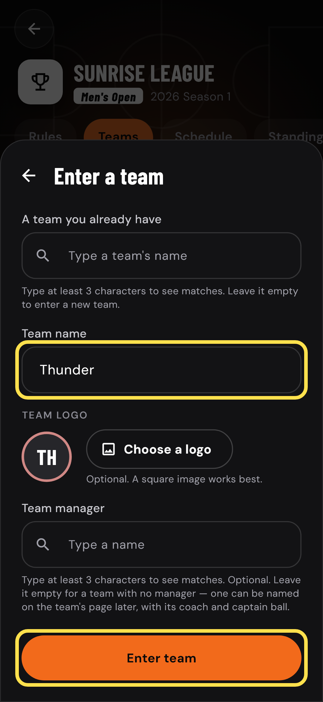

**Step 8.** The team is entered, but it is not in the season yet. A team takes a place only when it is approved, and **one credit is one team's place**. In the demo every place is already taken, so the Teams tab says the team waiting needs a credit before it can be approved.

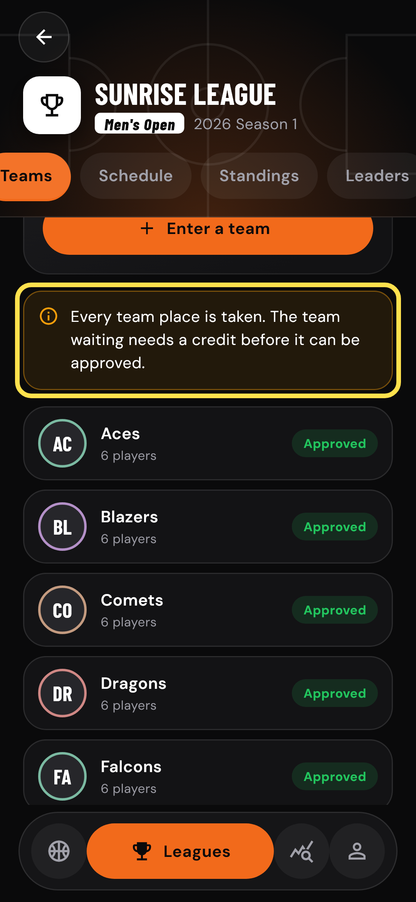

> **Who adds team places?** The league owner, who holds the credits. When your season is full, ask the owner to add a place.

**Step 9. (Demo only.)** To make room in the demo, be the owner for a moment:

1. Go back to Home, tap **Be someone else** and choose **LEAGUE OWNER**.
2. Open **Leagues → Sunrise League → 2026 Season 1 → Teams**.
3. Tap **Add team places**. Leave **Team places to add** at 1, tap **Use 1 credit**, then **Use credits**.
4. Go back to Home, tap **Be someone else** and choose **COMMISSIONER** again.

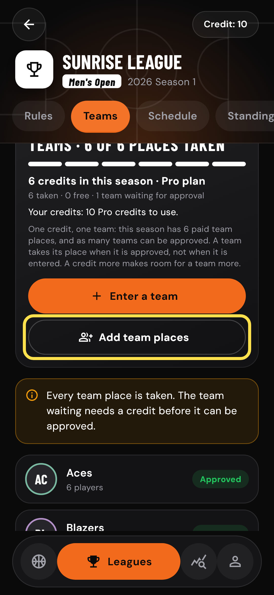

**Step 10.** As the commissioner again, open the **Teams** tab and tap **Thunder**. On the team's page, tap **Approve team**. (On a phone the button's name may be cut short to "Approve t…".) The team is now in the season.

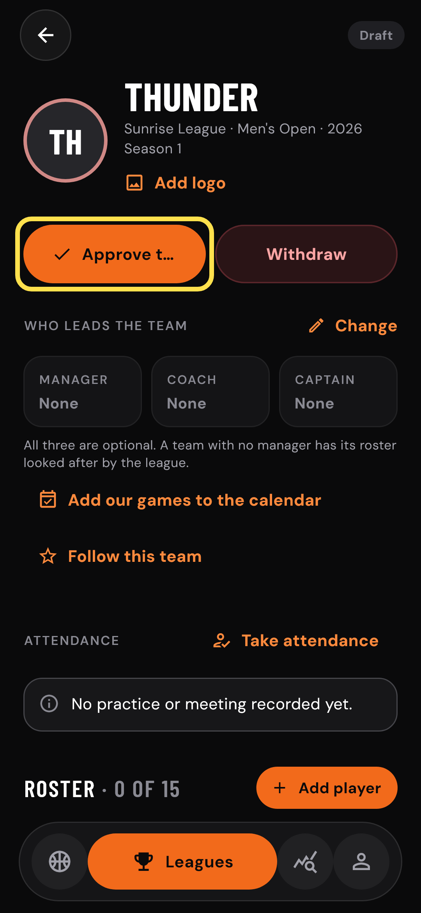

### Add players and approve them

**Step 11.** On the team's page, scroll down to **ROSTER** and tap **Add player**.

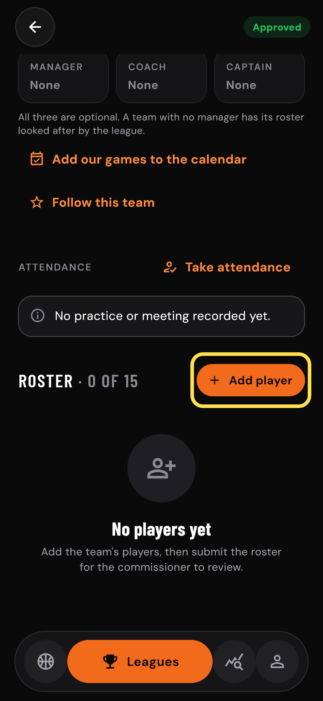

**Step 12.** Fill in **First name**, **Last name**, **Date of birth** and **Jersey number**, then tap **Add to roster**. Add each player the same way.

- **Email** and **Mobile number** are optional. The player needs no account to be on the roster.
- **A player you already have**, at the top of the form, finds the organization's own players and people who signed up by themselves.
- In a season with an age rule, a player without a date of birth shows "Information missing" and cannot be approved.

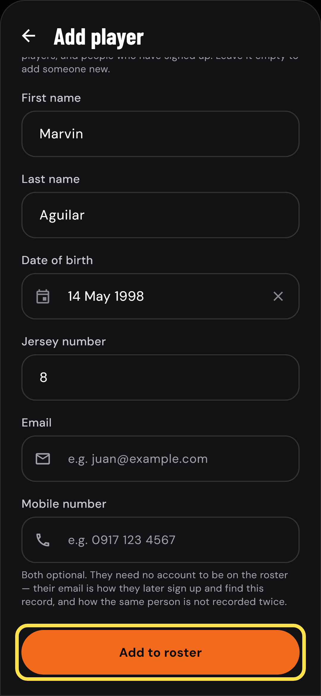

**Step 13.** New players are drafts. When the roster is ready, tap **Submit 2 for review** (the number is how many drafts there are).

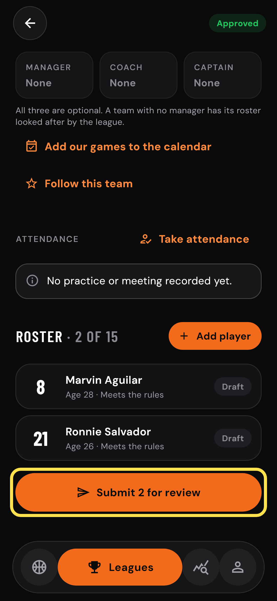

**Step 14.** The players now show **In review**. Tap a player to open them. Check the **Date of birth** and the **Eligibility** line ("Meets the rules"), then tap **Approve**. Do the same for each player.

- **Reject** needs a **Note** saying why.
- Only approved players can be checked in for a game.
- When a team manager sends in players from their own phone, they arrive the same way: the Teams tab shows "awaiting review" under the team, and you approve them here.

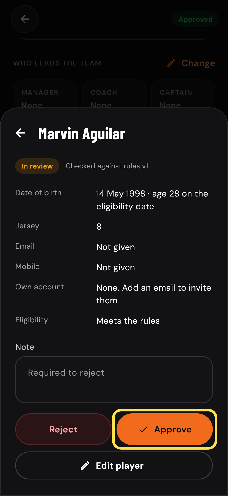

---

## 3. The schedule

### Add a game

**Step 15.** Tap the **Schedule** tab, then **Add game**.

- **Round robin** proposes a whole round-robin schedule from the approved teams, and **Knockout** a bracket. Nothing is created until you accept the proposal.
- **Venues** (top right of the card) is where you add and edit the places you play.
- Under the card, **All games**, **Upcoming** and **Completed** filter the list, and the calendar button shows the games on a month calendar.

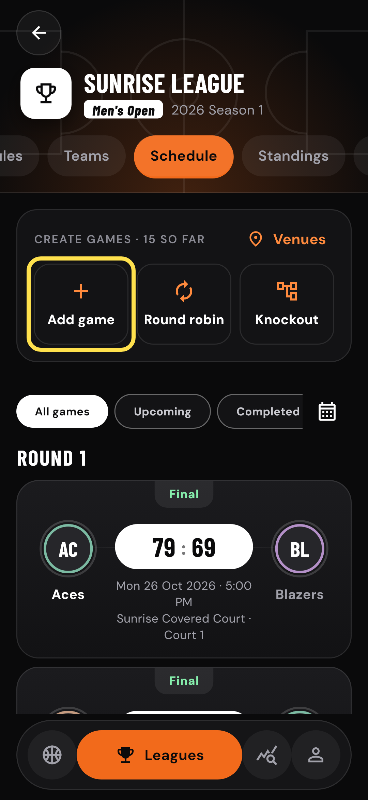

**Step 16.** Fill in the game:

- **Home** and **Away:** type the first letters of a team's name and pick it from the list.
- **Round**, **Date** and **TIP-OFF** (the start time).
- **Venue:** type the first letters and pick it. For a venue with more than one court, choose the **Court**.
- **Exhibition:** turn it on for a game that should count in no table, leaderboard or record.

Then tap **Add game**. If the game clashes with another (for example a team playing twice at once, or a court booked twice), the app asks first: **Change it** or **Schedule anyway**.

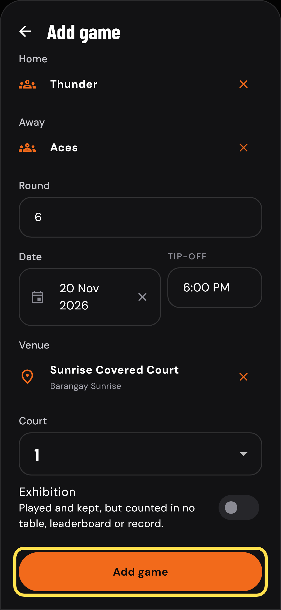

### Assign the scorer

**Step 17.** The game is now on the schedule. Tap it to open the game's page, then tap **Assign a scorer**.

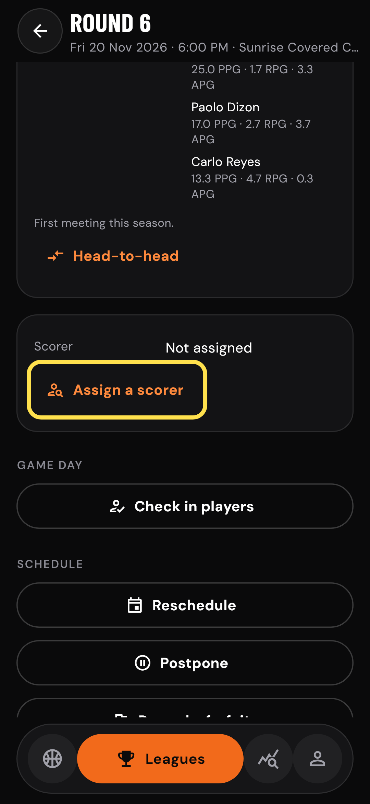

**Step 18.** Type the first letters of the scorer's name and tap them in the list. The game now appears on that scorer's **Game Day**.

- The list holds the people of this league whose role can score. To add someone, use **People** on the league's page.
- Once a scorer is assigned, the button reads **Change scorer**.

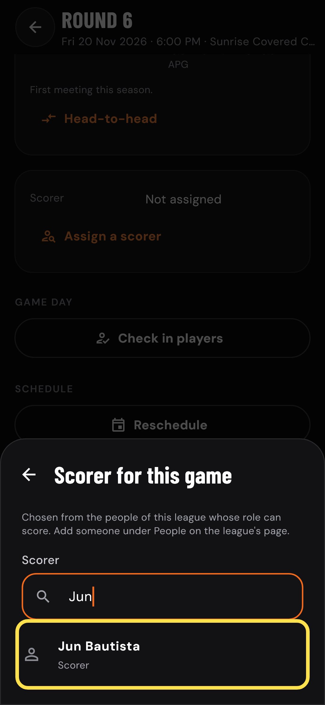

### Move or postpone a game

**Step 19.** Lower on the game's page, under **SCHEDULE**:

- **Reschedule** changes the date, the tip-off time, the venue or the court.
- **Postpone** takes the game off its date until it gets a new one. It asks for a reason.
- **Record a forfeit** and **Cancel game** are there too.

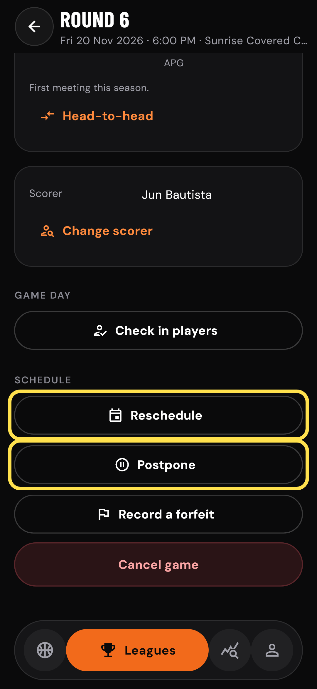

**Step 20.** In **Reschedule**, change what has moved (the demo moves the game to court 2), add a **Reason for the change** if you like, and tap **Save**. The earlier time and the reason stay on the game's page under **PREVIOUSLY SCHEDULED**.

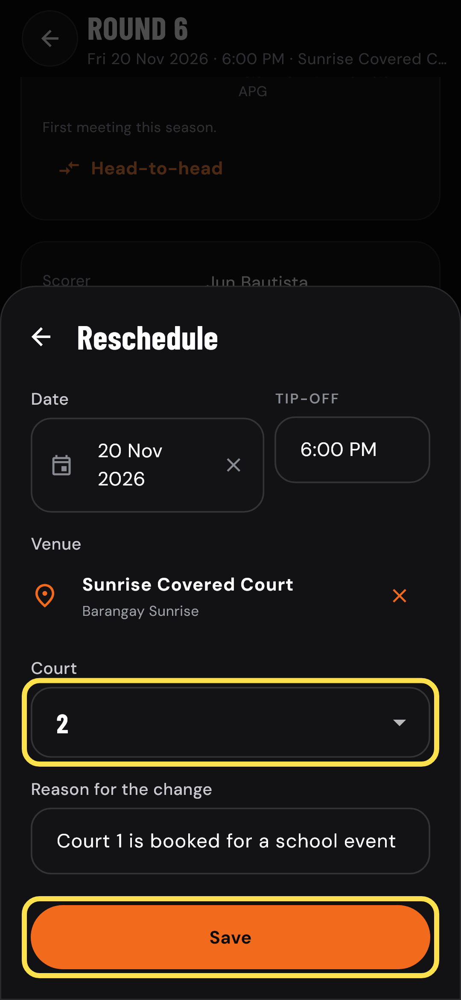

---

## 4. Confirm a result

After a game, the scorer hands in the result. It names the **Best Player of the Game (BPG)**, from the winning team, and the **Notable Player of the Game (NPG)**, from the defeated team. Nothing counts in the standings or the statistics until **you confirm it**.

### In the demo: have tonight's first game played

The demo's first three weeks are already confirmed, and tonight's games are not played yet. To have a result to confirm, play one of tonight's games as the scorer:

1. Go to Home, tap **Be someone else** and choose **SCORER**.
2. Tap **Game Day**. On tonight's first game, tap **Check-in**, tap **Everyone eligible** for both teams, and tap **Save check-in**.
3. Tap **Tip-off**, then **Start game**.
4. Score a few baskets: tap a player, then **+2** or **+3**. End each quarter with **End Q1** … **End Q4**, and start the next with **Start Q2** … in between.
5. Leave the console with the back arrow, open the game and tap **Submit result**. Check the **BPG** and **NPG** choices at the foot and tap **Submit result** again.

The [scorer's guide](../scorer/README.md) shows all of this step by step.

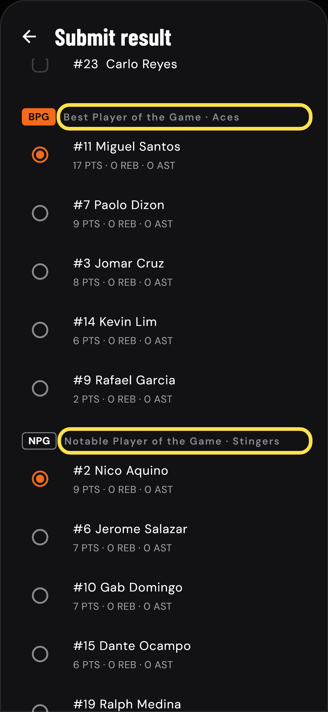

Then go to Home, tap **Be someone else** and choose **COMMISSIONER** again.

### Confirm it

**Step 21.** On Home, tap **Game Day**. Scroll down to **AWAITING CONFIRMATION** and tap the game.

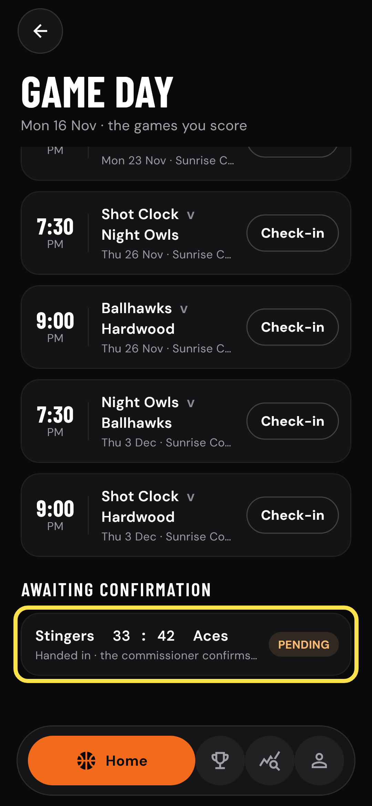

**Step 22.** The game's page shows the score, the players of the game the scorer named, and the box score. If everything is right, tap **Confirm result**.

- If something needs correcting, tap **Send back to the scorer** instead and say what needs correcting.

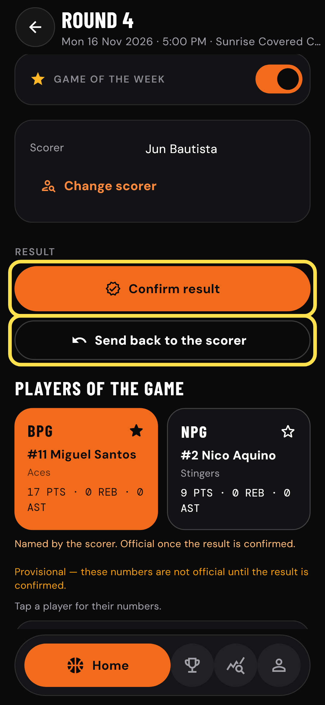

**Step 23.** The **Confirm result** form shows the final score, the **BPG** choices (the winners' players) and the **NPG** choices (the defeated team's players), with the scorer's picks selected. Change either one if you need to. Then scroll down and tap **Confirm result**.

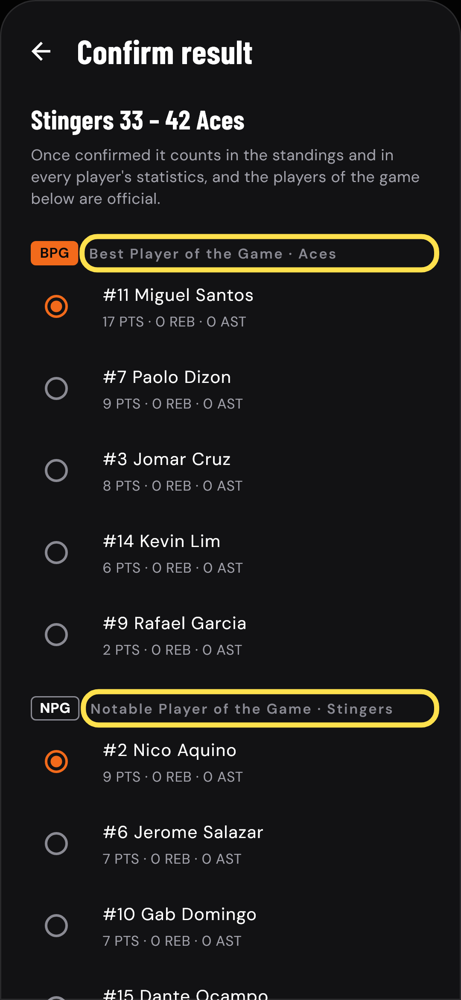

**Step 24.** The result is official. It counts in the standings and in every player's statistics, and the players of the game are on the page. In the box score, a player who was checked in but never played shows **DNP**.

- If a confirmed result turns out to be wrong, tap **Reopen for correction** and say what was wrong. The game is corrected and confirmed again as the next revision. Earlier revisions are kept.

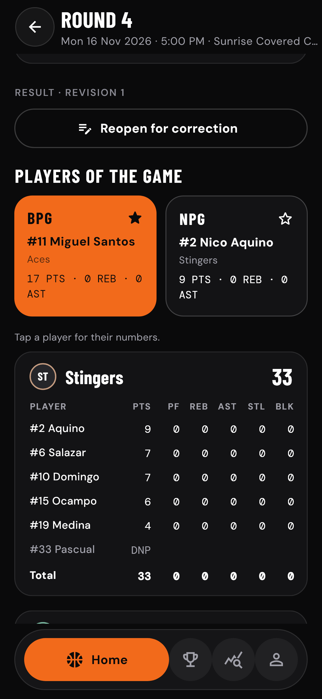

---

## 5. Standings, leaders and records

**Step 25.** Open the season again (**Leagues → Sunrise League → 2026 Season 1**) and tap **Standings**. Each team shows games played (**P**), wins (**W**), losses (**L**), point difference (**DIFF**) and points (**PTS**). Under each team: its streak, its last games and how many games it is behind the leader.

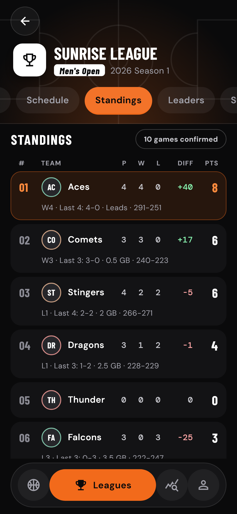

**Step 26.** Tap **Leaders**. The chips across the top choose the list: first the award races (**MVP**, **Finals MVP**, **Defense** …), then the statistics (**PPG** points, **RPG** rebounds, **APG** assists …). Under a statistic, **Totals** shows season totals, **Rookies** shows only players in their first season in the league, and **Share** makes a picture of the list. Tap a player to open their history.

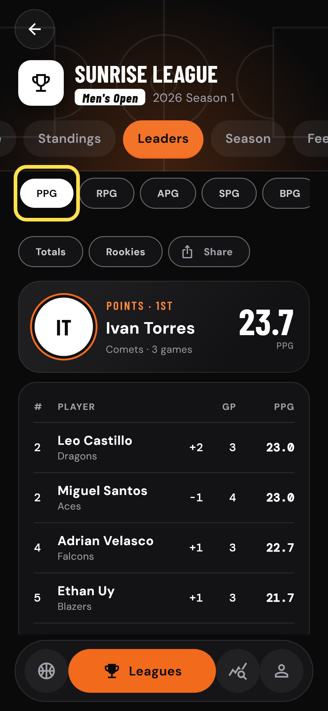

**Step 27.** Tap **Season**. It shows the season at a glance, the games coming up, the latest results, storylines and the Player of the Week (**Confirm the Player of the Week** names each week's best). Under **MORE** are **Records book**, **Head-to-head** and **Compare players**.

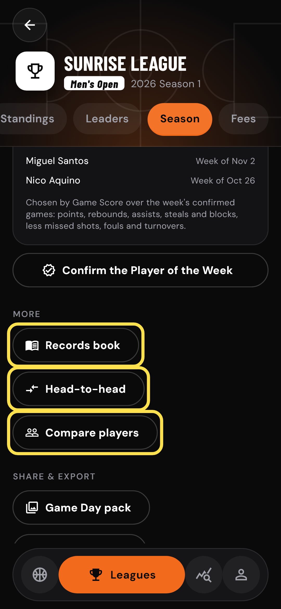

**Step 28.** **Records book** lists the league's single-game highs and marks the games that broke a record. The chips choose the seasons, the games and the statistic.

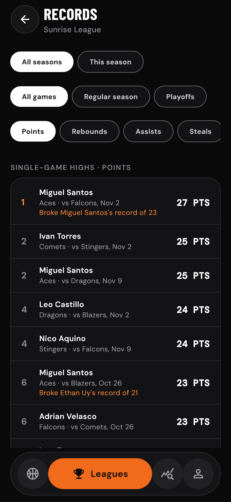

**Step 29.** **Head-to-head** compares two teams. Type the first letters under **First team** and **Second team** and pick them. It shows this season, all-time in the league, and their numbers per game against each other.

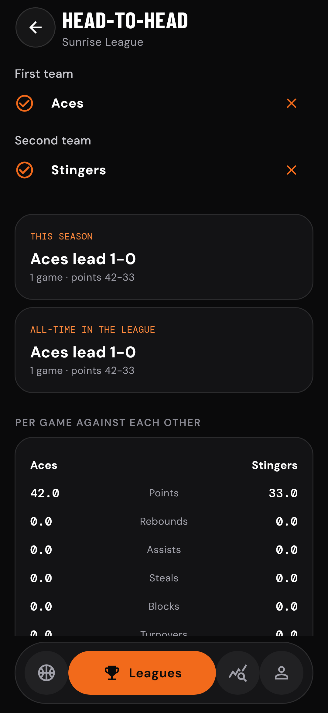

**Step 30.** **Compare players** does the same for two players, side by side, for **This season** or their **League career**.

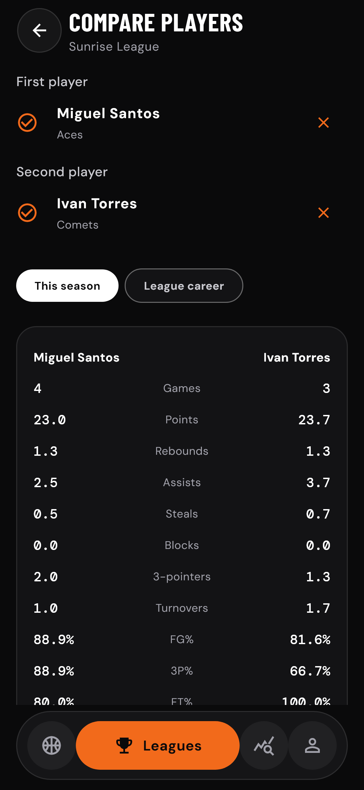

> **Box scores:** open any game from the **Schedule** tab or from **Game Day** to see its box score. Tap a player in it for that player's whole line in the game.

---

## 6. Season awards

At the end of the season you confirm the season's awards: MVP, Defensive Player, the Scoring, Rebounding and Assists Champions, the Mythical Five and the 2nd Mythical Five (and, in a season with a knockout bracket, the Finals MVP and where the teams finished).

**Step 31.** Open the **Leaders** tab and tap the **MVP** chip. The races show who the numbers put forward; **Combined**, **Regular season** and **Playoffs** choose which games count. At the foot of the race, tap **Confirm season awards**.

- The demo season has no knockout bracket, so every team is in the races and the button works at any time. In a season with a bracket, it waits until the Final has been decided.
- Who each award is open to (for example, whether the MVP comes from the two finalists) is set on the **Rules** tab, under **Edit rules**.

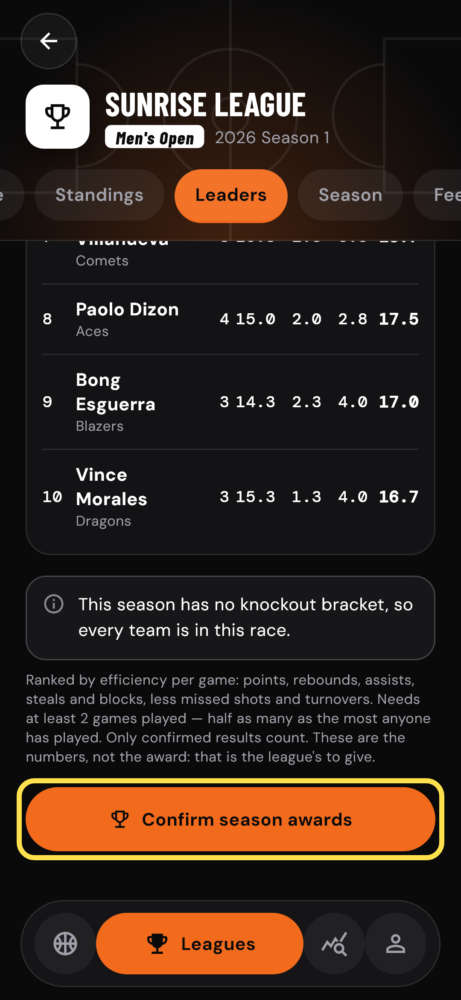

**Step 32.** The form starts from the players the ratings put forward, with each player's rating in every view. The decision is yours: to change an award, tap the **×** beside the name and type the first letters of another player who played this season. Leave an award empty if your league does not give it. Then scroll to the foot and tap **Confirm awards**.

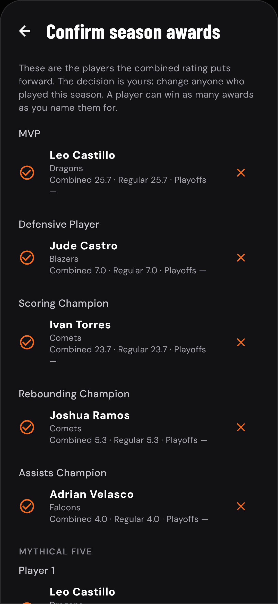

**Step 33.** The awards are official. They are at the top of the Leaders tab under **OFFICIAL AWARDS**, and on each winner's profile. To change them later, tap **Change season awards** and say why.

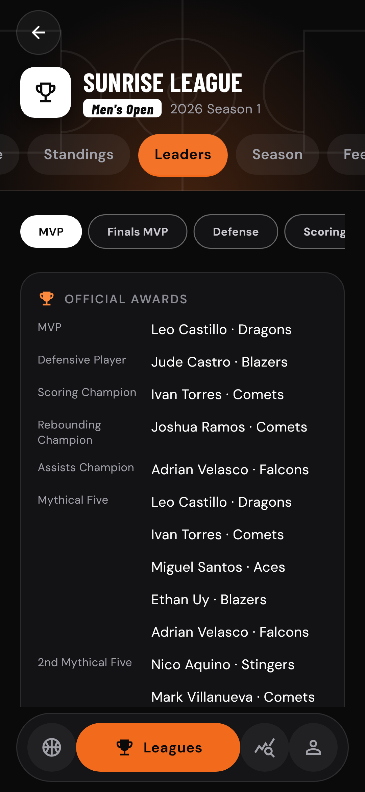

---

## 7. Scoring options for the season

The season's rules decide how the scorer's console works.

**Step 34.** Open the **Rules** tab, scroll to the foot and tap **Edit rules**.

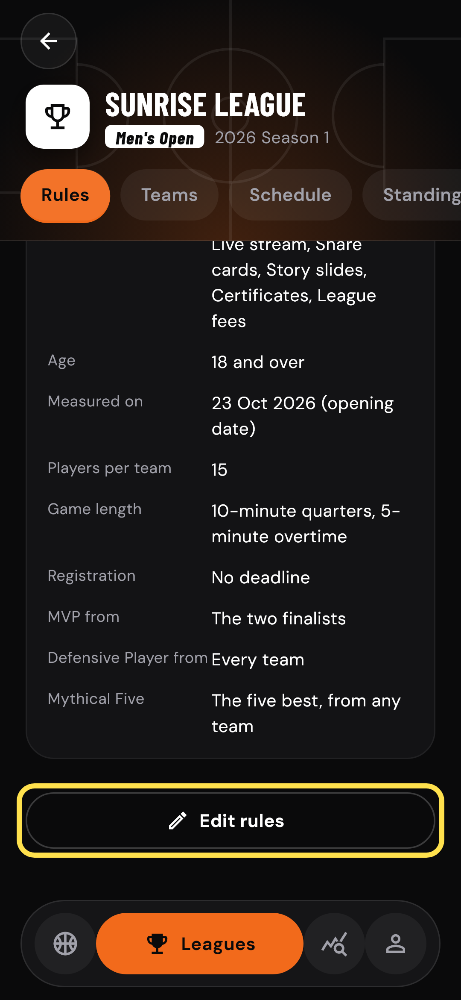

**Step 35.** Scroll to **Game length**:

- **Minutes a quarter** and **Minutes an overtime** set where the scorer's game clock starts each period (10 and 5 if left empty).
- **Two halves:** two halves instead of four quarters.
- **Points only:** the scorer keeps only points, fouls and timeouts. For short-staffed nights.
- **Shot locations:** the scorer marks where each field goal was taken, for shot charts. It can be skipped shot by shot.

Turn on what you need, scroll to the foot and tap **Save rules**.

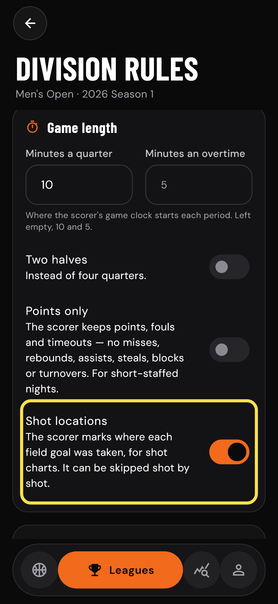

---

## About the demo

- **A made-up league.** It is called Sunrise League. It has six teams, three weeks of games already played and confirmed, tonight's games waiting to be scored, and next week's games on the calendar. Every Pro feature is on.
- **Saved on this phone only.** Nothing is synced, emailed or paid for. The credits the owner uses are part of the demo.
- **Gone after 24 hours.** The demo and everything you add to it are deleted 24 hours after you start it.
- **Switching roles:** tap **Be someone else** on Home. **Leave the demo** takes you back to the normal sign-in.

---

*These pictures were drawn from the app itself with the made-up demo league. The team Thunder and its players were added for this guide.*

[All guides](../README.md)
