# Suspensions, bans and fines

This guide is for the **league owner** and the **commissioner**: the people who run a league. It shows how to suspend or ban a player, fine a player or a team, see who has to sit out a game, and keep track of every fine, including a purse for the season's MVP. It uses the app's built-in demo, a made-up league, so you can try every step without an account or a real league. It takes about 10 minutes.

In the pictures, a **yellow ring** marks what to tap next.

> Discipline comes with the latest LigaPass update. If you do not see the **Discipline** tab on a season's page, update the app from Google Play.

**Contents**

1. [Before you start](#before-you-start)
2. [Set the season's discipline rules](#1-set-the-seasons-discipline-rules)
3. [The Discipline tab](#2-the-discipline-tab)
4. [Who sits out a game](#3-who-sits-out-a-game)
5. [Suspend or fine a player](#4-suspend-or-fine-a-player)
6. [Fine a team for a default](#5-fine-a-team-for-a-default)
7. [On the team's page](#6-on-the-teams-page)
8. [The MVP purse](#7-the-mvp-purse)
9. [How games served are counted](#how-games-served-are-counted)
10. [About the demo](#about-the-demo)

---

## Before you start

Open LigaPass. On the sign-in screen, tap **Try the demo — no account needed**, then **Start the demo**. The [getting started guide](../getting-started/README.md#try-the-demo) shows these two screens.

**Step 1.** Choose who to be. Tap **COMMISSIONER** (Rosa Mendoza). The league owner can do everything in this guide too.

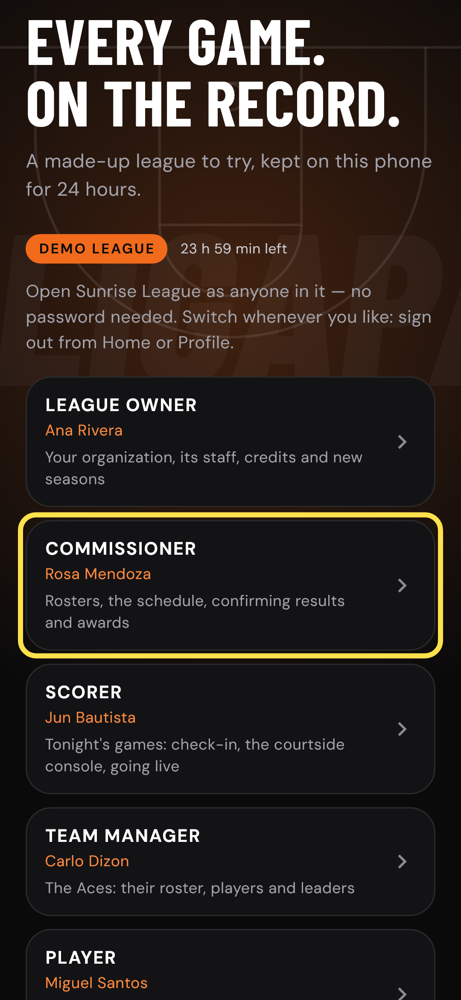

Then go to **Leagues**, tap **Sunrise League**, and open its season under **Men's Open**. The [commissioner's guide](../commissioner/README.md#1-find-your-way-around-a-season) shows the way.

---

## 1. Set the season's discipline rules

**Step 2.** On the season's **Rules** tab, **Fines** shows what each kind of fine costs, and **MVP purse** shows which fines go to the MVP.

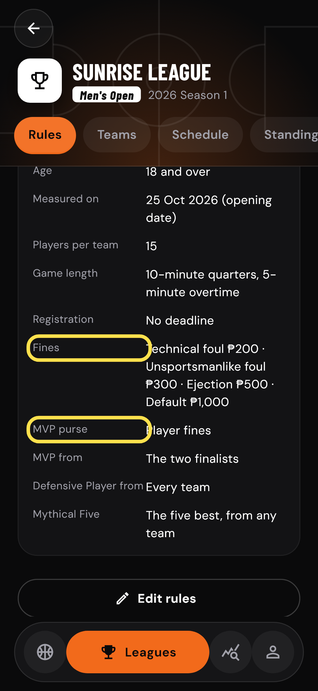

**Step 3.** To change them, tap **Edit rules** at the foot of the Rules tab and scroll to **Discipline**.

- **Fewest players to start a game.** Leave it empty for no minimum, or set it to what your league allows, for example **5** or **4**. A team with fewer players checked in cannot start the game: it is a default, and you record it as a forfeit.
- **Fines.** The amount for a **technical foul**, an **unsportsmanlike foul**, an **ejection**, and a team's **default**. Each fine is filled in at this amount when you give it, and you can change it then. Leave one empty to enter the amount each time.

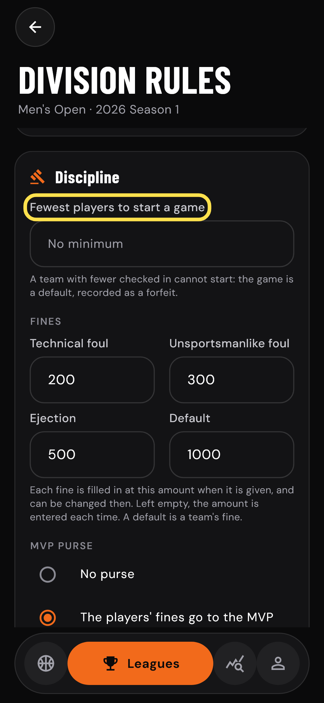

**Step 4.** Under **MVP PURSE**, choose what goes to the season's MVP on top of the trophy: no purse, the players' fines, or the players' and the teams' fines. Then tap **Save rules** at the foot of the form.

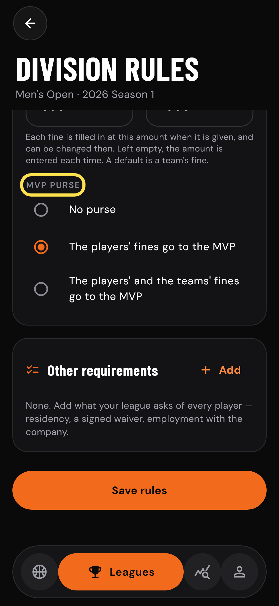

---

## 2. The Discipline tab

**Step 5.** Swipe the row of tabs to the end and tap **Discipline**. At the top are the **MVP purse** (when the season has one) and the season at a glance: how many players are suspended now, how many fines, and what they come to, collected and still owed.

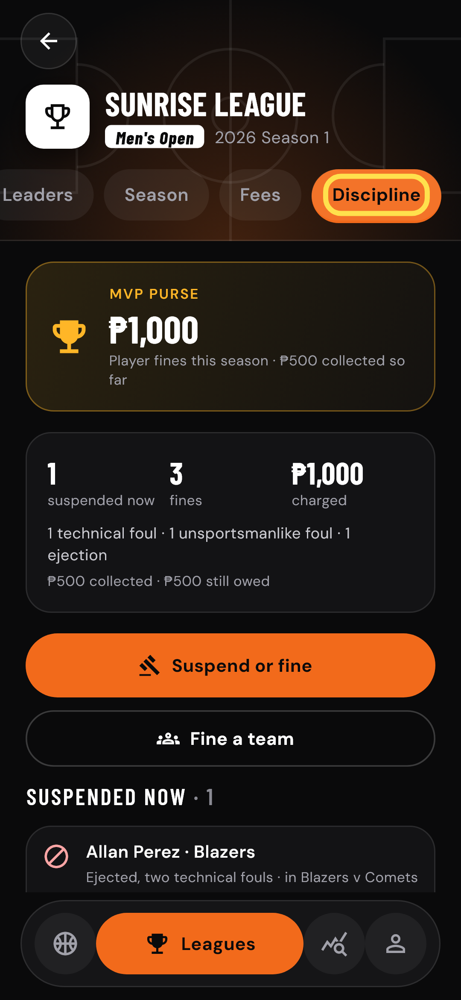

**Step 6.** Further down:

- **Suspended now**: who is suspended, why, and where the suspension stands, for example **Suspended for 1 game**.
- **Fines by player**: each player's fines, and whether they are paid.
- **Fines by team**: each team's own fines and its players' fines.
- **Served or lifted**: suspensions that are over.

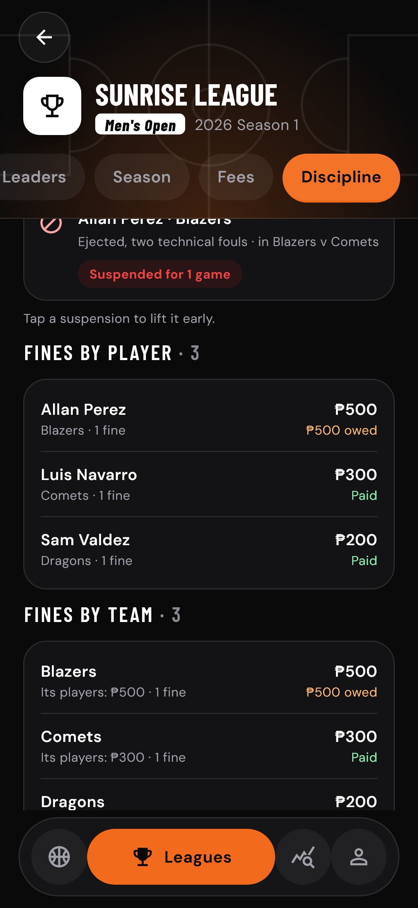
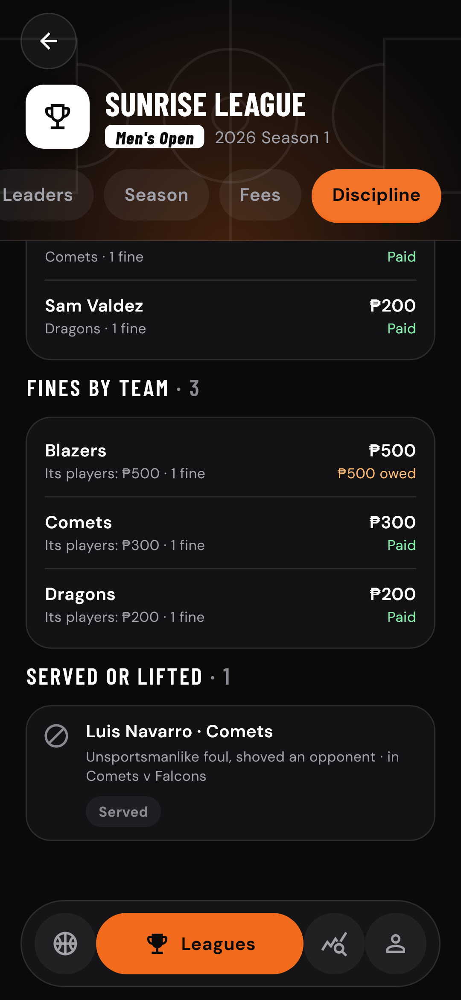

**Step 7.** To end a suspension early, tap it under **Suspended now**, say why, and tap **Lift suspension**. A lifted suspension stays on record, under **Served or lifted**.

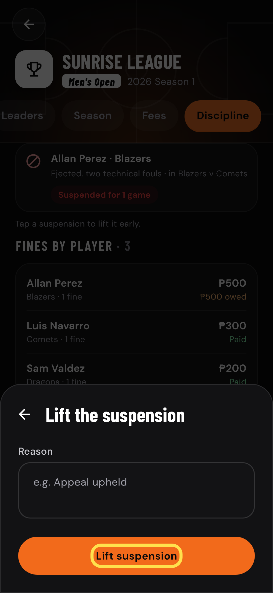

Fines are paid like any other charge, on the season's **Fees** tab, where each one is listed as a fine. A fine given by mistake is voided there, with a reason.

---

## 3. Who sits out a game

In the demo, a Blazers player was ejected last week and suspended for one game: tonight's.

**Step 8.** On the **Schedule** tab, tap tonight's Blazers game.

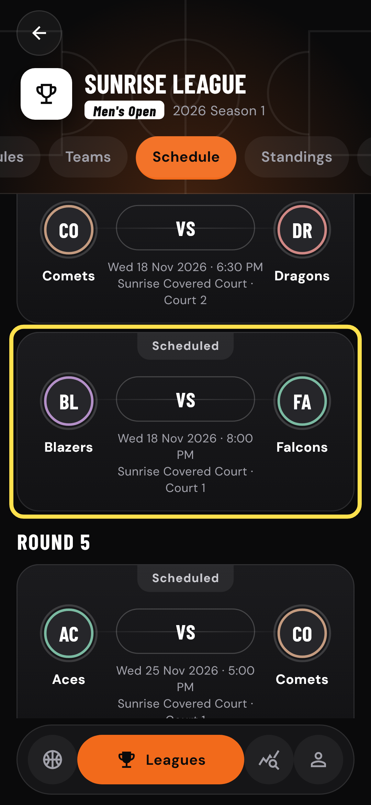

**Step 9.** Until the game is played, its page says who **sits out this game**, and why.

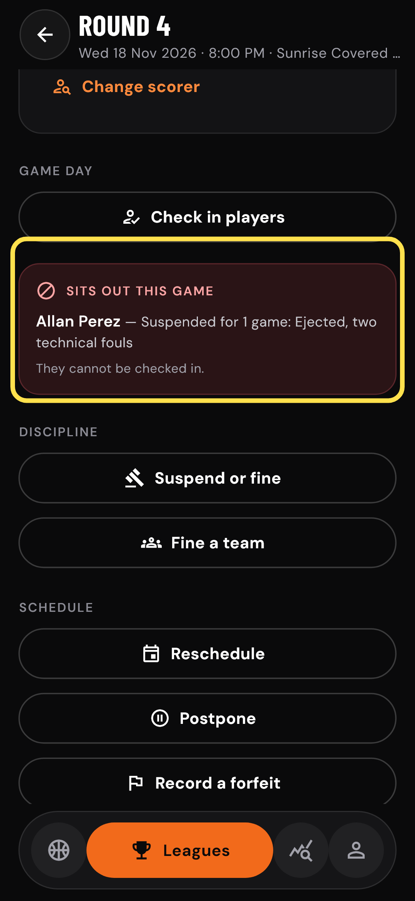

**Step 10.** At check-in, a suspended player is greyed out with the reason, and cannot be ticked. Nobody can check them in until the suspension is served or lifted.

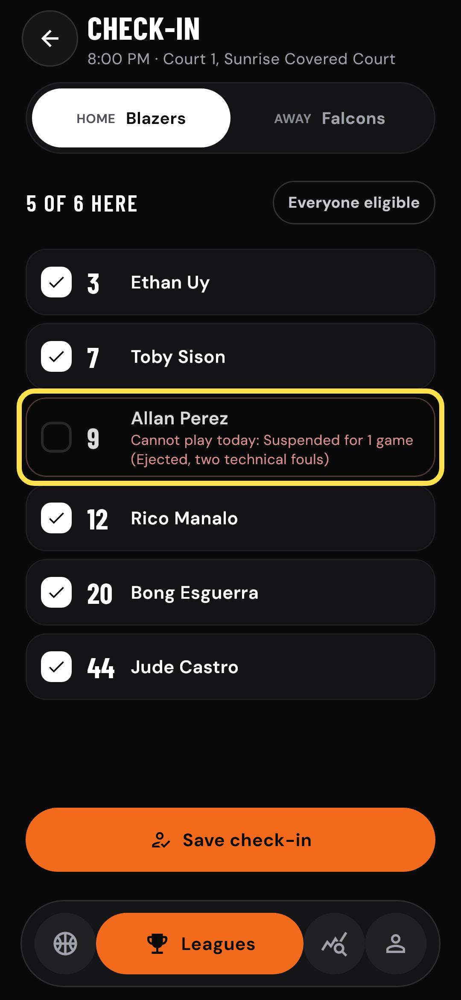

---

## 4. Suspend or fine a player

You can do this from a game's page, during the game or after it, or from the **Discipline** tab.

**Step 11.** On the game's page, under **DISCIPLINE**, tap **Suspend or fine**. Anything already given in this game is listed above it.

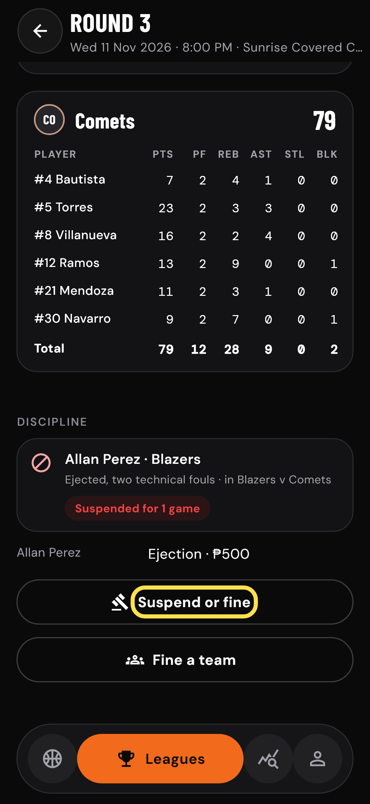

**Step 12.** Type part of the player's name and pick them. From a game's page, the list has both teams' players.

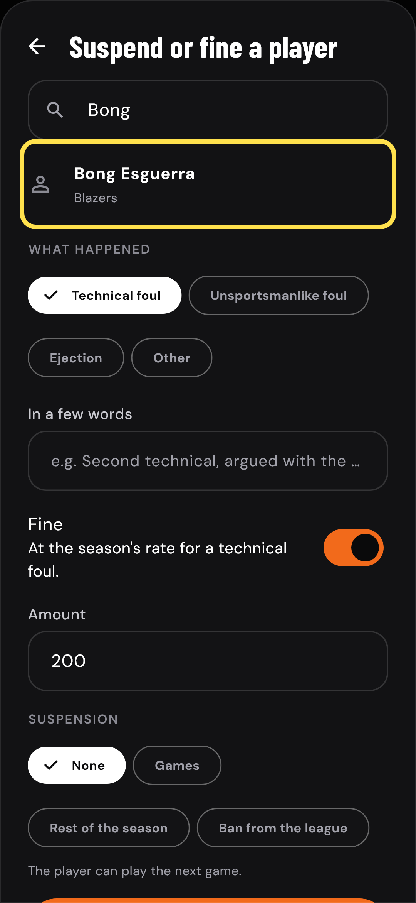

**Step 13.** Choose **what happened**: a technical foul, an unsportsmanlike foul, an ejection, or something else. Say it in a few words. With **Fine** on, the amount is the season's rate for what happened, and you can change it.

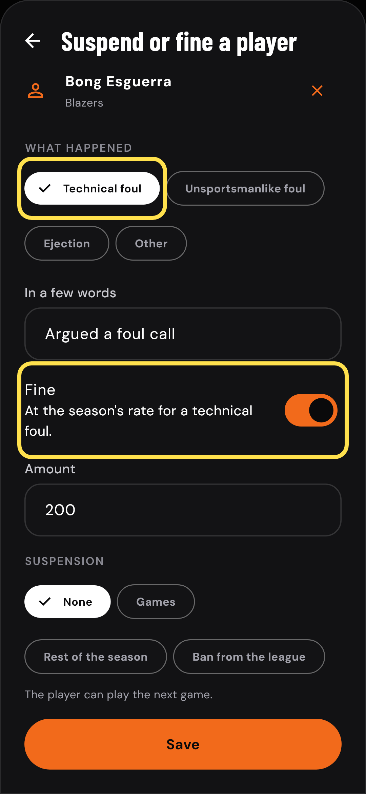

**Step 14.** Under **SUSPENSION**, choose how long:

- **None**: the player can play the next game.
- **Games**: a number of the team's games.
- **Rest of the season**: until the season ends, unless you lift it.
- **Ban from the league**: every game of the league, in every season, until you lift it.

Choosing **Ejection** suggests a one-game suspension. You can fine a player, suspend them, or both.

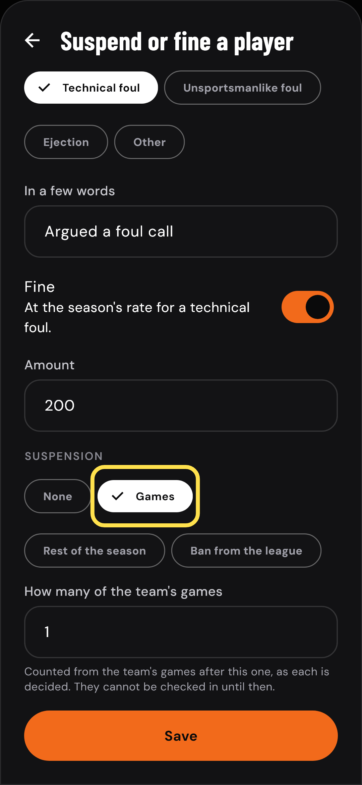

**Step 15.** Tap **Save**.

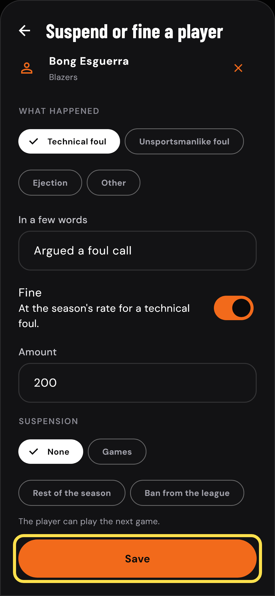

**Step 16.** A message says what was given, and it appears under **DISCIPLINE** on the game's page and on the Discipline tab.

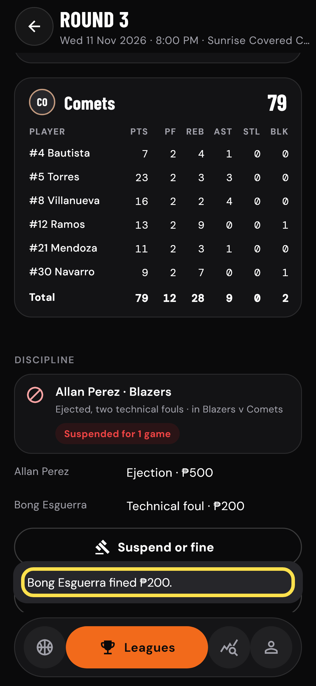

---

## 5. Fine a team for a default

**Step 17.** To fine a team, tap **Fine a team** on a game's page or on the Discipline tab. The amount is the season's rate for a default.

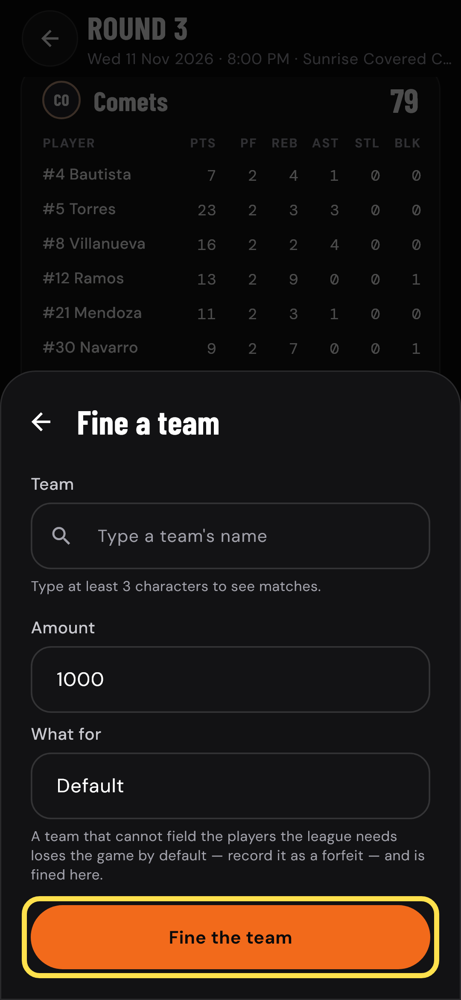

**Step 18.** When a team cannot field enough players, record the game as a forfeit: on the game's page, tap **Record a forfeit**. The sheet offers to **fine the team that defaulted** at the season's rate, in the same step.

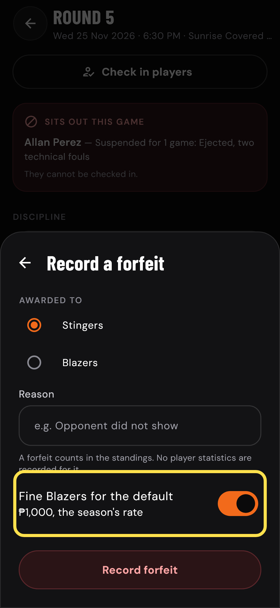

---

## 6. On the team's page

**Step 19.** A team's page has a **Discipline** card for its manager and for whoever runs the league. It shows who is suspended now, and what the team and its players have been fined.

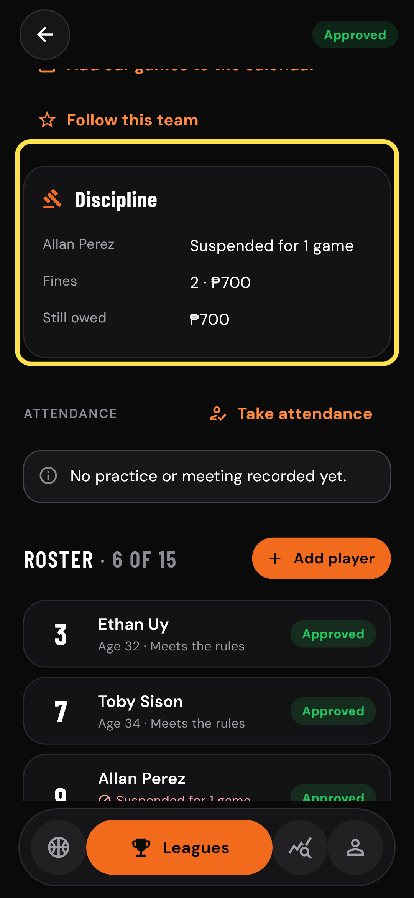

**Step 20.** On the roster, a suspended player is marked, so the team knows before game day.

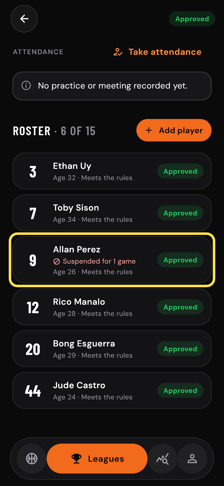

---

## 7. The MVP purse

**Step 21.** When the season has a purse, the **Leaders** tab shows it above the **MVP** race: what the fines come to, and how much has been collected so far.

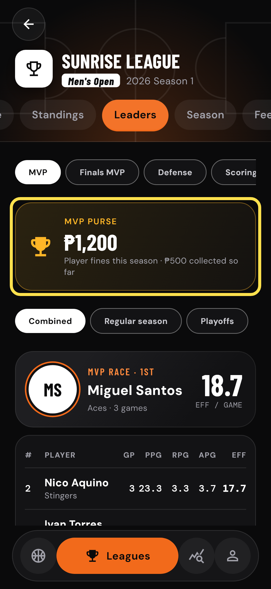

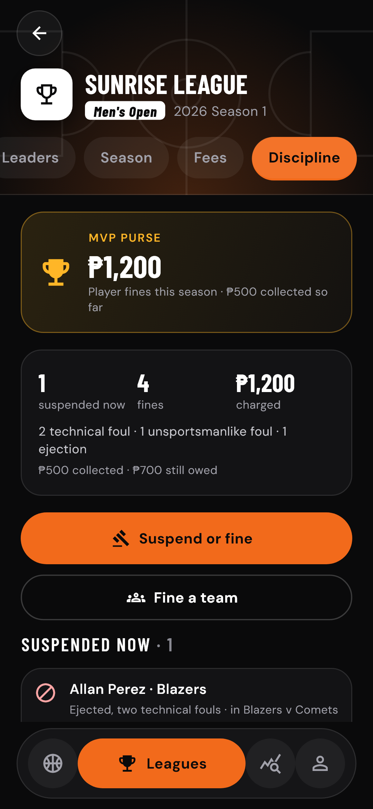

---

## How games served are counted

A suspension for games counts the **team's** games played after the game it was given in (or after the day it was given, if it was not given in a game). A game counts once it is decided: its result is handed in or confirmed, or it is recorded as a forfeit. A game that is **postponed**, **canceled** or **abandoned** does not count, so the player still has to sit out the next one.

That is why, in the demo, the suspended player is also listed as sitting out next week's game: tonight's game has not been played yet. Once it is, next week's game no longer lists them.

- **Rest of the season** lasts until the season ends.
- **Ban from the league** reaches every season of the league, until you lift it.

A suspension or a fine is never deleted. A suspension is lifted early with a reason, and a fine is voided with a reason. Both stay on record.

Suspensions work in every season. Fines are kept in the season's books, so they need a plan that includes **league fees**.

---

## About the demo

The demo's league, Sunrise League, and everyone in it are made up. The demo lives on your phone only and is deleted after 24 hours; nothing in it is sent anywhere.
