# Getting started with LigaPass

This guide is for anyone new to **LigaPass**, the app for running basketball leagues: players, team managers, scorers, commissioners and league organizers. It shows how to get the app, sign in or sign up, try the built-in demo, find your way around and look after your profile.

In the pictures, a **yellow ring** marks what to tap next.

**Contents**

1. [Get the app](#get-the-app)
2. [The sign-in screen](#the-sign-in-screen)
3. [Forgot your password](#forgot-your-password)
4. [Sign up as a player](#sign-up-as-a-player)
5. [Try the demo](#try-the-demo)
6. [Find your way around](#find-your-way-around)
7. [Your profile](#your-profile)
8. [Updates and what's new](#updates-and-whats-new)
9. [If something goes wrong](#if-something-goes-wrong)
10. [About the pictures](#about-the-pictures)

---

## Get the app

LigaPass works on **Android phones only**. You get it from **Google Play**.

While LigaPass is being tested, you need the **tester invitation link** you were sent:

1. On your Android phone, check that the Play Store is signed in with the **Google account that was invited**: the one whose email address you gave for testing.
2. Open the invitation link and accept the invitation.
3. Follow the link through to LigaPass on Google Play and tap **Install**.
4. Open **LigaPass**. The sign-in screen appears.

> If the link says the app isn't available to you, the Play Store is probably signed in with a different Google account. Switch to the invited account and open the link again.

*Google Play's own pages can't be shown here, so this part has no pictures.*

---

## The sign-in screen

This is the first screen you see.

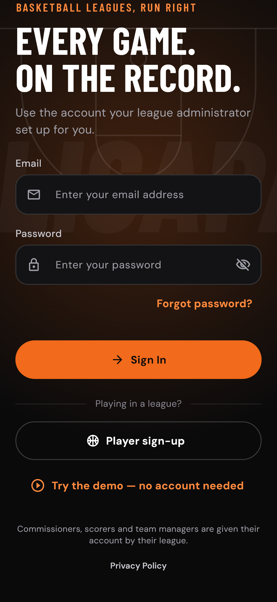

What each part is for:

- **Email** and **Password**: sign in to the account you already have.
- **Forgot password?**: get a code by email and choose a new password. See [Forgot your password](#forgot-your-password).
- **Sign In**: signs you in.
- **Player sign-up**, under *Playing in a league?*: players make their own account here. See [Sign up as a player](#sign-up-as-a-player).
- **Try the demo — no account needed**: open a made-up league to look around. See [Try the demo](#try-the-demo).
- **Privacy Policy**: what LigaPass keeps and who sees it. You can read it before you have an account.

> **Who gets an account, and how:** players sign themselves up with **Player sign-up**. Commissioners, scorers and team managers don't sign up. Their league gives them an account, so ask the league's owner or commissioner.

**Step 1.** Type your email address and your password, then tap **Sign In**.

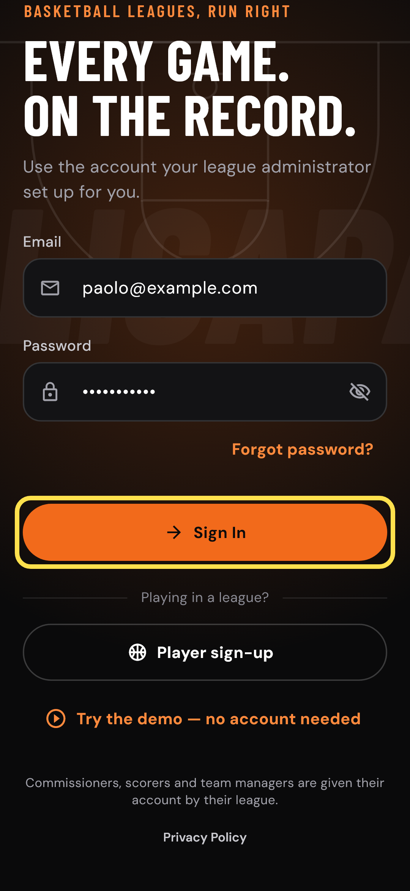

> **Tip:** the first time you use a phone, sign in with your **email address**. After that, your username works on that phone too.

---

## Forgot your password

LigaPass sends a 6-digit code to the email address on your account. You type the code back into the app and choose a new password.

**Step 1.** On the sign-in screen, tap **Forgot password?**

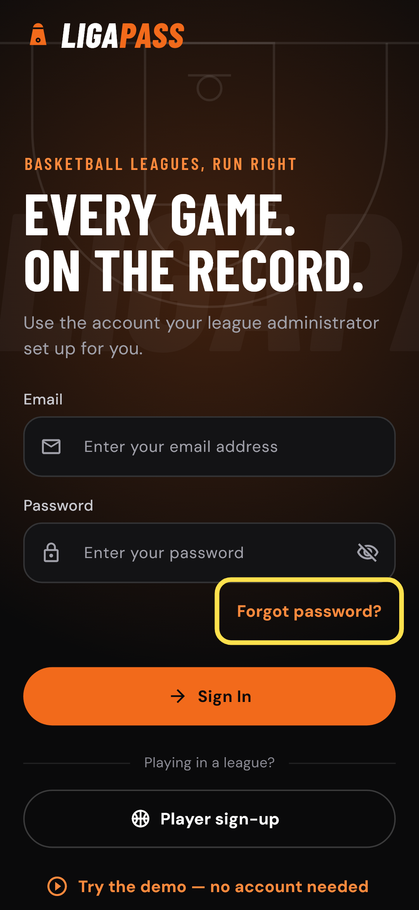

**Step 2.** On **Reset your password**, type the email address on your account and tap **Send code**.

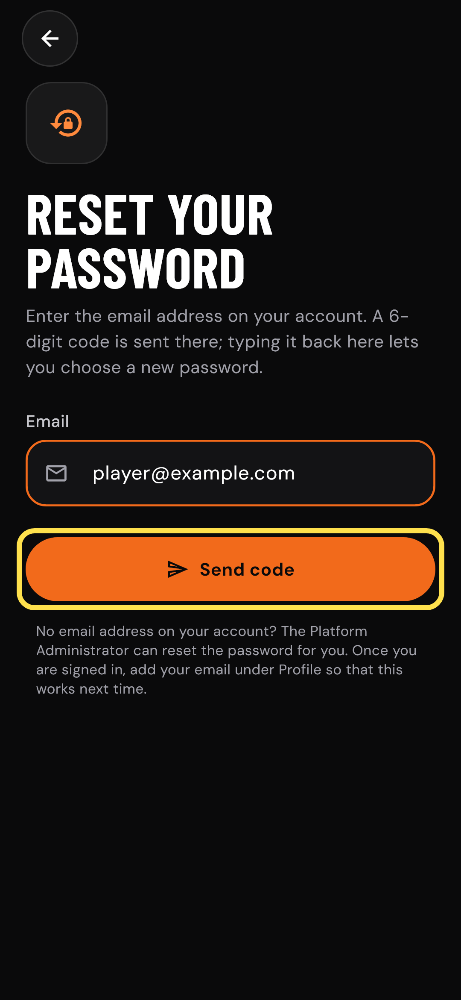

**Step 3.** The screen changes to **Enter the code**. The green box says a code is on its way to that address and that it works for 10 minutes.

- The message is the same whether or not an account uses that address. That way, nobody can use this screen to find out who has an account.

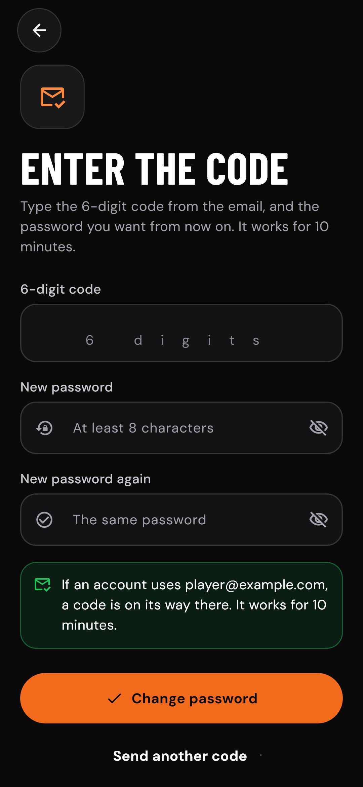

**Step 4.** Open your email and find the message with your 6-digit code. *(The email itself can't be shown here.)*

**Step 5.** Back in LigaPass, type the code in **6-digit code**. Then type your new password in **New password** and again in **New password again**. Tap **Change password**.

- LigaPass says *"Your password has been changed. Sign in with it."* and goes back to the sign-in screen.
- You are signed out on any other phone you use, too. Sign in there with the new password.

> **No code?** Check your spam or junk folder. Tap **Send another code** to get a new one. If you typed the wrong address, tap **Use another address**.
>
> **A good password** has at least 8 characters, with a capital letter, a small letter, a number and a symbol.

---

## Sign up as a player

Players make their own account. One account works for every league you play in.

**Step 1.** On the sign-in screen, tap **Player sign-up**.

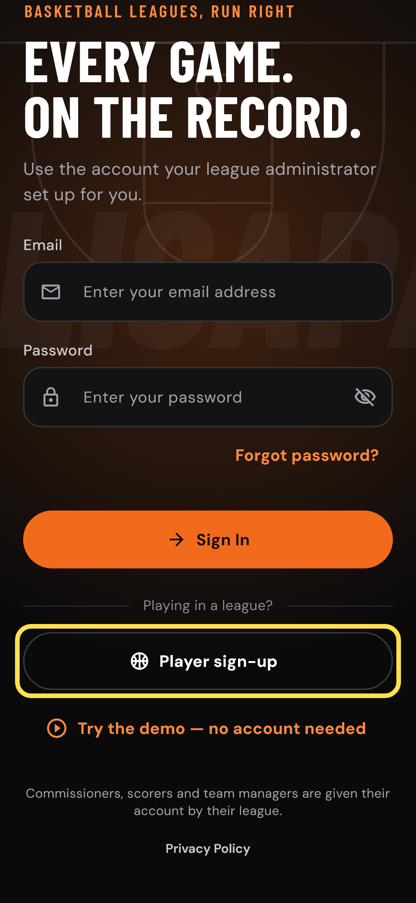

**Step 2.** Fill in your details:

- **First name** and **Last name**.
- **Email**: use the address your team has for you. As the screen says, the record your team made is then yours, so you don't get a second one.
- **Username**: LigaPass fills it in from your name. You can change it. It can have 3 to 30 letters, digits, dots, dashes or underscores.
- **Password**: at least 8 characters, with a capital letter, a small letter, a number and a symbol.

Then tick the box **I am 13 or older, and if I am under 18 I have the permission of a parent or guardian.** You can't sign up without ticking it. **Read the Privacy Policy** under it opens the policy. Whatever you've typed is still there when you come back.

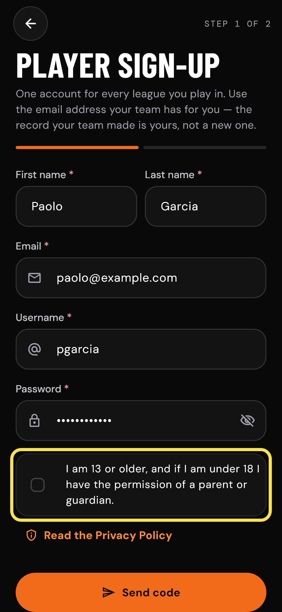

**Step 3.** Tap **Send code**.

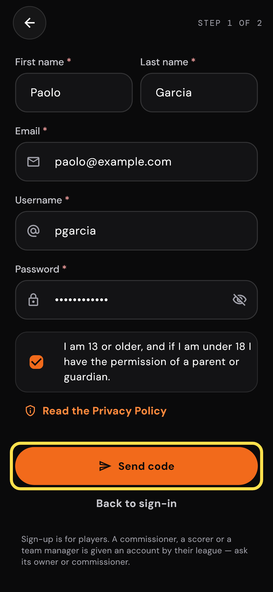

**Step 4.** The screen now says **Check your email** (step 2 of 2). Open the email LigaPass sent you and type its 6-digit code in **Code**. Then tap **Create my account**.

- **Send another code** sends a new code. **Change my details** takes you back to the form.
- *The email can't be shown here. The code in the picture is made up.*

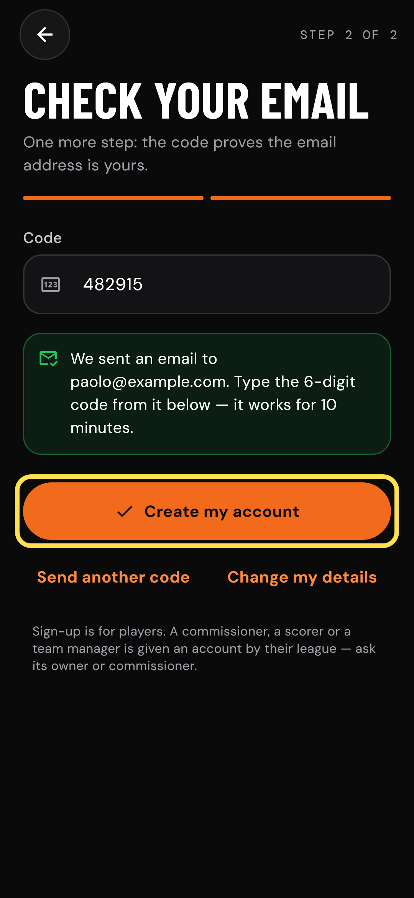

**Step 5.** You're signed in. Home shows your name and the **Player** role. *"Everything is saved to the cloud."* means your account is saved.

- Once you play in a league that uses LigaPass, Home also shows your next game and **My Stats**.

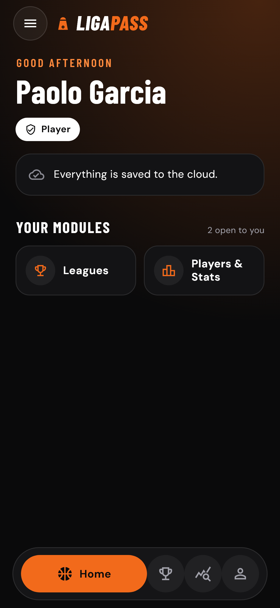

---

## Try the demo

The demo is a made-up league, **Sunrise League**, that you can open without an account. You can be anyone in it: the league owner, the commissioner, the scorer, a team manager or a player. Everything you do in it is saved **on your phone only**. Nothing is synced, emailed or paid for. The demo is **deleted 24 hours after you start it**.

**Step 1.** On the sign-in screen, tap **Try the demo — no account needed**.

**Step 2.** Read what the demo has, then tap **Start the demo**. Setting up the league takes a few seconds.

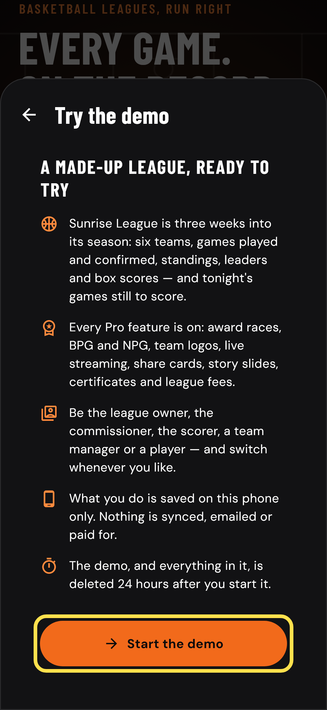

**Step 3.** Choose who to be. No password is needed. Each card says who the person is and what to try as them:

- **League owner** (Ana Rivera): the organization, its staff, credits and new seasons.
- **Commissioner** (Rosa Mendoza): rosters, the schedule, confirming results and awards.
- **Scorer** (Jun Bautista): tonight's games, check-in, the courtside console and going live.
- **Team manager** (Carlo Dizon): the Aces' roster, players and leaders.
- **Player** (Miguel Santos): their schedule in two leagues, and their stats.

The last card, **Platform administrator**, is for running the whole app. This guide doesn't cover it. In this guide, tap **COMMISSIONER**.

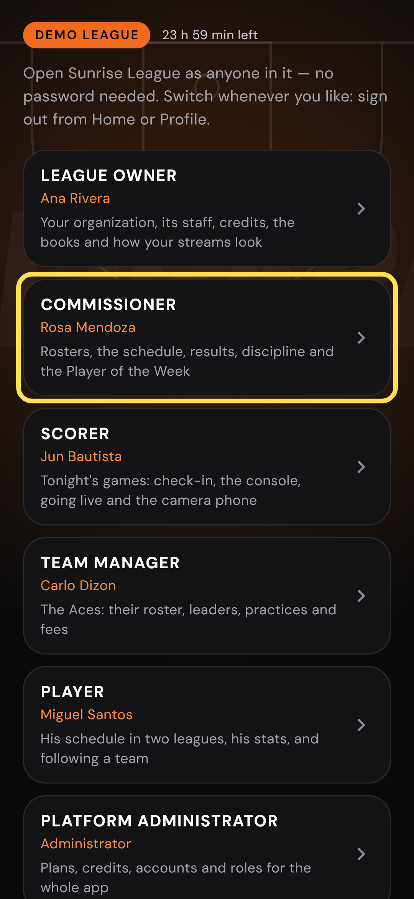

**Step 4.** Home has a **DEMO LEAGUE** card:

- **How much time is left** before the demo is deleted, for example *23 h 59 min left*.
- **Be someone else** takes you back to the list of people, so you can try another role.
- **Leave the demo** takes you back to the normal sign-in screen. The demo is kept until its time runs out.

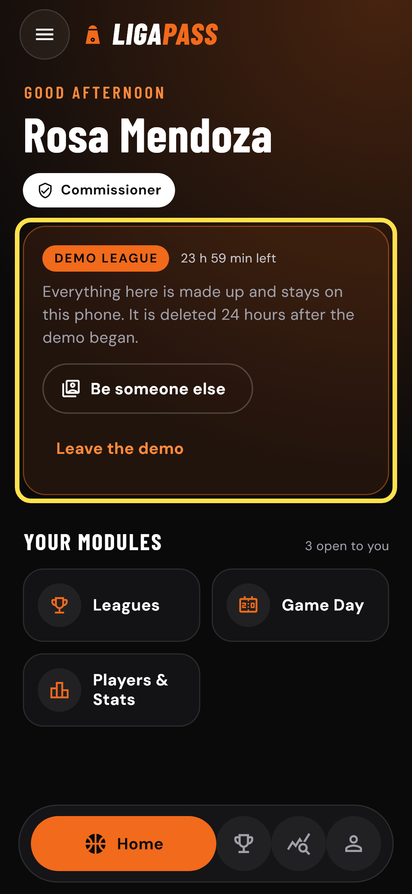

**Step 5.** To come back after leaving, tap **Back to the demo** on the sign-in screen. It shows how much time is left. You go back in as the same person.

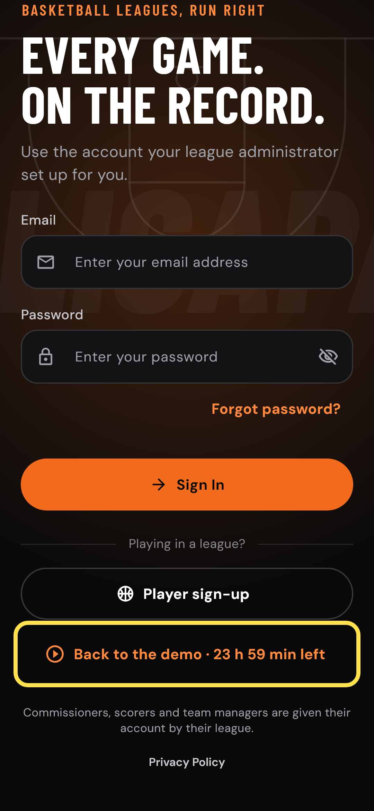

**Step 6.** To start the demo from the beginning, tap **Be someone else** on Home. Then scroll to the bottom of the list of people and tap **Start over**.

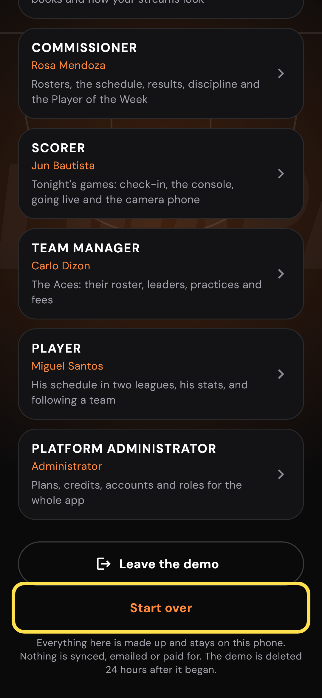

**Step 7.** LigaPass asks first. **Start over** deletes everything you did in the demo and puts the league back to how it began, with a new 24 hours. **Cancel** keeps your demo as it is.

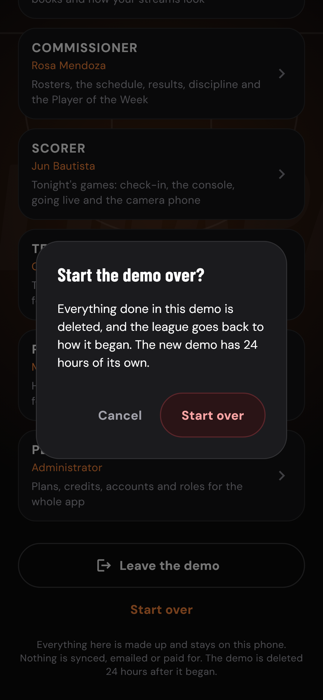

> **When the 24 hours are up**, LigaPass leaves the demo and deletes it. The sign-in screen then says *"Your demo ended after 24 hours, and everything in it was deleted."* Tap **Try the demo** to start a new one. *(This can't be shown here without waiting a day.)*
>
> Want to try streaming a game to Facebook from the demo? See [Try live streaming in the demo](../live-stream-demo/README.md). The demo also has the **camera phone**: one phone plays both the scoring phone and the camera ([One phone scores, another streams](../camera-phone/README.md#7-try-it-in-the-demo-one-phone-plays-both)). And it has the league office filled in: sponsors, the league's logo and banner on its streams, team fees and expenses, practices, the Player of the Week, and a suspension or two.

---

## Find your way around

These pictures show the demo's commissioner. Your own screens look the same, but what is on them depends on your role.

**Step 1.** **Home** greets you by name and shows your role. Under **YOUR MODULES** are the parts of the app your role can open, for example *3 open to you*. Tap a module to open it.

- A commissioner sees **Leagues**, **Game Day** and **Players & Stats**. A new player sees **Leagues** and **Players & Stats**.

To open the menu, tap **☰** at the top left.

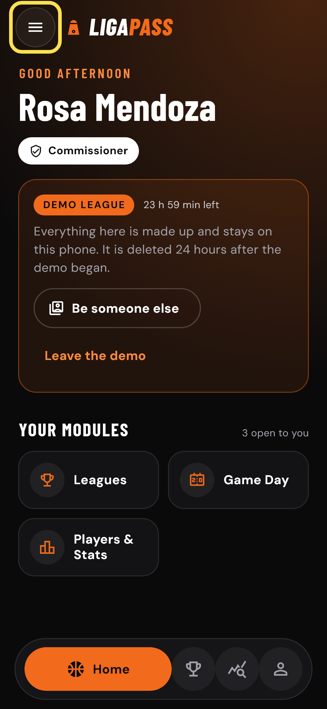

**Step 2.** The menu lists **Home**, **Profile** and then your modules. **Sign Out** is at the bottom. To close the menu, tap outside it.

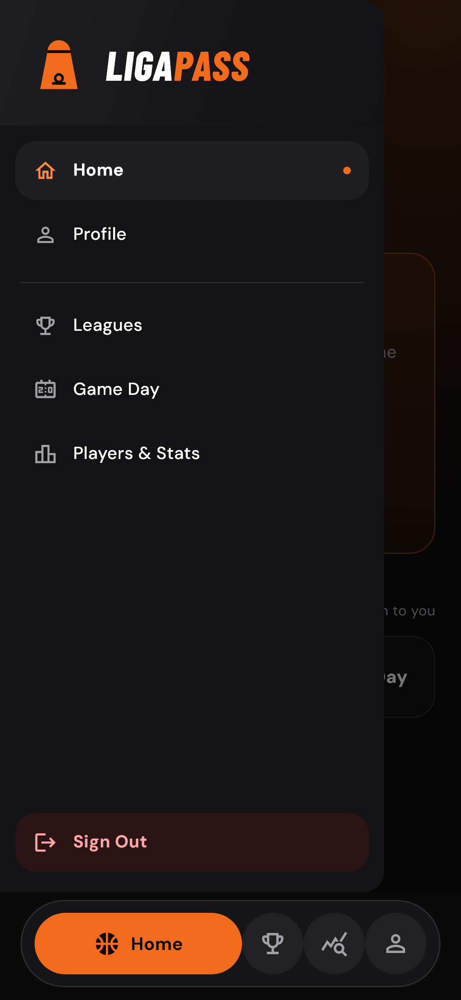

**Step 3.** The **bar at the bottom** is always there. Its four buttons are **Home**, **Leagues**, **My Stats** and **Profile**. The open one is orange and shows its name. The others show only their icon.

- **Leagues** lists the organizations and leagues open to you. Here it shows the demo's Sunrise Hoops, with its two leagues.
- **My Stats** shows your own games and averages as a player.
- **Profile** is your account. See [Your profile](#your-profile).

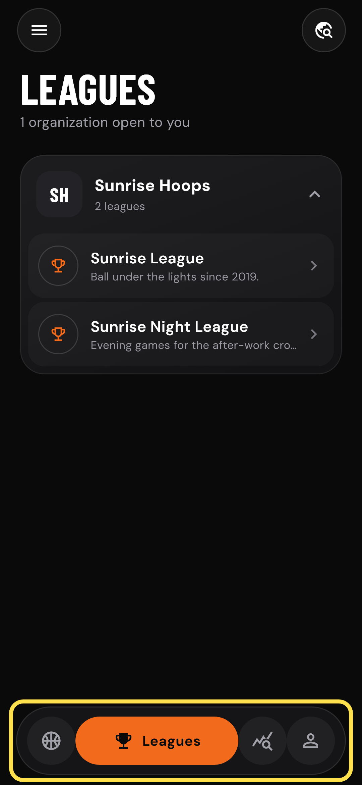

---

## Your profile

These pictures show Paolo, the player who signed up in [Sign up as a player](#sign-up-as-a-player).

**Step 1.** Tap **Profile** (the person icon) in the bottom bar.

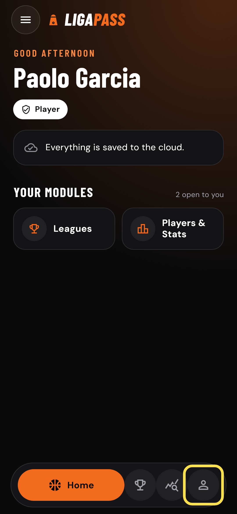

**Step 2.** Profile shows your name, your **username** (for example *@pgarcia*) and your role. Under **ACCOUNT DETAILS** are your **Role**, your **Email** and your **Last Sign-in**. Your email address is the one you sign in with, and it is where password codes go.

To add a photo, tap the circle with your initials.

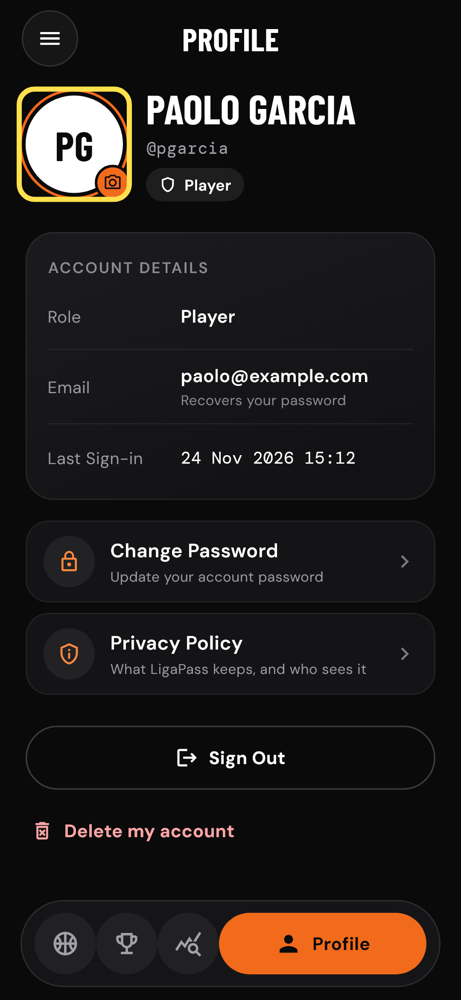

### Add a photo

**Step 3.** **Your photo** says who sees it: your photo is shown instead of your initials, to the people of your leagues and your organization, and to nobody else. A square photo works best. Tap **Choose a photo**, then pick one from your phone.

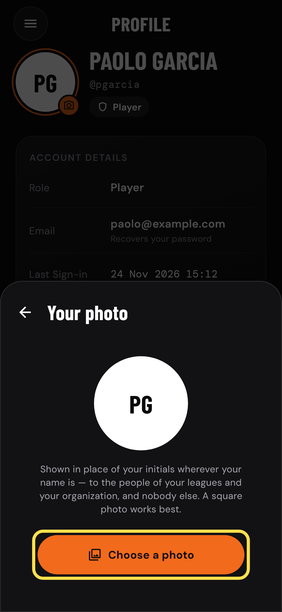

**Step 4.** LigaPass says *"Your photo is on your account."* Your photo is now on Profile and next to your name on Home.

- To change it, tap your photo again and choose **Choose another photo**. To remove it, choose **Take my photo off**.
- *The phone's own photo picker can't be shown here. The photo in the picture is a drawing.*

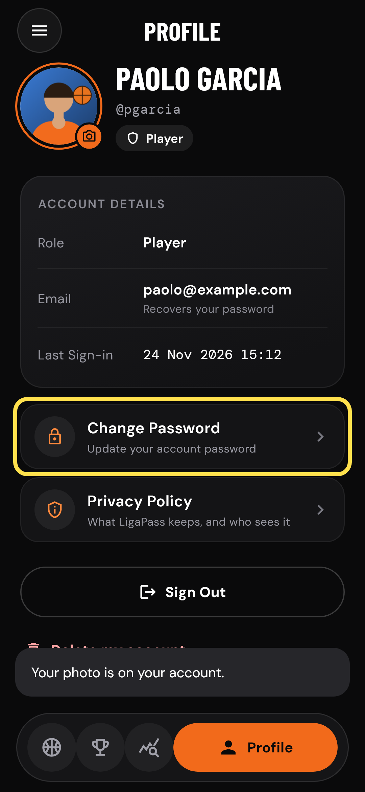

### Change your password

**Step 5.** On Profile, tap **Change Password** (ringed above).

**Step 6.** Type your **Current Password**, then your **New Password**. The list under it ticks off each rule as your password meets it. Type the new password again in **Confirm New Password**, then tap **Change Password**. LigaPass says *"Password changed successfully."*

- Your new password must be different from the one you use now.

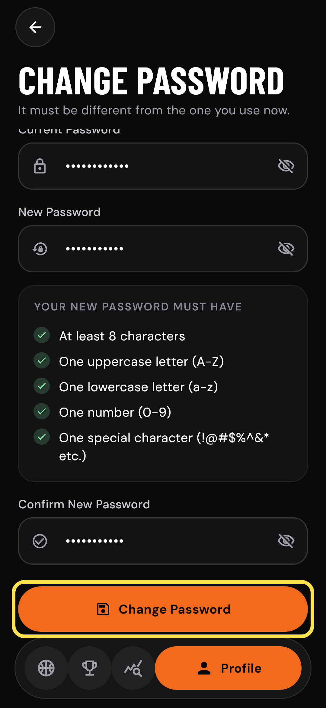

### Your username

You choose your username when you sign up. It appears under your name on Profile. **You can't change it yourself.** Only the Platform Administrator, who looks after accounts for the whole app, can change a username. Your password stays the same, and you can always sign in with your email address.

### Privacy Policy

**Step 7.** On Profile, tap **Privacy Policy**.

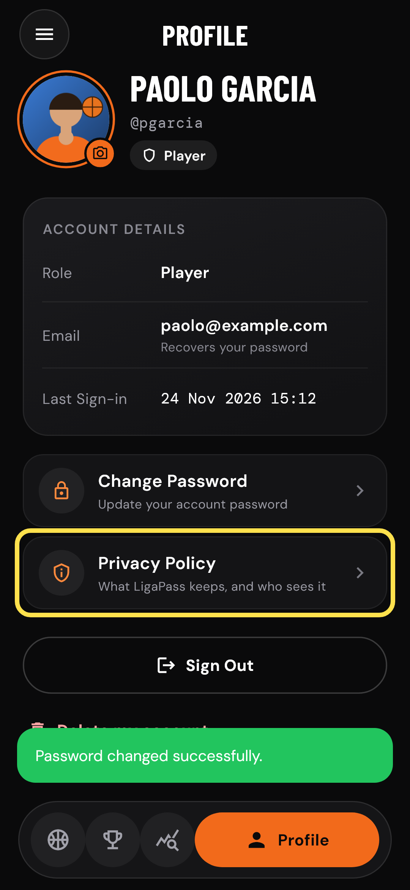

**Step 8.** The policy says what LigaPass collects, why, who sees it, how long it is kept and how to have it deleted. Tap the back arrow to return to Profile.

- You can also open it from the sign-in screen and from Player sign-up.

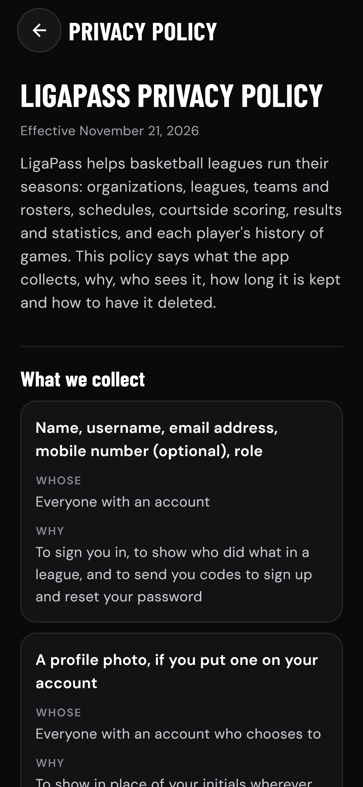

### Delete your account

**Step 9.** **Delete my account** is at the bottom of Profile, under **Sign Out**.

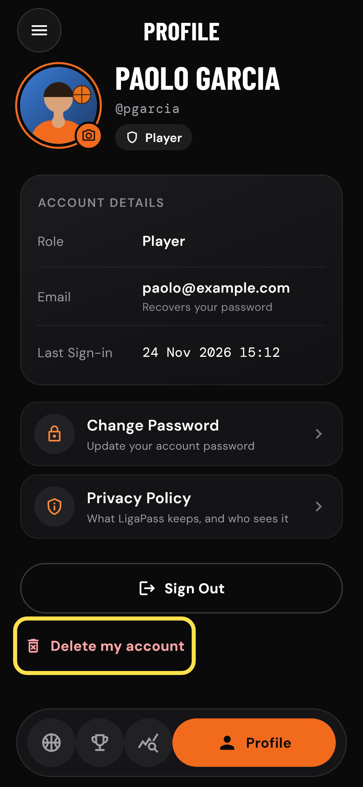

**Step 10.** The **Delete your account** page explains what happens:

- **Deleted:** your sign-in, your email address and mobile number, your profile photo, and how to reach you on any team you played for.
- **Kept:** the leagues' records of the games you played, under the name on the roster.
- **Deleting cannot be undone.** If your account owns an organization, hand it over to someone else first.
- Your phone needs an internet connection.
- If you can't use the app, the page also says how to ask for your account to be deleted by email.

The **Delete my account** button is at the foot of the page.

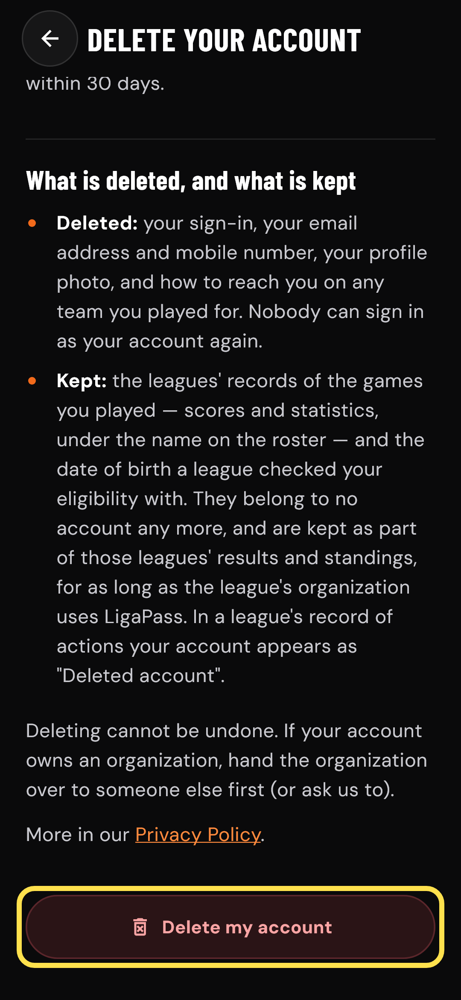

**Step 11.** LigaPass asks for your password before it deletes anything. To delete your account for good, type your password and tap **Delete my account**. To keep your account, tap the back arrow instead.

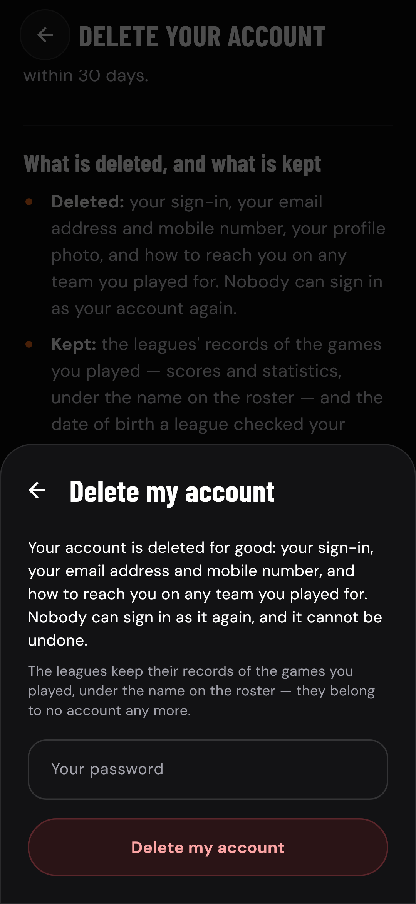

### Sign out

Tap **Sign Out** on Profile or in the menu, then tap **Sign Out** again in the question *"Are you sure you want to sign out?"*

---

## Updates and what's new

LigaPass updates through **Google Play**, like any other app.

**When an update is needed.** If Google Play has a newer version, LigaPass shows **Update required** and stops there until you update. Tap **Update on Google Play**, update the app, then open LigaPass again. Your leagues, games and stats stay exactly as they are.

- If your phone can't reach Google Play, LigaPass opens as usual.
- LigaPass doesn't check for updates while you're scoring a game or streaming one.

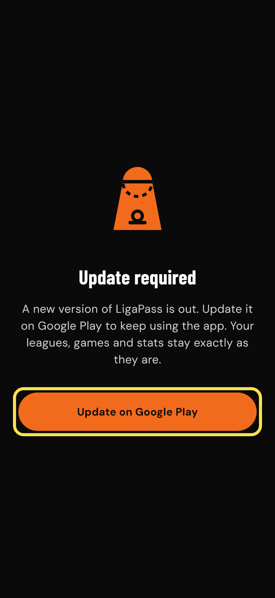

**What's new.** The first time you open LigaPass after an update, a **What's new** box lists what changed in that version. Tap **Got it**. Each version shows it only once, and it doesn't appear after a fresh install.

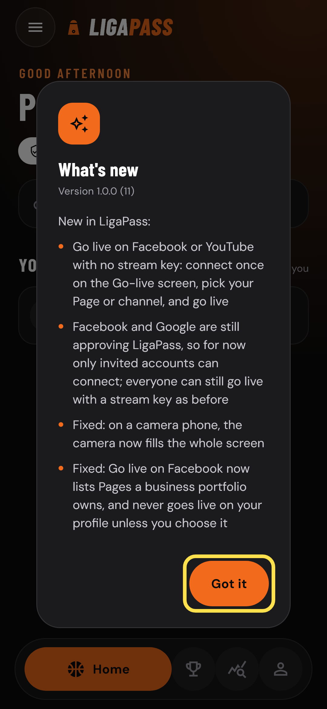

---

## If something goes wrong

| What you see | What to do |
|---|---|
| *"Sign in with your email address the first time on this phone."* | Type your email address instead of your username. |
| *"Invalid email or password."* | Check both. If you've forgotten the password, use [Forgot password?](#forgot-your-password). |
| No email with your code | Check your spam or junk folder and check the address you typed. Then tap **Send another code**. |
| *"A code was sent a moment ago. Wait a minute before asking for another."* | Wait a minute, then tap **Send another code**. |
| *"That code is not right, or it has run out. Ask for a new one."* | Tap **Send another code** and type the newest code. |
| *"Could not reach LigaPass. Check your internet connection and try again."* | Signing up, getting a code and your first sign-in on a phone all need an internet connection. |
| *"Tick this to sign up — LigaPass accounts are for people 13 and older."* | Tick the age box on the sign-up form. |
| *"The username … is taken. Choose another."* | Change **Username** on the sign-up form. |
| Home says *"No connection. This phone has what it needs to keep working."* | Carry on. What you do is sent when you're back online. Tap the card to try again. |
| *"You were signed out because your session ended. Sign in again to carry on."* | Sign in again. A session lasts 12 hours from the last time you opened LigaPass. |

---

## About the pictures

These pictures were drawn from the app itself, as it is on Google Play. Paolo Garcia, their email address, the code and their photo (a drawing) are made up, and so is player@example.com. Everyone in the demo's Sunrise League is made up too.

[All guides](../README.md)
