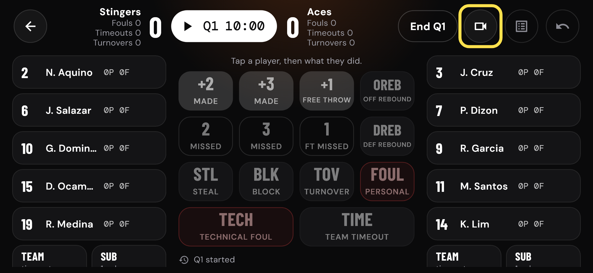
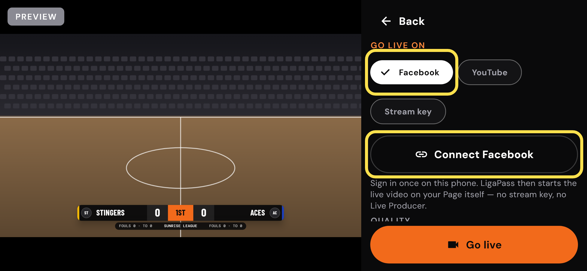
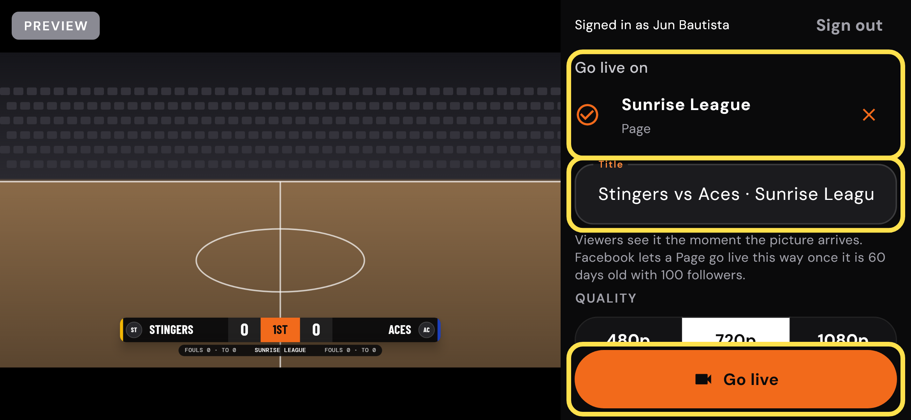
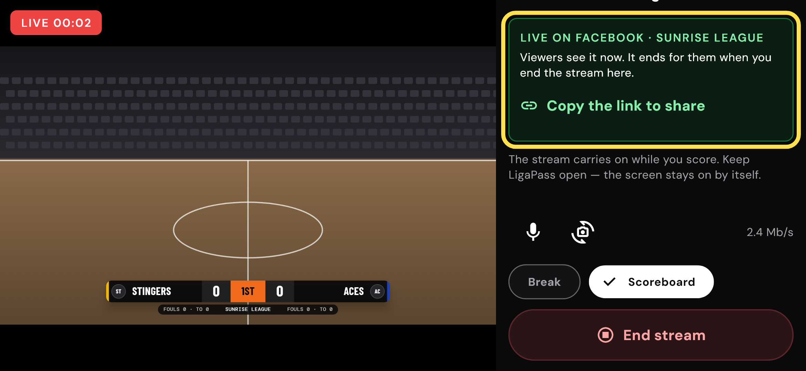
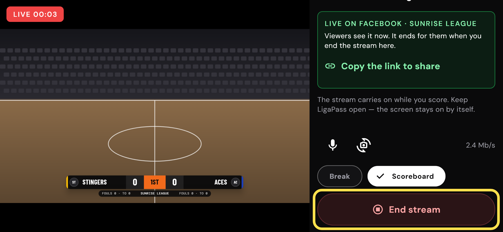
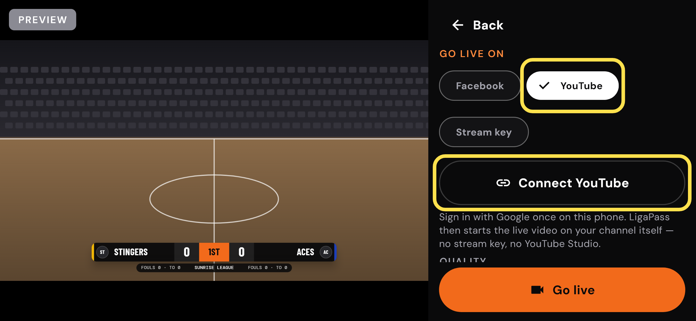
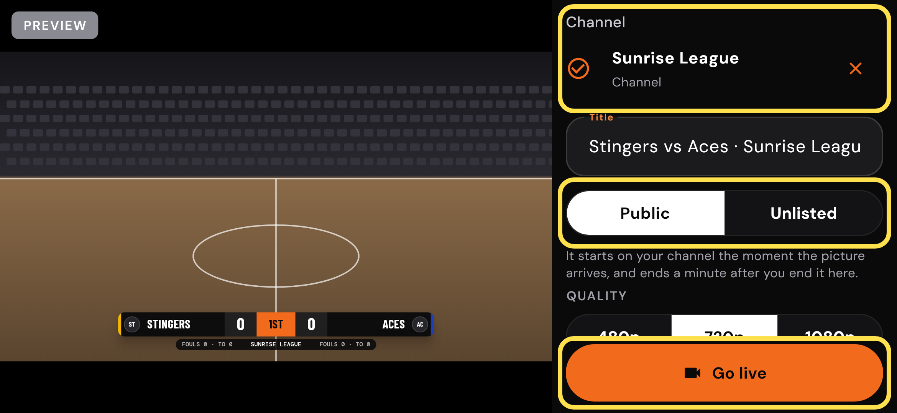
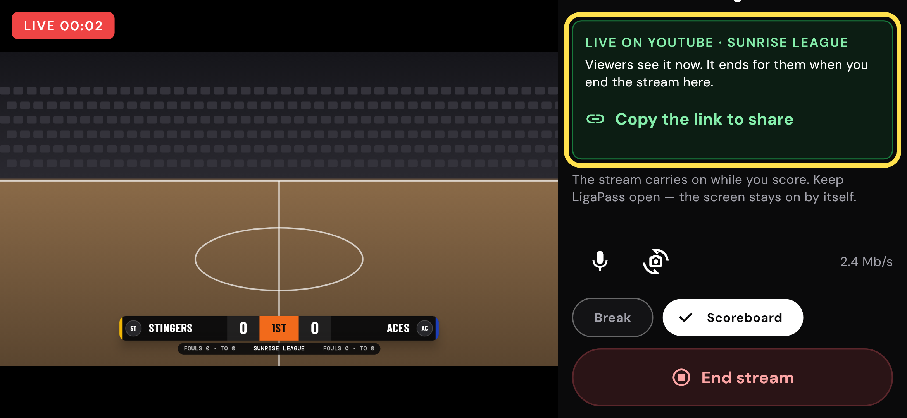
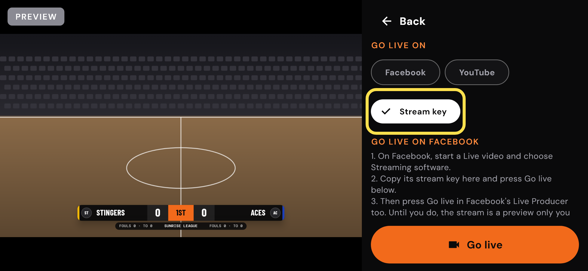

# Go live on Facebook or YouTube with no stream key

Connect your Facebook or YouTube account **once** on LigaPass's Go-live screen. From then on, tap **Go live** and LigaPass starts the live video on your Page or channel by itself. There's no stream key to copy and no second **Go live** to press in Facebook's Live Producer: viewers see the game as soon as the picture arrives.

This works in **LigaPass 1.0.0 (20)** and newer, on Android.

In the pictures, a **yellow ring** marks what to tap next.

> **Still being approved.** Facebook and Google are reviewing LigaPass. Until they approve it, **Connect Facebook** and **Connect YouTube** work only for accounts the LigaPass team has added as testers. Anyone else gets a refusal from Facebook or Google ([see below](#if-something-goes-wrong)). Until then, stream with a stream key: see [Try live streaming in the LigaPass demo](../live-stream-demo/README.md).

**Contents**

1. [What you need](#what-you-need)
2. [Open the Go-live screen](#1-open-the-go-live-screen)
3. [Connect Facebook](#2-connect-facebook)
4. [Go live on your Page](#3-go-live-on-your-page)
5. [End the stream](#4-end-the-stream)
6. [YouTube instead](#5-youtube-instead)
7. [The next game](#6-the-next-game)
8. [Using a stream key instead](#7-using-a-stream-key-instead)
9. [If something goes wrong](#if-something-goes-wrong)
10. [Good to know](#good-to-know)

---

## What you need

- **An Android phone with LigaPass 1.0.0 (20) or newer**, from Google Play.
- **For Facebook:** a Facebook account that manages the **Page** the game goes on (or your own profile). Facebook has two rules of its own for going live this way:
  - The account must be at least **60 days old**.
  - A Page needs at least **100 followers**.
- **For YouTube:** a Google account with a **YouTube channel** that has live streaming turned on. To turn it on, open the YouTube app and tap **Create**, then **Go live**. **The first time, YouTube takes up to 24 hours** before the channel can go live, so do this a day before the game.
- **A good internet connection.** At 720p (the default) a stream uses about 1.2 GB an hour.
- **Recommended:** a tripod or stand to hold the phone sideways, and a charger.

---

## 1. Open the Go-live screen

Open the game's **scorer console** and turn the phone **sideways**. To try it in the demo, follow steps 1 to 9 of [Try live streaming in the LigaPass demo](../live-stream-demo/README.md#2-open-the-demo-as-the-scorer): open the demo as the **Scorer**, check in tonight's first game, and start it.

**Step 1.** On the console, tap the **camera** button at the top right. That is **Go live**.

The camera opens. The badge at the top left says **PREVIEW**, so nothing is being sent yet. If the phone asks to use the **camera** and **microphone**, allow both.

---

## 2. Connect Facebook

You do this **once on each phone**. LigaPass remembers the connection.

**Step 2.** Under **GO LIVE ON**, **Facebook** is chosen. Tap **Connect Facebook**.

**Step 3.** Facebook opens its own sign-in. The pictures don't show it, because it is Facebook's and changes often.

1. Sign in to Facebook if it asks.
2. Choose the **Pages** LigaPass may use.
3. **Allow everything it asks for.** LigaPass needs to see your Pages and publish live videos on them.

When you finish, you're back on the Go-live screen.

---

## 3. Go live on your Page

**Step 4.** The screen now says **Signed in as** and your name.

- **Go live on:** if you manage one Page, it is chosen for you. To choose another Page, or your own profile, tap the **×** and type 3 letters of its name.
- **Title:** the live video's title, filled in as *home team vs away team · league*. Change it if you like.

Tap **Go live**.

**Step 5.** The badge turns red: **LIVE**, with the time on air. The green box says **LIVE ON FACEBOOK** and the Page's name. **Viewers can see the game now.** There is nothing to press in Live Producer.

- Tap **Copy the link to share** to copy the live video's link, then paste it into your group chats.
- Tap **Back to scoring** to go back to the console. The stream carries on while you score. Keep LigaPass open; the screen stays on by itself.
- On the console, the red **LIVE** button brings you back to this screen.

---

## 4. End the stream

**Step 6.** Tap **End stream**, then **End stream** again to confirm. **This also ends the live video on Facebook**, so you don't need to end it there.

The badge goes back to **PREVIEW**. The camera stays open, so you can go live again, or tap **Back** to return to the console.

---

## 5. YouTube instead

**Step 7.** Under **GO LIVE ON**, tap **YouTube**, then **Connect YouTube**.

**Step 8.** Google opens its own sign-in. The pictures don't show it.

1. Choose your Google account.
2. While LigaPass is being verified, Google may say **"Google hasn't verified this app"**. If you are one of LigaPass's testers, tap **Continue**.
3. Allow LigaPass to **manage your YouTube account**. It needs this to start and end live videos on your channel.

**Step 9.** Check the **Channel** and the **Title**, then choose who can see the video:

- **Public:** anyone can find it on YouTube.
- **Unlisted:** only people with the link can watch. This is good for a test.

Tap **Go live**.

**Step 10.** The green box says **LIVE ON YOUTUBE** and the channel's name. The video goes live on your channel as soon as the picture arrives. **Copy the link to share** works the same as for Facebook. When you tap **End stream**, YouTube ends the video about a minute later.

---

## 6. The next game

LigaPass remembers how each league's games were last streamed on this phone: Facebook or YouTube, which Page or channel, and Public or Unlisted.

For the next game, open **Go live** and tap **Go live**. That's all.

To disconnect an account from this phone, tap **Sign out** next to **Signed in as**.

---

## 7. Using a stream key instead

**Step 11.** Stream keys still work. Under **GO LIVE ON**, tap **Stream key** to stream the way you did before: paste a key from Facebook's Live Producer or YouTube Studio, and press Go live in LigaPass. With Facebook, also press Go live in Live Producer. The steps are in [Try live streaming in the LigaPass demo](../live-stream-demo/README.md).

Use a stream key when:

- Facebook or Google won't let you connect yet.
- Your Page is too new for Facebook's rules.
- You stream to a service other than Facebook or YouTube.

---

## If something goes wrong

| What you see | What to do |
|---|---|
| Facebook's window says the app is **not active** or **not available**, or Google says **"Access blocked: LigaPass has not completed the Google verification process"** | LigaPass is still being approved. Only testers' accounts can connect for now. Use a **Stream key** ([part 7](#7-using-a-stream-key-instead)). |
| **"Facebook lets a Page go live this way once it has 100 followers."** or **"…once it is 60 days old."** | These are Facebook's rules. Until your Page or account qualifies, use a **Stream key**. |
| **"Facebook was not allowed to let LigaPass go live for you. Connect again, and allow it."** | Something was left unticked in Facebook's window. Tap **Connect Facebook** again and allow everything. |
| **"Facebook shows no Page you can post on."** | Make a Page, ask the Page's admin to add you, or use a **Stream key**. |
| **"Live streaming is not turned on for this YouTube channel yet."** | In the YouTube app, tap **Create**, then **Go live**. The first time, YouTube takes up to 24 hours. |
| **"Facebook signed LigaPass out."** or **"Google signed LigaPass out."** | Tap **Connect Facebook** or **Connect YouTube** again. |
| **"YouTube's limit for LigaPass is used up for today."** | Use a **Stream key** for today. |
| The badge says **STOPPED** | The connection dropped. Tap **Go live** again: the stream carries on in the same live video. |
| There is no **GO LIVE ON** with Facebook and YouTube | Update LigaPass from Google Play. Going live this way needs version 1.0.0 (20) or newer, and an Android phone. |
| There is no camera button on the console | Live streaming needs an Android phone and a league plan that includes it. Every plan feature is on in the demo. |

---

## Good to know

- **Your sign-in stays on the phone.** The Facebook or Google sign-in is kept in the phone's secure storage. LigaPass's servers never get it. Facebook and YouTube receive only the live video, its title and the stream, and only when you tap Go live.
- **LigaPass talks to Facebook only after you tap Connect Facebook.** A phone that never connects never contacts Facebook.
- **In the demo, the stream is real.** Connecting signs in to your real Facebook or Google account, and Go live puts the video on your real Page or channel. For a test, use **Unlisted** on YouTube, or a Page you use for testing.
- **Everyone on camera should know the game is streamed.** Players under 18 need their parents' permission, and getting it is the league's job.

---

*These pictures were drawn from the app itself, using the made-up demo league. The court stands in for a real camera picture. The Facebook account, Page and YouTube channel in them are made up. Facebook's and Google's own sign-in windows are not shown.*

[All guides](../README.md)
