# Run your leagues as their owner

This guide is for the person who owns the organization and its leagues in **LigaPass**. As the owner, you buy the season credits, choose who works on each league, open new seasons, and set up how the league looks to players, fans and sponsors. The guide uses the app's built-in demo, so you can follow along without an account or a real league, and nothing is paid. In the pictures, a **yellow ring** marks what to tap next.

**Contents**

1. [Before you start](#before-you-start)
2. [Season credits](#1-season-credits)
3. [Your staff and who works on each league](#2-your-staff-and-who-works-on-each-league)
4. [Open a new season and put credits into it](#3-open-a-new-season-and-put-credits-into-it)
5. [How your league looks on a live stream](#4-how-your-league-looks-on-a-live-stream)
6. [The league office](#5-the-league-office)
7. [Season insights, records and sharing](#6-season-insights-records-and-sharing)
8. [About the demo](#about-the-demo)

---

## Before you start

Open LigaPass, tap **Try the demo — no account needed**, then tap **Start the demo**. [Getting started](../getting-started/README.md#try-the-demo) shows these first taps in detail.

**Step 1.** Choose who to be. Tap **LEAGUE OWNER** (Ana Rivera). She owns the made-up organization Sunrise Hoops and its two leagues, Sunrise League and Sunrise Night League. No password is needed.

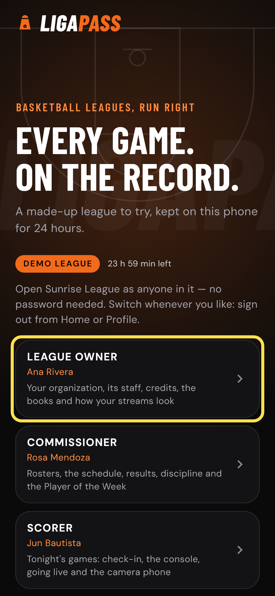

---

## 1. Season credits

A **credit** is one team's place in one season. A season needs at least **2** credits before it opens to teams, and you add one more credit whenever another team joins. Credits are what you pay for.

**Step 2.** Home shows your modules: **Leagues**, **Game Day**, **Players & Stats** and **Season Credits**. Tap **Season Credits**.

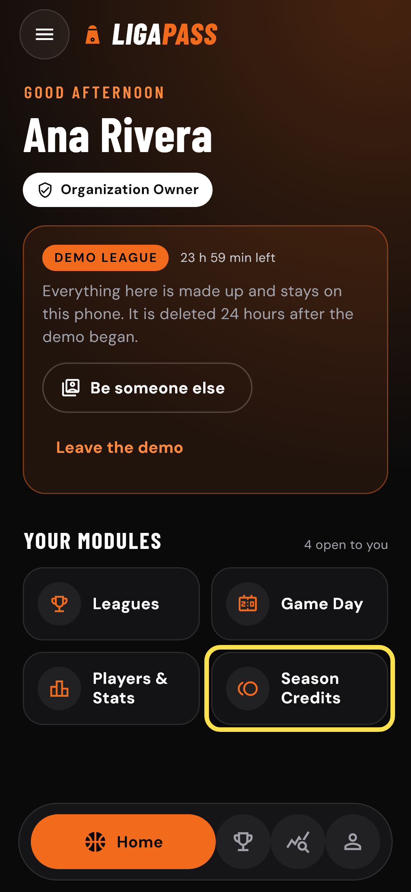

**Step 3.** **TO USE** is how many credits you have left to put into seasons, and on which plan. The demo owner has **10 Pro credits**. Further down the page are the plans on sale with their price per credit, and every lot of credits you have, with where each one went. To get more, tap **Buy credits**.

- Your credits belong to **your account**, not to one organization. You can use them in a season of any organization you own or work for.

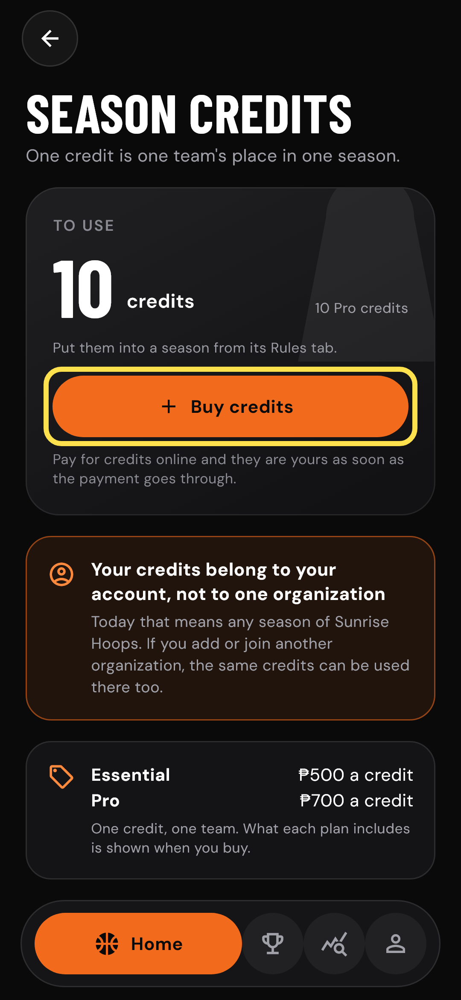

**Step 4.** Choose a plan. Each plan lists what a season on it includes. **Pro** adds the award races, team logos, the Best and Notable Player of every game, live streaming, share cards, certificates and league fees. Tap **Pro**.

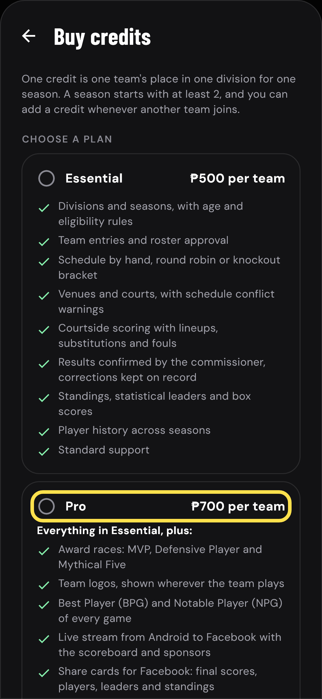

**Step 5.** Set **HOW MANY CREDITS** with **−** and **+**, or type the number: one for each team. **AMOUNT TO PAY** shows the total, here 4 credits × ₱700 = ₱2,800. To buy, you would now tap **Pay ₱2,800 online**.

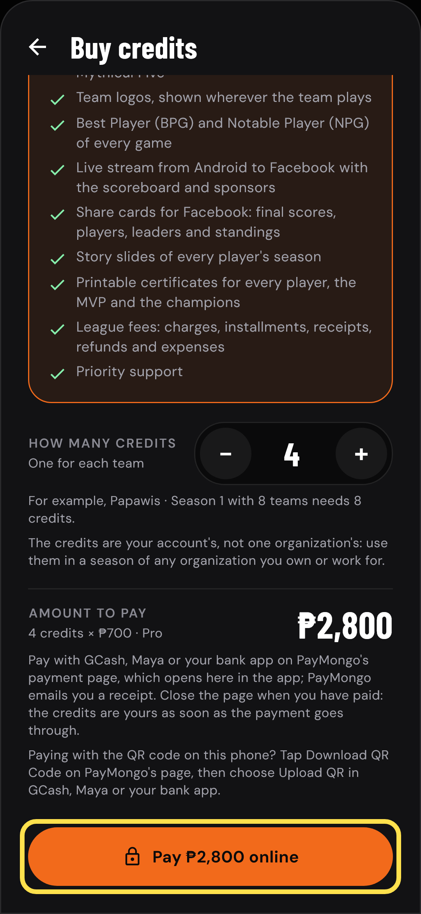

**What happens when you pay** (not shown here: the demo never takes a payment):

1. PayMongo's payment page opens inside the app. Pay there with **GCash**, **Maya** or your bank app. Paying with a QR code on the same phone? Tap **Download QR Code** on PayMongo's page, then choose **Upload QR** in your wallet or bank app.
2. PayMongo emails you a receipt. Close the page when you have paid.
3. Back on Season Credits, the purchase waits under **WAITING FOR YOUR PAYMENT**. If you closed the page without paying, tap **Open the payment page** to go back to it.
4. As soon as the payment goes through, the app says **Payment received**, and the credits are yours to use.

> **In the demo** nothing can be paid, so the bottom of this sheet looks different there: it asks for a payment reference instead of offering the payment page. You can type any reference and send it, then approve it yourself: tap **Be someone else** on Home, choose **Platform administrator** and open **League Approvals**. Or close the sheet with the back arrow.

> **Tip:** when you buy credits from a season's own page, only that season's plan is offered, because a season's teams are all on one plan.

---

## 2. Your staff and who works on each league

Every staff account has one role: **Commissioner** (runs a season: rosters, the schedule, results), **Scorer** (scores games at the court) or **Team Manager** (looks after a team's roster). A league's **People** list says who may open that league. You, the owner, see every league of your organization without being on any list. Players don't need an account to be put on a roster.

What you and your commissioners do takes effect **at once**: a team you enter is in while the season has a free place, eligible players you add are approved, and results you hand in are confirmed. A team manager's or a scorer's work still waits for one of you to approve it.

**Step 6.** Tap **Leagues** in the bar at the bottom (the trophy). Your organization, Sunrise Hoops, is listed with its leagues. Tap **Sunrise League**.

- **Manage** opens the organization's own page: its name (**Rename**), its staff, and **Create an account**.
- **New league** adds a league to the organization. The **Organization** button at the top adds another organization.

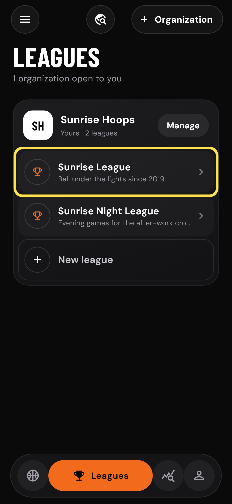

**Step 7.** This is the league's page. Tap **People**.

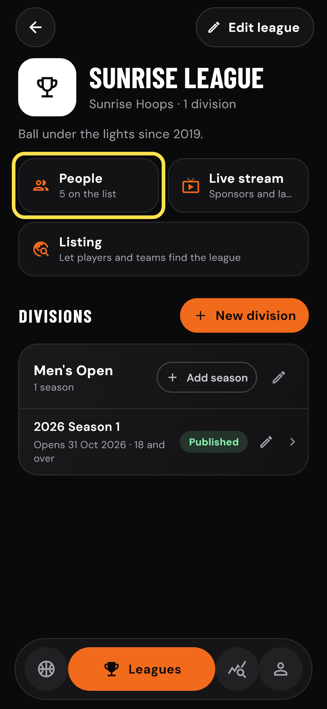

**Step 8.** **People in Sunrise League** lists everyone who may open the league, each with their role. To bring in someone who has no account yet, tap **Create an account**.

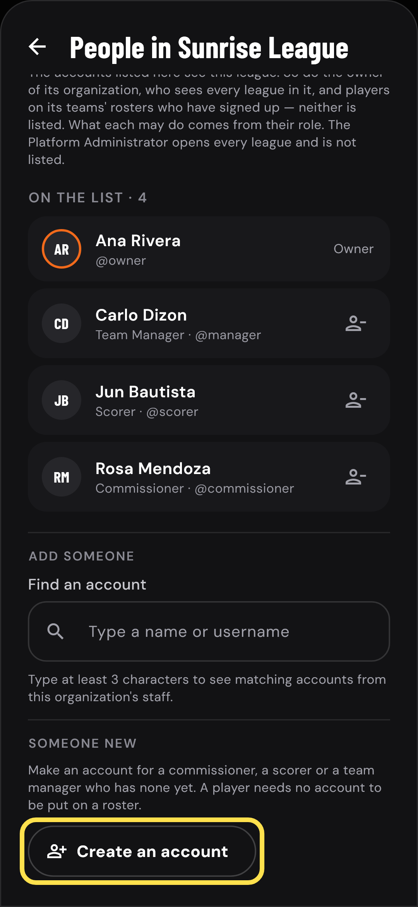

**Step 9.** Under **WHAT THEY WILL DO**, choose their role. Tap **Scorer**.

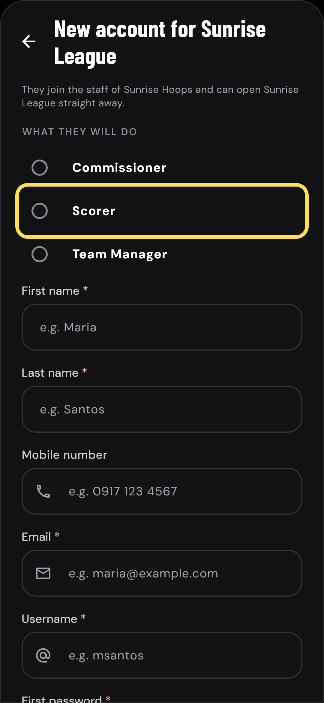

**Step 10.** Fill in their **First name**, **Last name** and **Email**. The mobile number is optional. A **Username** is suggested from the name. Type a **First password**, or tap the arrows at the end of the field to have one suggested. Tap **Create account**.

- Pass the username and password on to them. They are asked to change the password the first time they sign in.

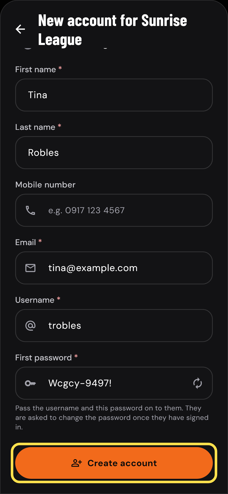

**Step 11.** The new scorer is on the list, and the app says they now have an account and can open Sunrise League. They have also joined your organization's staff.

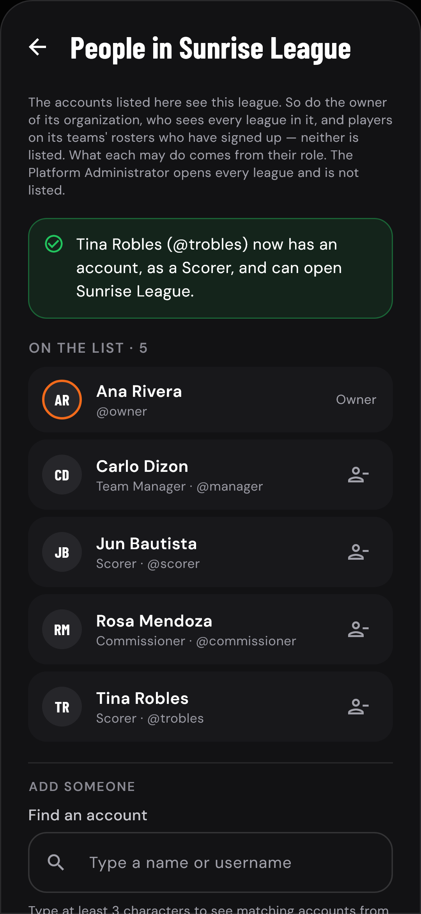

**Step 12.** You can also add someone already on your staff to another league. Open **Sunrise Night League** from Leagues and tap **People**. In **Find an account**, type at least 3 letters of their name, here "Jun". Tap the match, then tap **Add to this league**. The app says **Jun Bautista can now open Sunrise Night League.**

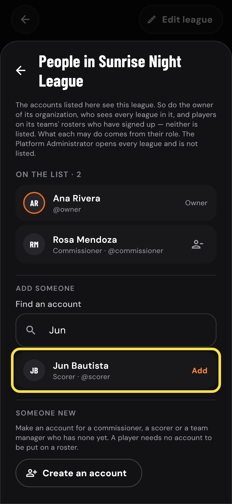

> **Taking someone off a league:** the person icon at the end of their row takes them off the list. They no longer see that league, but their account and what they did in it stay, and they can be added back at any time.

---

## 3. Open a new season and put credits into it

A league has **divisions**, such as Men's Open or 35-and-over, and each division runs **season after season**.

**Step 13.** On the league page, next to the division, tap **Add season**.

- For a new level, tap **New division** instead. It asks for the division's name, its first season and its rules.

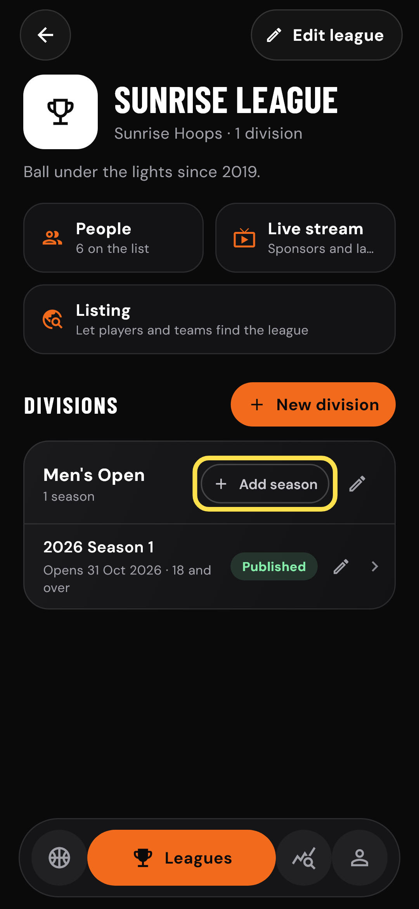

**Step 14.** Type the **Season name** and choose the **Opening Date**: tap the field, pick the day and tap **OK**. Tap **Save**.

- The new season starts with the rules of the last one. Check them on its **Rules** tab **before you use credits**: the season opens to teams the moment the credits go in.

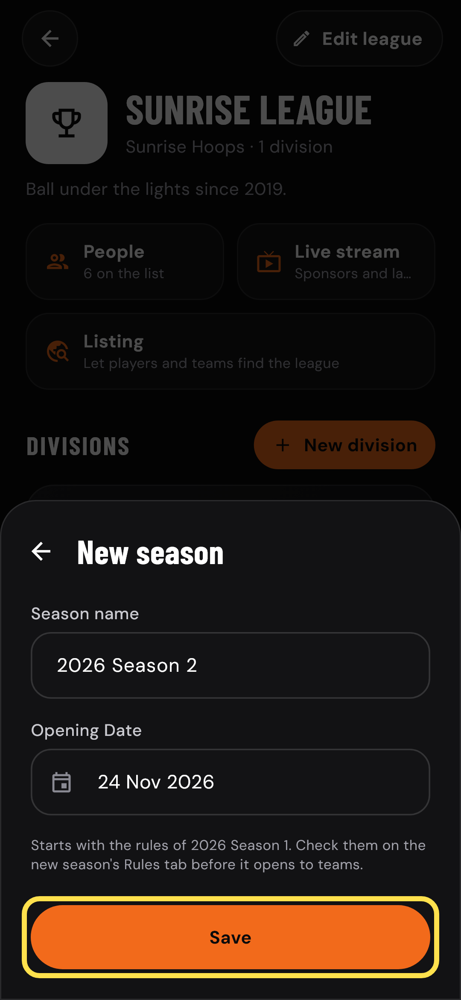

**Step 15.** The new season opens on its **Rules** tab. It says **Not active yet** and how many credits you have: use at least 2, one for each team's place, to activate it and open it to teams. You can set it up meanwhile. Tap **Use credits**.

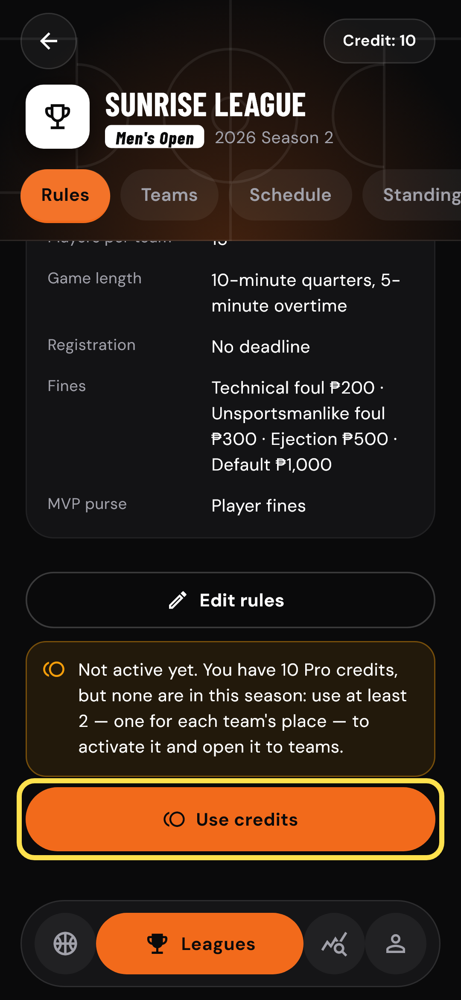

**Step 16.** Type how many teams the season will have, one credit each and at least 2. Here, 4. Tap **Use 4 credits**, then tap **Use credits** to confirm.

- Credits are not refunded. But a place no team ends up in is not lost: it can be moved to another season on the same plan with **Move team places**.
- Not enough credits? The sheet offers to buy the rest, on this season's plan.

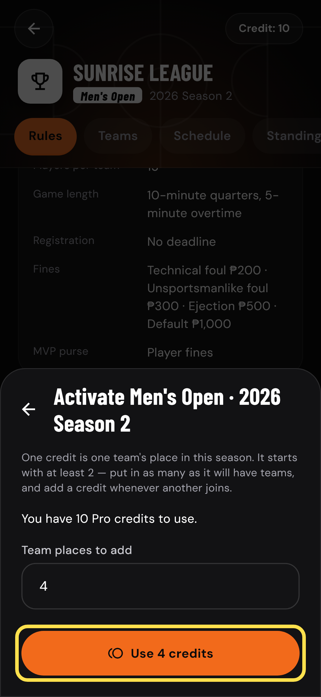

**Step 17.** That's it: the message says the season **is active with room for 4 teams, and open to teams**. As the league's owner you don't need anyone's approval and there is no separate Publish step: teams, schedules and scoring can start now. **Credit** at the top is how many of your credits are left to use. The date that ages are measured on can't be changed once the season is open.

- If the season's rules aren't complete yet, it is active but opens to teams once they are.
- A season someone else set up waits for **Publish division** on its Rules tab.

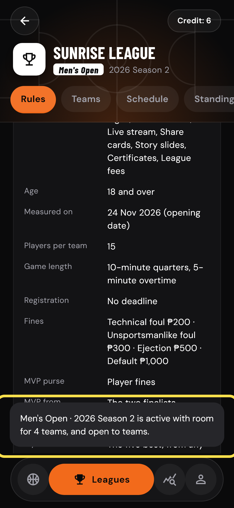

**Step 18.** At the top of the Rules tab, **TEAM PLACES** shows how many places the season has and how many are still free. **Add team places** puts in one more credit when another team joins. Further down, **Plan extras** lists what this season gets from its plan.

- A season on a cheaper plan also has **Upgrade plan** here.

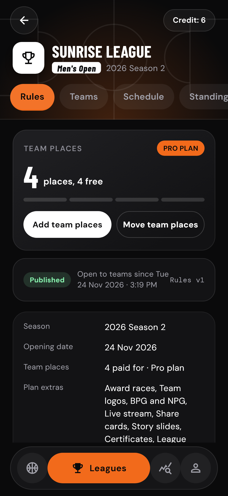

---

## 4. How your league looks on a live stream

When a scorer streams a game from the court, LigaPass draws the scoreboard and your sponsors over the camera picture. You set how it looks once, for the whole league. Live streaming comes with the Pro plan.

**Step 19.** On the league page, tap **Live stream**. The top of the page is a preview. Scroll down to **Sponsors** and tap **Add**.

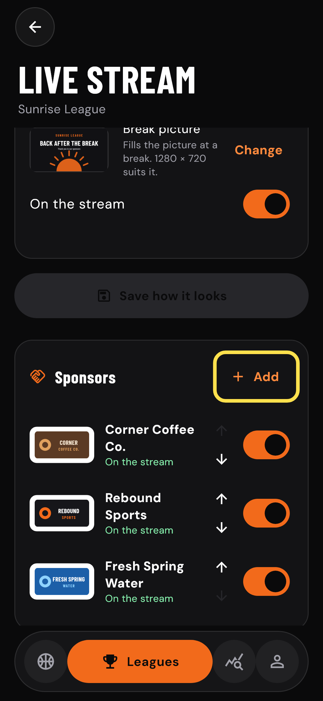

**Step 20.** Type the sponsor's **Name** and tap **Choose a picture** to pick their logo or banner from the phone. A wide picture with a light background shows best. Open **Tier, website and a line** to choose a tier (**Founding partner**, **Season partner** or **Game-day partner**) and add their website and a short line about them. Tap **Add sponsor**.

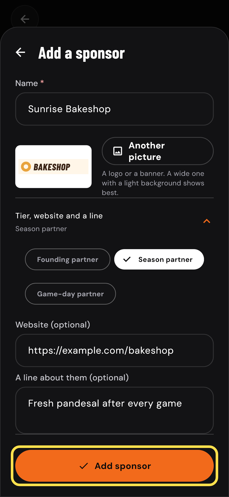

**Step 21.** Back at the top, the preview has three moments: **In play**, **At a break** and **Game over**. Tap **At a break**: the sponsors show big before tip-off, at timeouts, between periods and after the game, unless the league has a break picture (the demo league has one, so it shows here with the countdown). In play, they take turns in a corner. At the end, the stream shows the players of the game.

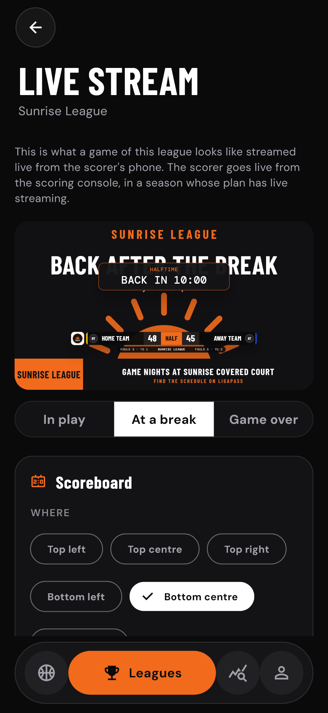

**Step 22.** Below the preview, choose where the **Scoreboard** sits and its size, the title under the scores, team logos, the game clock, fouls and timeouts, and each team's colour. Under **Sponsors on the stream**, choose their corner, their size and how many seconds each one shows. Then scroll down and tap **Save how it looks**. Here the scoreboard was moved to the top left.

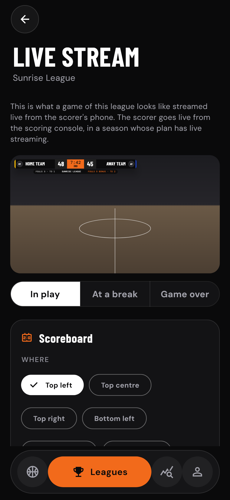

The same page also takes your league's own **logo**, **banner** and **break picture**, a **dark or light scoreboard**, and how long the stream's countdowns run at timeouts and between periods. See [One phone scores, another streams](../camera-phone/README.md#1-before-the-game-your-leagues-look).

To go live from a game, see [Try live streaming in the LigaPass demo](../live-stream-demo/README.md), [Go live with no stream key](../go-live-connect/README.md) (Facebook or YouTube, including Pages a business portfolio owns), or [One phone scores, another streams](../camera-phone/README.md).

---

## 5. The league office

The office keeps a season's money and records. Open a season from the league page: tap **Sunrise League**, then the season's name (**2026 Season 1** in the demo).

### League fees

LigaPass keeps the books by hand: the app never takes the money. In the demo the books are already started: every team's registration (one team has paid half, another nothing yet), the fines from discipline, and three expenses.

**Step 23.** On the season's page, tap the **Fees** tab. Swipe the row of tabs to the left to find it. Tap **Charge**.

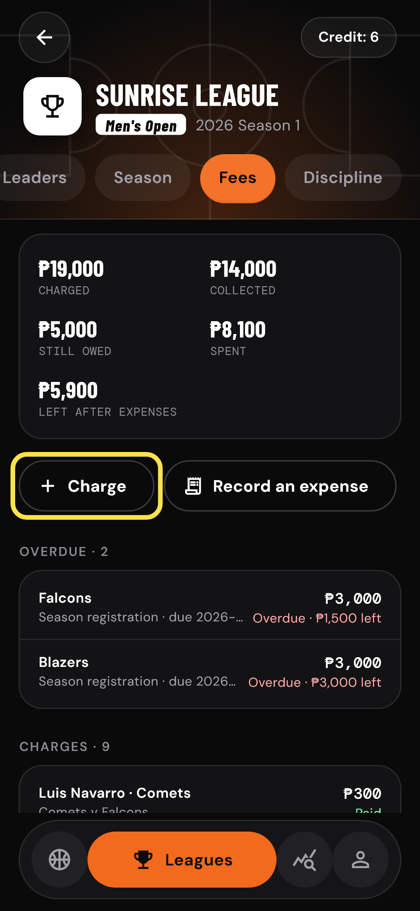

**Step 24.** In **Team or player**, type a name and pick it, here the Aces. Under **FOR**, choose what it is for: **Registration**, **Game fee**, **Tryout**, **Jersey**, **Cash bond** or **Other**. Type the **Amount**, add a **Due** date if you like, and tap **Charge**.

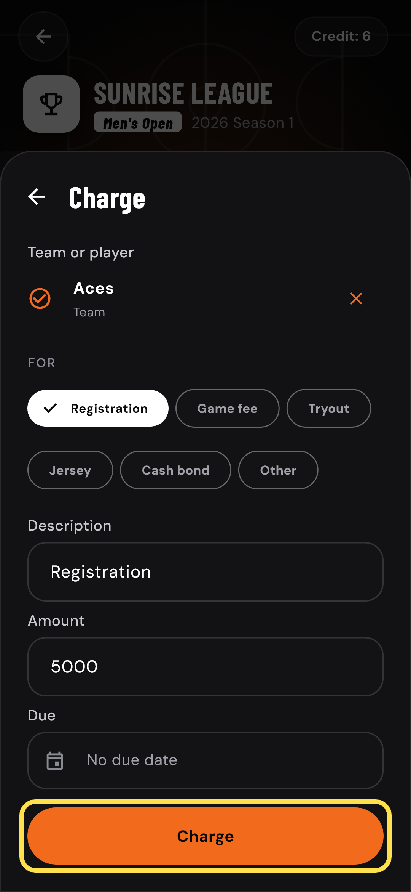

**Step 25.** The charge is listed as **Not paid**. When the team pays, tap it, then tap **Record a payment**.

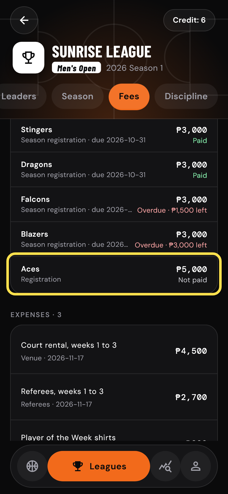

**Step 26.** Check the **Amount received**, choose **HOW** it was paid (**Cash**, **GCash**, **Maya**, **Bank transfer** or **Other**) and the day, and tap **Record it**. Each payment gets a receipt number (the first is R-0001), and the charge then shows **Paid**. The team's page shows its fees too.

- A charge can be paid in parts, and refunded. Nothing is erased: a wrong entry is voided with a reason and stays in the books, struck through.
- **Record an expense** keeps what the season costs, such as the court or the referees. The top of the tab shows what is left after expenses.

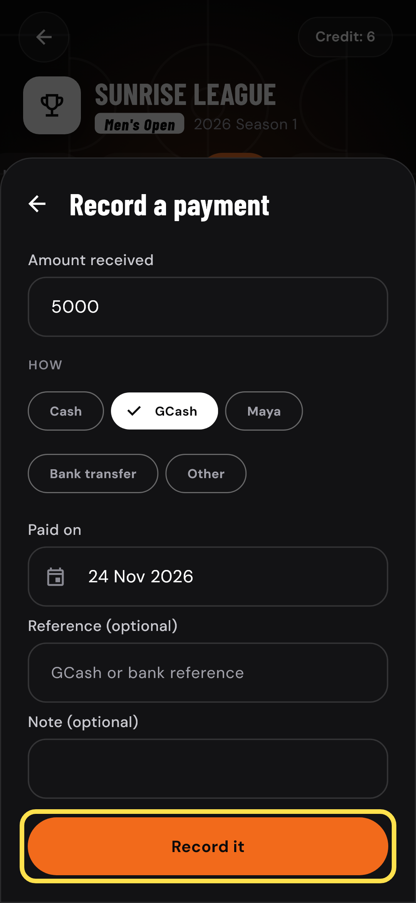

### Attendance

**Step 27.** On the **Teams** tab, tap a team to open its page. Scroll to **ATTENDANCE** and tap **Take attendance**. Choose the day and the kind of session, untick anyone who wasn't there, and tap **Save**. The team's page then shows how often each player came. The team's manager can take attendance too.

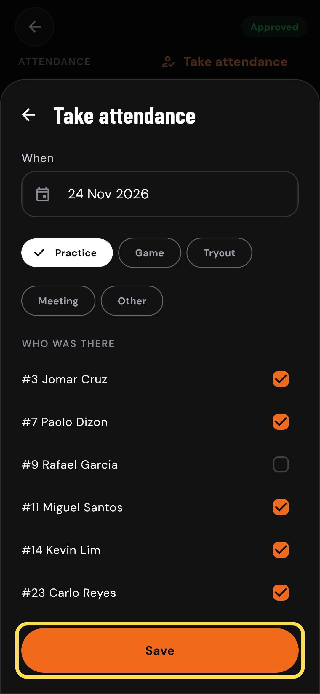

### Let players find your league

**Step 28.** On the league page, tap **Listing**. Turn on **Listed**, choose the **AREA**, and fill in what players and teams should know: the city, the court, game days and times, the format, divisions, who you're looking for, how to join and a link where they can ask. Scroll down and tap **Save**. In the demo, Sunrise League is listed already, so the page opens filled in.

- Only what is on this page is shown. The league's players, results and anyone's contact details are never shown.

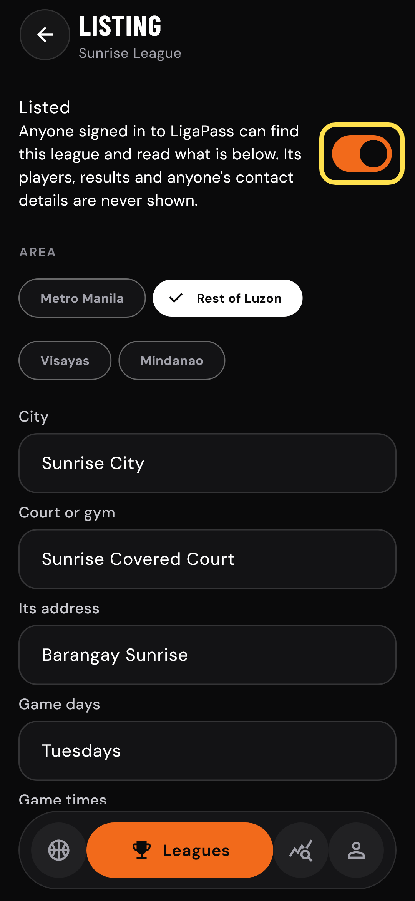

**Step 29.** Anyone signed in to LigaPass can now find the league. On **Leagues**, the round search button at the top (next to **Organization**) opens **Find a league**, where people search by league, city, court or division, or choose an area.

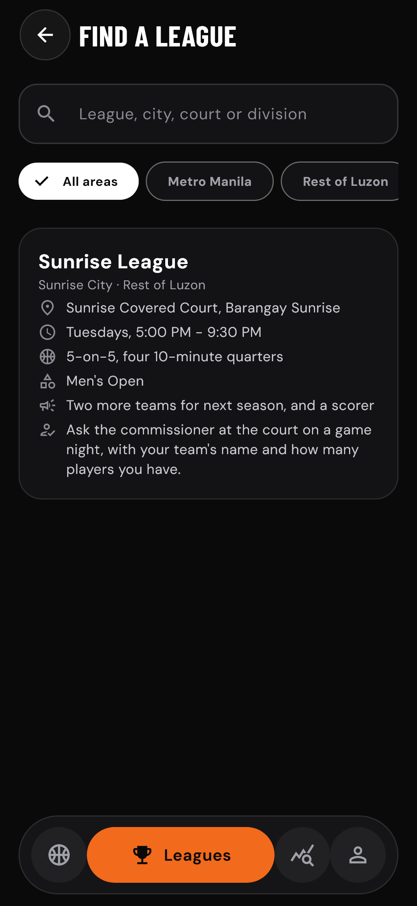

### The Game of the Week

**Step 30.** On the season's **Schedule** tab, tap a game that is still to come. Here, next week's Aces vs Comets.

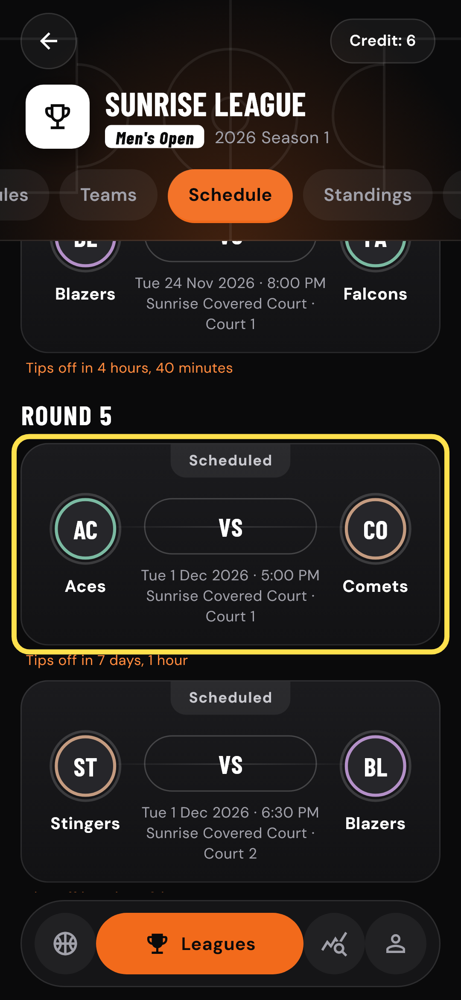

**Step 31.** On the game's page, turn on **GAME OF THE WEEK**. Under **Presented by**, type a sponsor's name and pick it, or leave it empty for no sponsor. The game is marked as the Game of the Week where the season's page lists the games coming up.

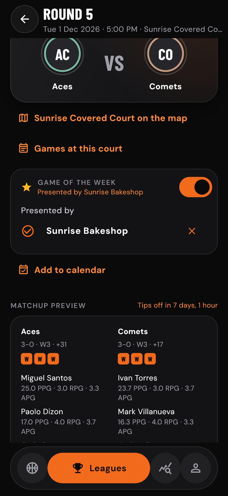

### Discipline

Suspensions, bans and fines are on the season's **Discipline** tab (the last tab), and every fine goes into these books. See [Suspensions, bans and fines](../discipline/README.md).

---

## 6. Season insights, records and sharing

Everything here is worked out from confirmed results. There is nothing to fill in.

**Step 32.** Open the season's **Season** tab, next to Fees. A league sponsor is shown at the top. **AT A GLANCE** sums the season up. Below it: the games coming up with a countdown, the latest results, **STORYLINES** (streaks and records within reach) and the **PLAYER OF THE WEEK**.

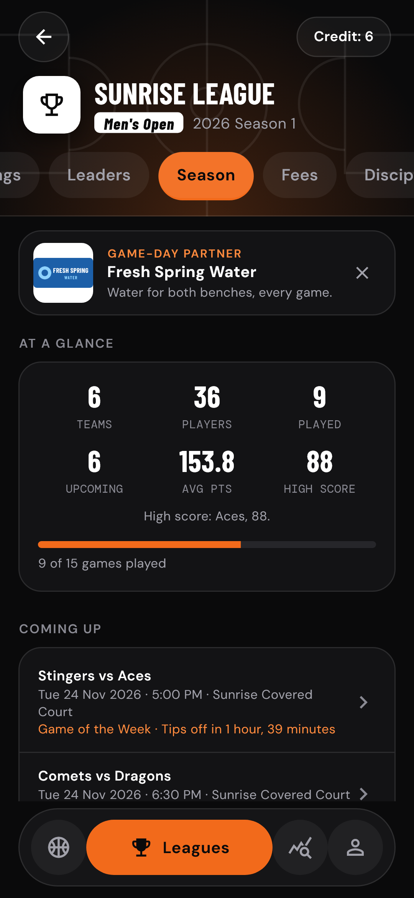

**Step 33.** Further down, **Records book** opens the league's records: single-game highs and career totals for points, rebounds, assists and more, over all seasons or this one. **Head-to-head** puts two teams side by side, and **Compare players** two players.

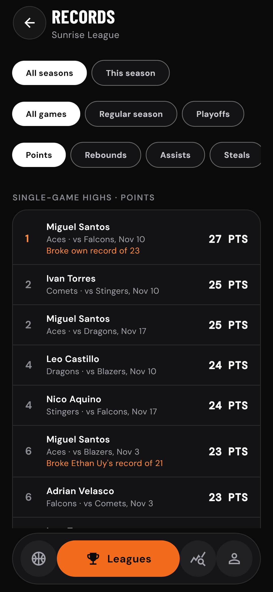

**Step 34.** Near the bottom of the Season tab, **SHARE & EXPORT** makes pictures and files to post: the **Game Day pack**, a **Standings card**, **Award cards**, printable **Certificates**, the **Season report (CSV)** and **Add schedule to calendar**. Tap **Standings card**.

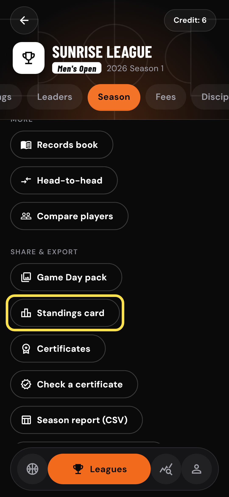

**Step 35.** LigaPass draws the card and opens your phone's share sheet, so you can post it to Facebook or Messenger, or save it. This is the card it draws for the demo league, with the league's sponsor at the foot:

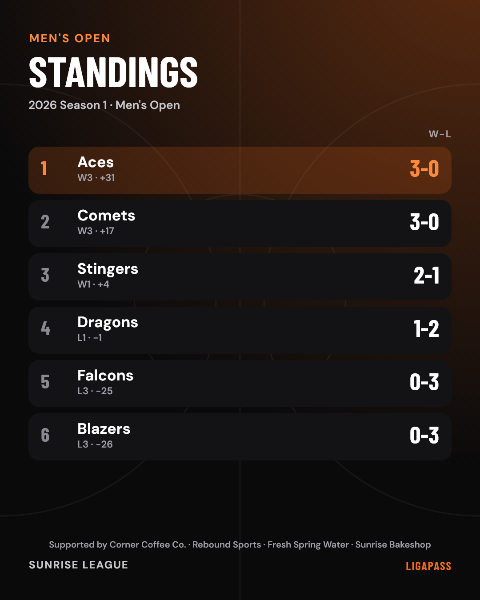

---

## About the demo

- **A made-up league.** Sunrise League has six teams, three weeks of games played and confirmed, and tonight's games still to play. Every Pro feature is on. Everyone in it is made up.
- **Saved on this phone only.** Nothing is synced, emailed or paid for. That is why the payment step looks different in the demo.
- **Gone after 24 hours.** The demo and everything you added to it are deleted 24 hours after you start it.
- **Switching roles:** to see the league as someone else, tap **Be someone else** on Home. **Leave the demo** takes you back to the normal sign-in.

---

*These pictures were drawn from the app itself with the made-up demo league. PayMongo's payment page is not shown. The sponsor and its logo are made up.*

[All guides](../README.md)
