# Try live streaming in the LigaPass demo

This guide walks you through a test stream to Facebook from **LigaPass**, using the app's built-in demo. You don't need a league or an account. It takes about 10 minutes.

In the pictures, a **yellow ring** marks what to tap next.

**Contents**

1. [What you need](#what-you-need)
2. [Get your stream key from Facebook](#1-get-your-stream-key-from-facebook)
3. [Open the demo as the scorer](#2-open-the-demo-as-the-scorer)
4. [Check in and start tonight's game](#3-check-in-and-start-tonights-game)
5. [Go live from the phone](#4-go-live-from-the-phone)
6. [Finish going live on Facebook](#5-finish-going-live-on-facebook)
7. [Score while you stream](#6-score-while-you-stream)
8. [End the stream](#7-end-the-stream)
9. [If something goes wrong](#if-something-goes-wrong)
10. [Streaming to YouTube instead](#streaming-to-youtube-instead)
11. [About the demo](#about-the-demo)

---

## What you need

- **An Android phone with LigaPass installed**, on the latest version from Google Play. Live streaming works on Android only.
- **A Facebook account**, streaming to your own profile or to a Page you manage.
- **A way to copy the stream key onto the phone.** The easiest way is to open Facebook in the phone's own browser. If you use a computer, send the key to yourself (for example in a chat with yourself) and copy it on the phone.
- **A good internet connection.** The stream uses about:

  | Quality | Data |
  |---|---|
  | 480p | 0.6 GB an hour |
  | 720p (the default) | 1.2 GB an hour |
  | 1080p | 2.1 GB an hour |

- **Recommended:** a tripod or a stand to hold the phone sideways, and a charger.

---

## 1. Get your stream key from Facebook

1. Open **Facebook Live Producer** at <https://www.facebook.com/live/producer> and sign in.
2. Choose where the video will go: your profile, or a Page you manage.
3. Under the video source, choose **Streaming software**.
4. Copy the **Stream key**.
   - Optional: turn on **Use a persistent stream key**. The same key then works for every game, so you only paste it once.
5. **Leave the Live Producer page open.** You will come back to it in [step 5](#5-finish-going-live-on-facebook).

> **Keep your stream key private.** Anyone who has it can stream to your profile or Page. If it gets out, press **Reset** next to the key in Live Producer to get a new one.

---

## 2. Open the demo as the scorer

**Step 1.** Open LigaPass. On the sign-in screen, tap **Try the demo — no account needed**.

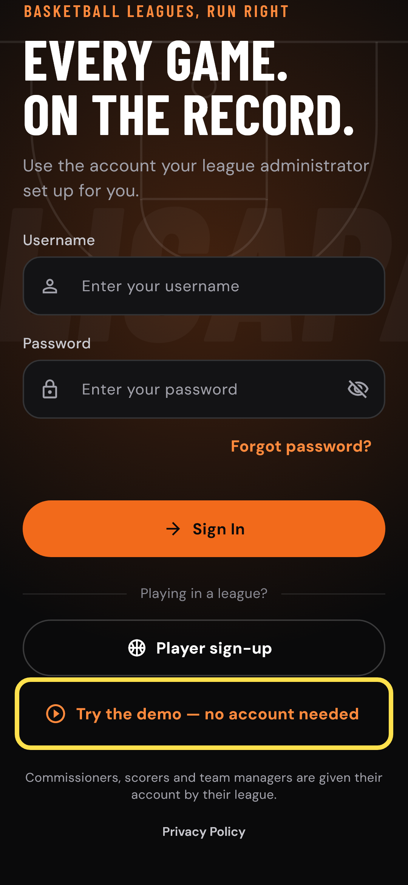

**Step 2.** Read what the demo is, then tap **Start the demo**. It takes a few seconds to set up the made-up league.

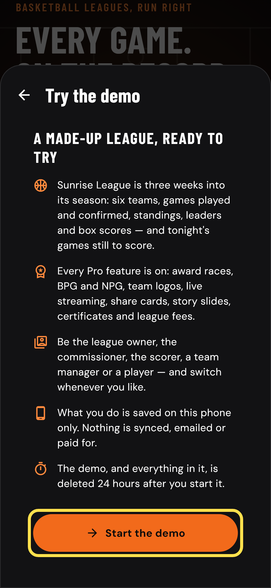

**Step 3.** Choose who to be. Tap **SCORER** (Jun Bautista). The scorer is the person who keeps score at the court and streams the game. No password is needed.

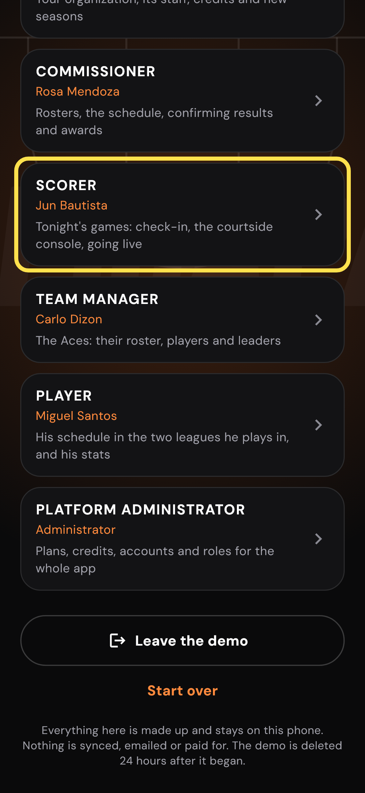

---

## 3. Check in and start tonight's game

**Step 4.** On Home, tap **Game Day**.

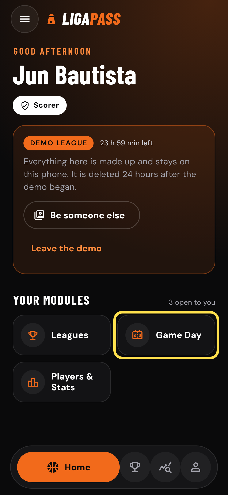

**Step 5.** Game Day lists the games you score. On tonight's first game, tap **Check-in**.

**Step 6.** Check-in shows the home team first. Tap **Everyone eligible** to mark all its players as here. Then tap the **AWAY** team at the top.

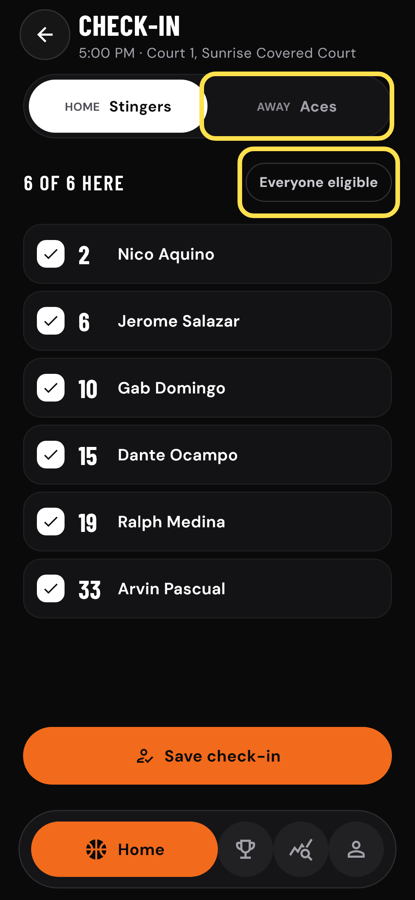

**Step 7.** Tap **Everyone eligible** again for the away team, then tap **Save check-in**.

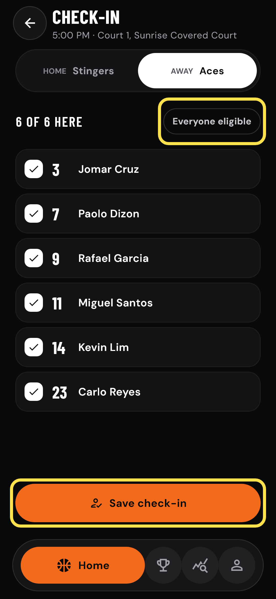

**Step 8.** Back on Game Day, the game now shows **Tip-off**. Tap it to open the scorer console.

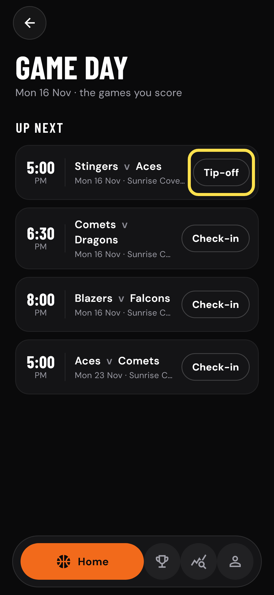

**Step 9.** **Turn the phone sideways** and keep it that way from here on: a game is streamed wide, like TV. The first five players of each team are ticked for you. Tap **Start game**.

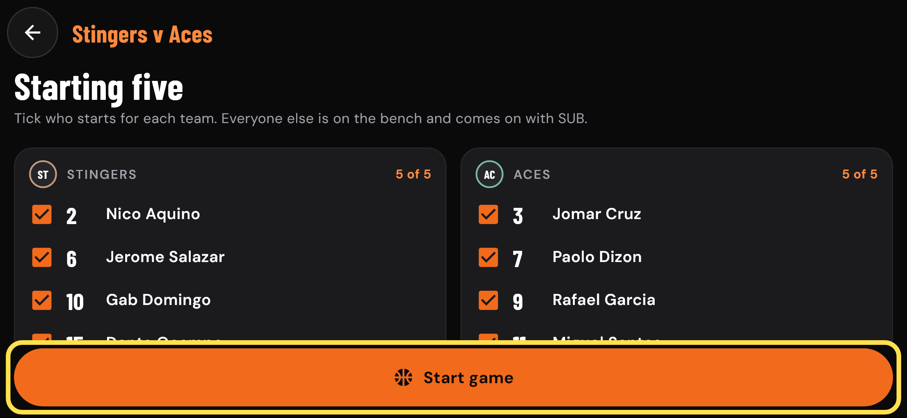

---

## 4. Go live from the phone

**Step 10.** On the scorer console, tap the **camera** button at the top right. That is **Go live**.

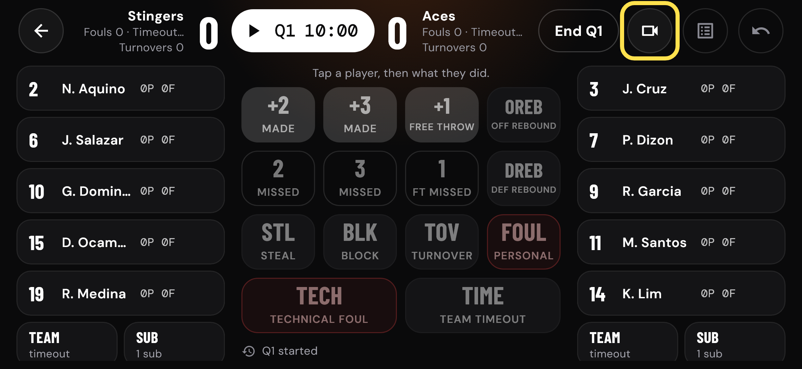

**Step 11.** The camera opens. The badge at the top left says **PREVIEW**, so nothing is being sent yet. The scoreboard is already drawn over the picture. Tap the **paste** button in the Stream key field to put in the key you copied from Facebook.

- If the phone asks to use the **camera** and **microphone**, allow both.

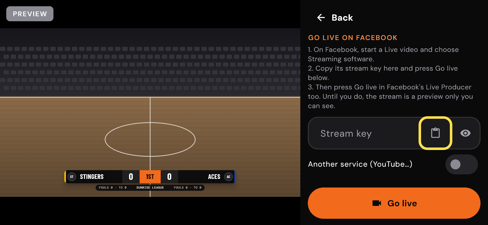

**Step 12.** The key is hidden behind dots. Under it, LigaPass shows how the key **ends** (for example "Ends in Gh78"). **Check that this matches the end of the key in Live Producer.** Tap the eye icon if you want to see the whole key. Then tap **Go live**.

- Leave **Keep the key on this phone** on, so the key is filled in next time.
- **Quality:** 720p suits most connections. Choose 480p on a weak signal.

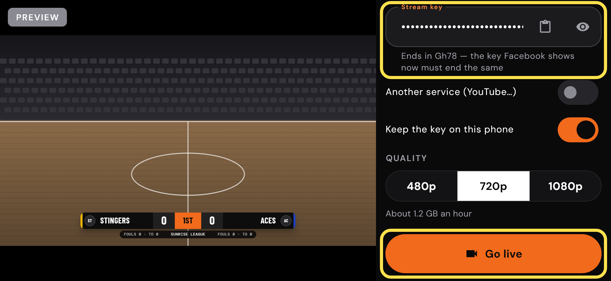

**Step 13.** The badge turns red: **LIVE**, with the time on air. Facebook is now receiving the picture, but **nobody else can see it yet**. The box **ONE MORE STEP ON FACEBOOK** reminds you of the step below.

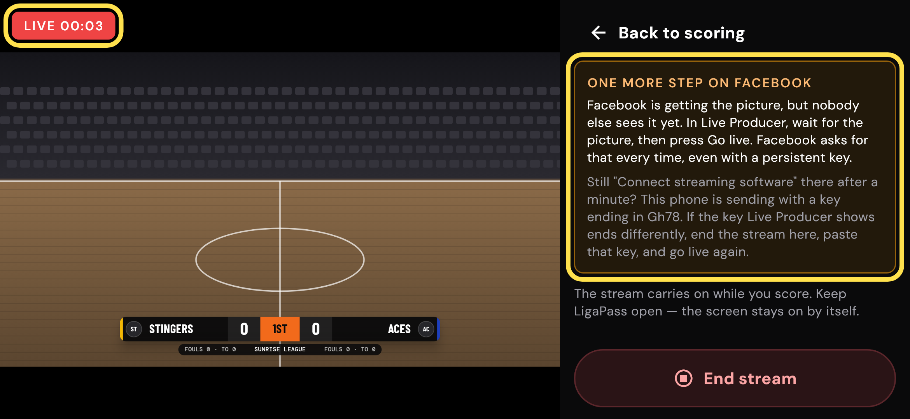

---

## 5. Finish going live on Facebook

Facebook holds every stream as a private preview until you press its own **Go live** button. This is needed **every time**, even with a persistent key.

1. Go back to the **Live Producer** page you left open in [part 1](#1-get-your-stream-key-from-facebook).
2. Wait for the phone's picture to appear there. It can take up to about 30 seconds.
3. Press **Go live** in Live Producer. The game is now on your profile or Page for everyone who can see it.

> **Only testing?** You can stop after the picture appears in Live Producer. Until you press Go live there, only you can see it.

---

## 6. Score while you stream

**Step 14.** Tap **Back to scoring**. The stream carries on while you score. Keep LigaPass open; the screen stays on by itself.

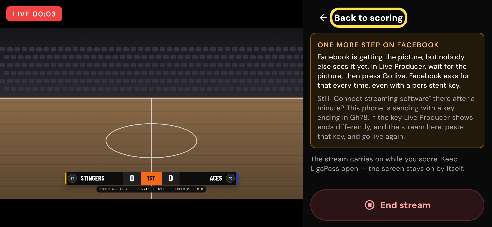

**Step 15.** Score as usual: tap a player, then what they did. The red **LIVE** button at the top shows the time on air. Tap it to get back to the stream screen.

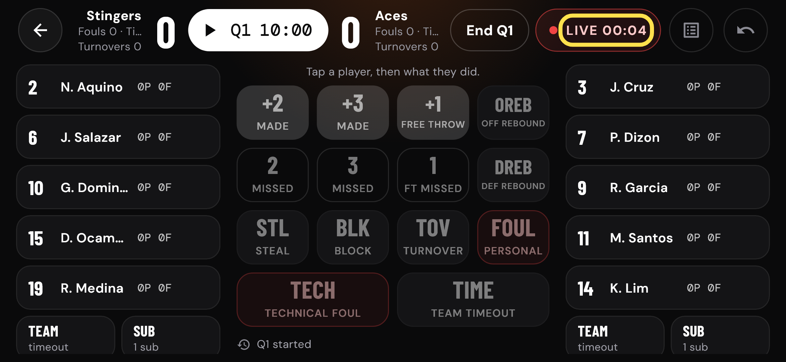

**Step 16.** This is what viewers see: your camera's picture with the scoreboard over it. The score, period and fouls change as you score.

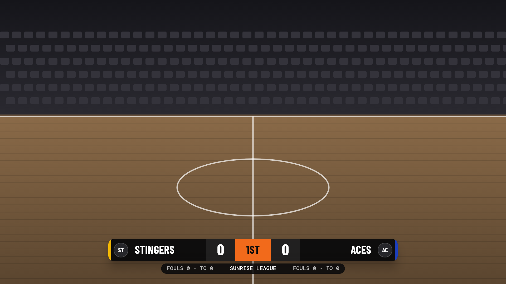

---

## 7. End the stream

**Step 17.** On the scorer console, tap the red **LIVE** button, then tap **End stream**.

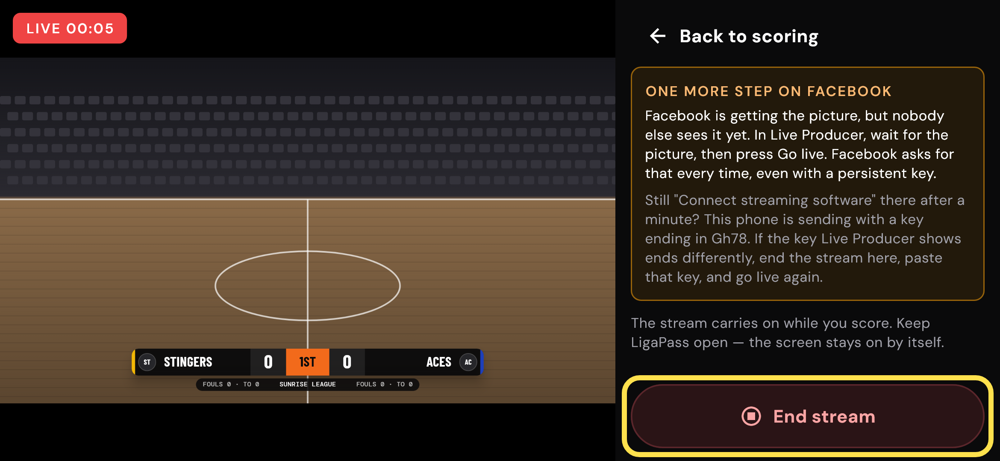

**Step 18.** Tap **End stream** again to confirm. Viewers see the stream end.

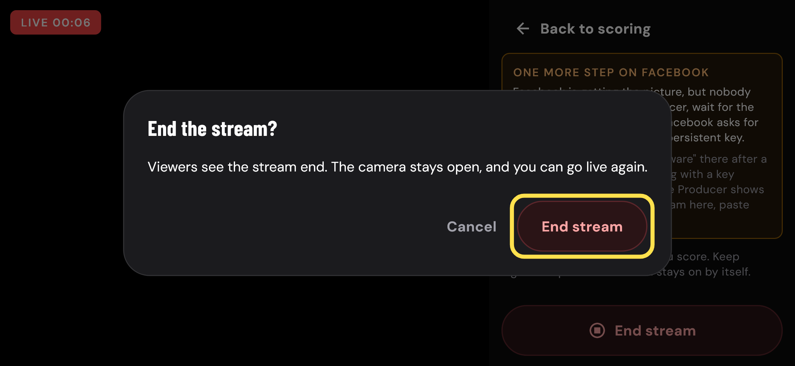

**Step 19.** The badge goes back to **PREVIEW**. The camera stays open, so you can go live again with **Go live**. Tap **Back** to return to the console. On Facebook, end the live video in Live Producer as well if it is still open.

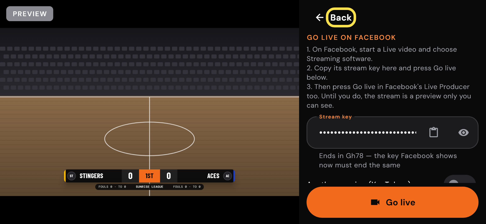

---

## If something goes wrong

| What you see | What to do |
|---|---|
| The phone shows **LIVE**, but nothing is on your profile or Page | Press **Go live** in Live Producer ([part 5](#5-finish-going-live-on-facebook)). Facebook keeps the stream private until you do. |
| Live Producer still says **"Connect streaming software"** after a minute | The phone is probably sending with a different key. Compare the key's ending on the phone with the key in Live Producer. If they differ, end the stream on the phone, paste the key again and tap Go live. Close any other Live Producer tabs: a persistent key works for one live video at a time. |
| The badge says **STOPPED** with a message | The connection dropped or Facebook refused the key. Check the internet connection and the key, then tap **Go live** again. The camera stays open. |
| A screen says **"Turn the phone sideways"** | Turn the phone on its side. The camera opens by itself. |
| There is no camera button on the console | Live streaming needs an Android phone and a league plan that includes it. Every plan feature is on in the demo. |
| The picture stutters or keeps reconnecting | Choose a lower quality (480p) before going live, or move to a stronger signal. |

---

## Streaming to YouTube instead

1. In **YouTube Studio**, choose **Go live → Stream** and copy the **stream key**.
2. On LigaPass's Go-live screen, turn on **Another service (YouTube…)**.
3. In **Server**, enter `rtmps://a.rtmps.youtube.com/live2`.
4. Paste the key and tap **Go live**.

LigaPass streams only over **RTMPS**, which encrypts the video, the sound and the key.

---

## About the demo

- **A made-up league.** It is called Sunrise League. It has six teams, three weeks of games already played, and tonight's games waiting to be scored. Every Pro feature is on.
- **Saved on this phone only.** Nothing is synced, emailed or paid for.
- **Gone after 24 hours.** The demo and everything in it is deleted 24 hours after you start it. The stream key you kept goes with it.
- **The stream itself is real.** Going live sends your camera's picture to Facebook (or YouTube) for real, so use your own test live video.
- **Switching roles:** to try another role, tap **Be someone else** on Home. **Leave the demo** takes you back to the normal sign-in.

> **Using an older version of the app?** These pictures come from the newest version. In older versions, the Go-live screen has no paste button and no "Ends in …" line. Instead, tap the **Stream key** field, long-press it and choose **Paste**. The "One more step on Facebook" box is missing there too, but Facebook's own **Go live** step ([part 5](#5-finish-going-live-on-facebook)) is still needed.

---

*These pictures were drawn from the app itself with the made-up demo league. The court stands in for a real camera picture. The stream key shown is made up.*
