# LigaPass for players

This guide is for a **player**. It shows where to find your next game, your schedule in every league you play in, your own stats and records, and the box score of each game you played. It also shows how to look for a league and follow a team. It uses the app's built-in demo, so you don't need a league or an account. In the demo you are **Miguel Santos**, who plays in two leagues: **#11 for the Aces** in Sunrise League and **#11 for the Night Owls** in Sunrise Night League.

In the pictures, a **yellow ring** marks what to tap next.

**Contents**

1. [Before you start](#before-you-start)
2. [Your next game](#1-your-next-game)
3. [My Schedule: every league in one list](#2-my-schedule-every-league-in-one-list)
4. [My Stats: your games, averages and records](#3-my-stats-your-games-averages-and-records)
5. [A game's page and box score](#4-a-games-page-and-box-score)
6. [Find a league](#5-find-a-league)
7. [A season's schedule on a calendar](#6-a-seasons-schedule-on-a-calendar)
8. [Follow a team](#7-follow-a-team)
9. [Your profile and photo](#8-your-profile-and-photo)
10. [If something goes wrong](#if-something-goes-wrong)

---

## Before you start

Open LigaPass, tap **Try the demo — no account needed**, then **Start the demo**. Choose **PLAYER** (Miguel Santos). No password is needed. [Try the demo](../getting-started/README.md#try-the-demo) in the getting-started guide shows these steps in full.

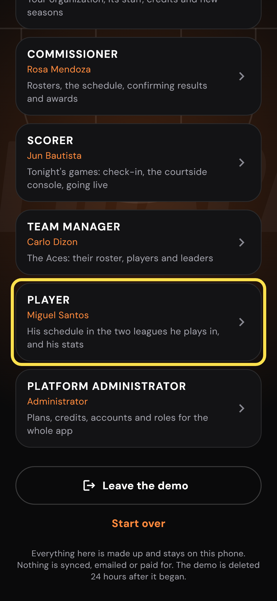

> **Your games are yours once your account is linked.** In a real league, your team adds you with the email address of your LigaPass account (or you [sign up as a player](../getting-started/README.md#sign-up-as-a-player) with the address your team has). Your games, schedule and stats then show up on your own phone.

---

## 1. Your next game

**Step 1.** Home shows your **Next game**: when it is, who you play (**at** means away, **vs** means at home), the league and division, and the court. The button says how many more games are to come. Tap **My schedule**.

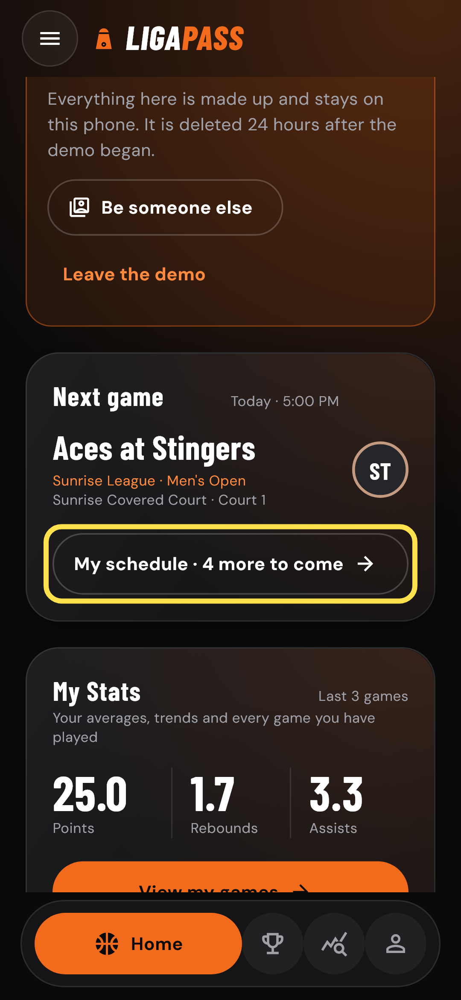

---

## 2. My Schedule: every league in one list

**Step 2.** **MY SCHEDULE** lists the games of every team you are on, in every league, day by day: **Today**, then the dates to come. Under each game, the orange line says which league and division it belongs to. Here the Aces' games (Sunrise League) and the Night Owls' games (Sunrise Night League) are in one list.

The button at the top right is **Add to my calendar**: it hands all these games to your phone's calendar in one go.

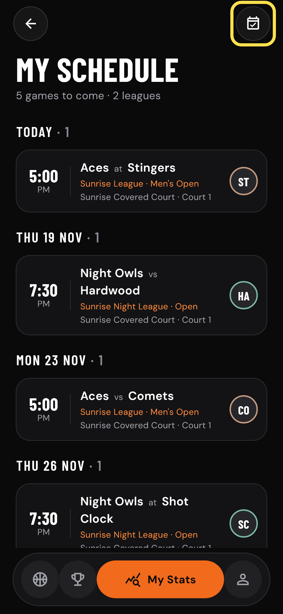

- A game being played shows under **Live now**.
- A game without a time (for example one that was postponed) shows under **Time to be set**.
- A game you played shows under **Played · awaiting confirmation** until the commissioner confirms it. Then it moves to My Stats.

**Step 3.** Tap any game to open its page. Here, tap the Night Owls' game.

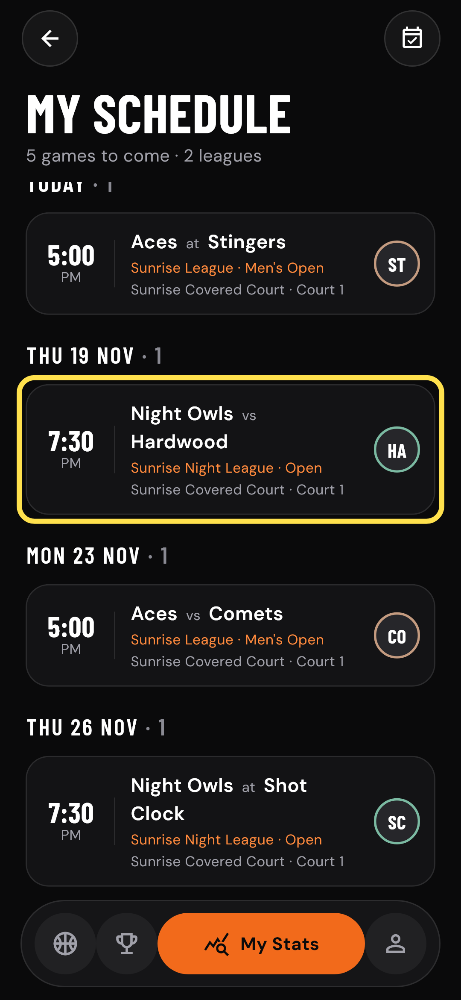

**Step 4.** A game still to come shows **Scheduled**, the two teams, the way to the court (**… on the map**), **Games at this court**, **Add to calendar** (just this game) and a **MATCHUP PREVIEW** with a countdown to tip-off. **Head-to-head** compares the two teams.

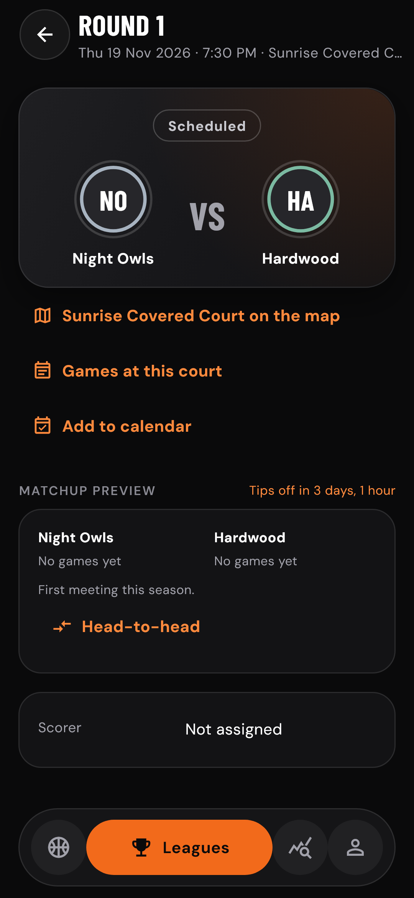

---

## 3. My Stats: your games, averages and records

**Step 5.** Back on Home, the **My Stats** card shows your averages over your last games. Tap **View my games**. (The **My Stats** tab at the bottom of the screen opens the same page.)

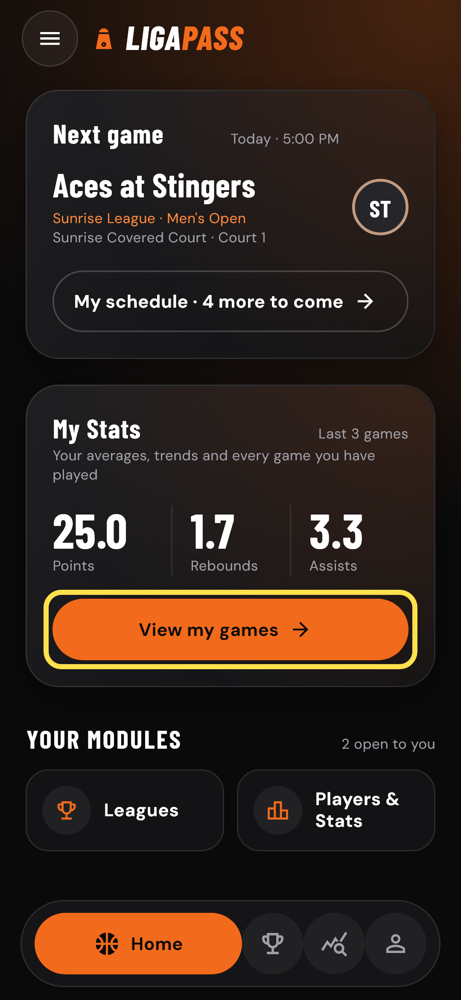

**Step 6.** **MY STATS** counts only confirmed games ("official lines only"), from every league you play in. The **Overview** tab shows how many games you played and won, and your averages a game: **POINTS**, **REBOUNDS**, **ASSISTS** and **EFFICIENCY**.

- The chips (**All time**, a year, or the last 5, 10 or 20 games once you have that many) choose which games are counted.
- **Filter** narrows them to one season, one opponent, or wins or losses.
- **What stands out** points out what the numbers say. With only a few games it says there are too few to read yet.
- The calendar button at the top right opens My Schedule.

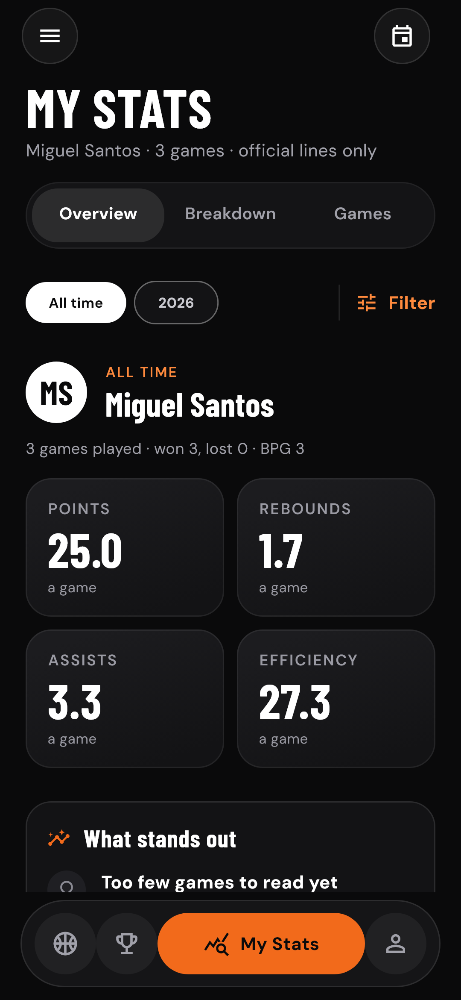

**Step 7.** Scroll down the Overview for your trend, your shooting, and **Best games**: your record in each statistic, with the game you set it in. Tap one to see that game. The chips under it count your milestone games (for example 10+ and 20+ point games).

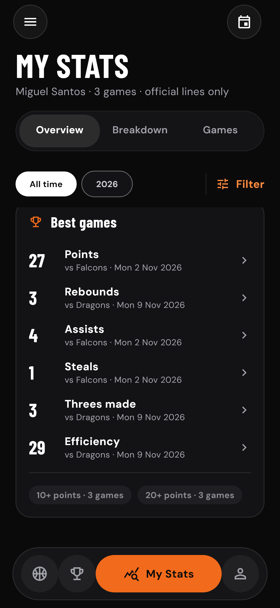

**Step 8.** Tap **Breakdown** to see the same games **By year**, **By season**, by wins and losses, and by opponent. Tap a row to look at just those games.

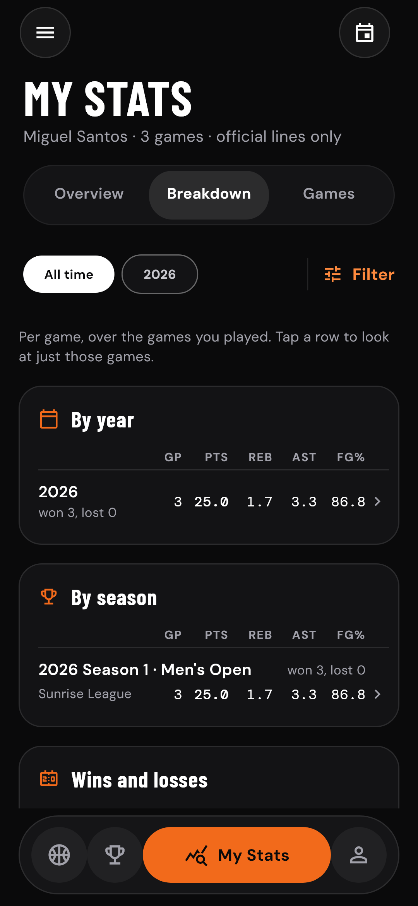

**Step 9.** Tap **Games** for every game you played, month by month. Each shows the opponent, the result (**W** or **L** and the score) and your line. **BPG** means you were the Best Player of the Game. Tap a game.

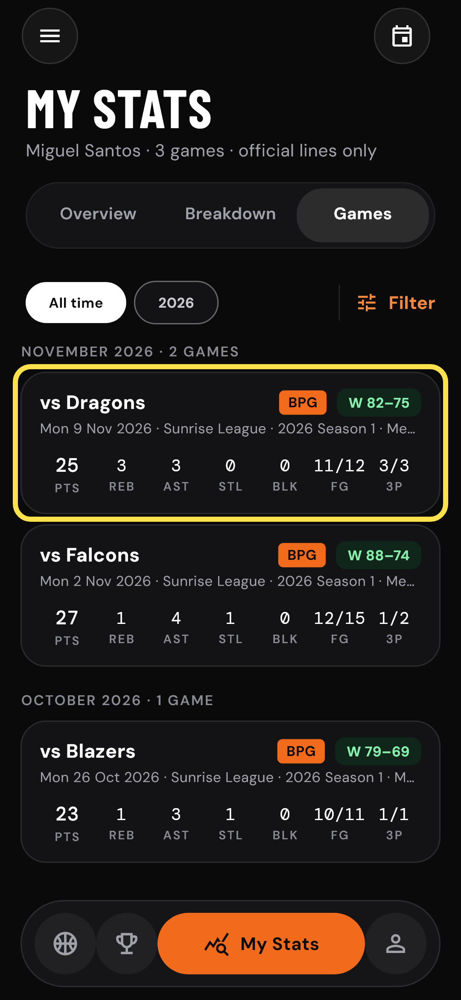

**Step 10.** The game's sheet shows your whole line and how it compares with your average (**AGAINST YOUR AVERAGE**), your shooting, and the rest.

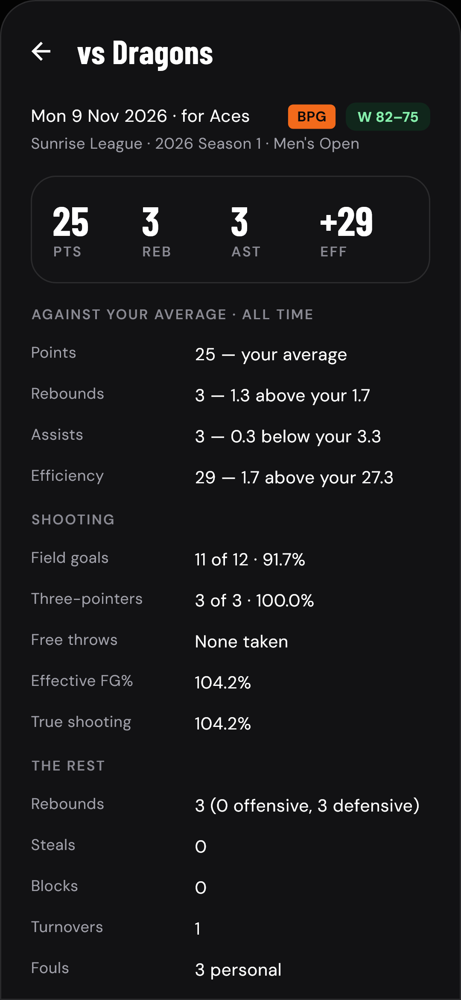

**Step 11.** At the foot of the sheet, tap **Open the box score**.

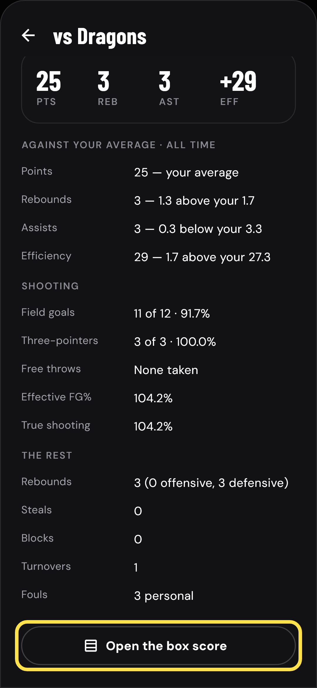

---

## 4. A game's page and box score

**Step 12.** A finished game shows **Final · Confirmed**, the score by quarter and the **GAME LEADERS**. **Share the final** makes a picture of the result to share.

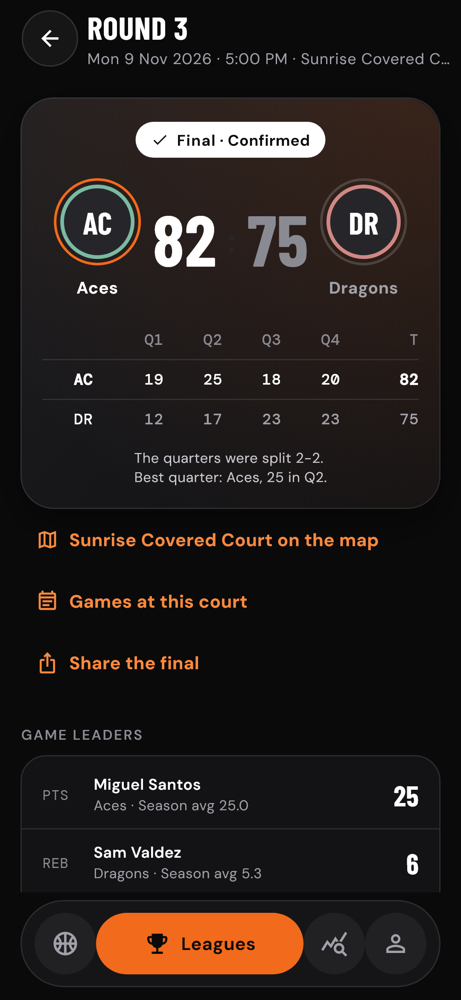

**Step 13.** Scroll down to **PLAYERS OF THE GAME** (**BPG**, the Best Player of the Game, and **NPG**, the Notable Player of the Game from the other team) and the box score of each team. Tap your own row.

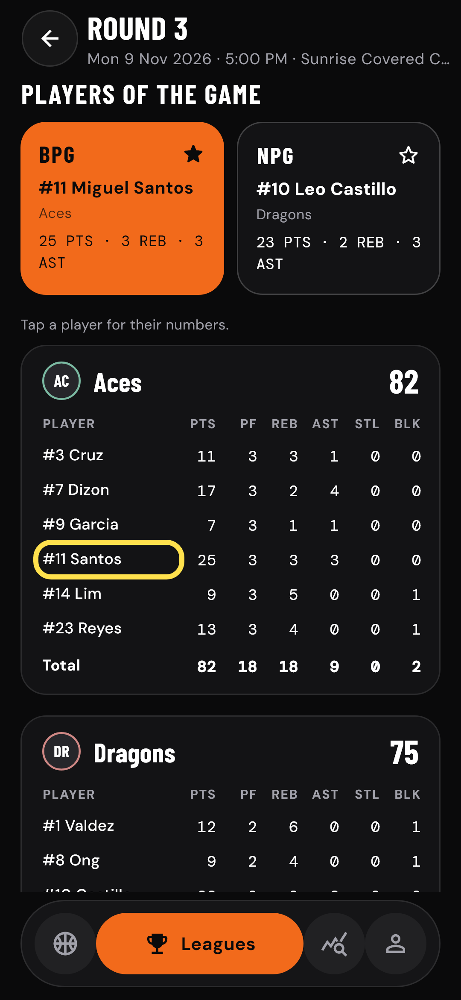

**Step 14.** Your sheet for this game: points, rebounds, assists and efficiency, your shooting, the rest, and a few figures worked out from them (**ANALYTICS**). Further down are your confirmed averages for the season (**This season, confirmed games**) and **Full playing history**. Tap the back arrow to close it.

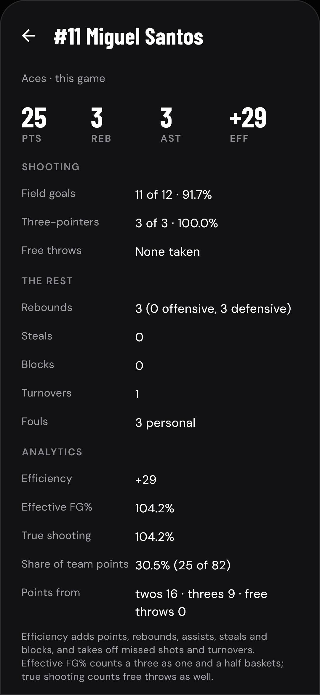

---

## 5. Find a league

**Step 15.** Tap the **Leagues** tab (the trophy) at the bottom. It lists the leagues open to you. To look for another league, tap **Find a league** at the top right.

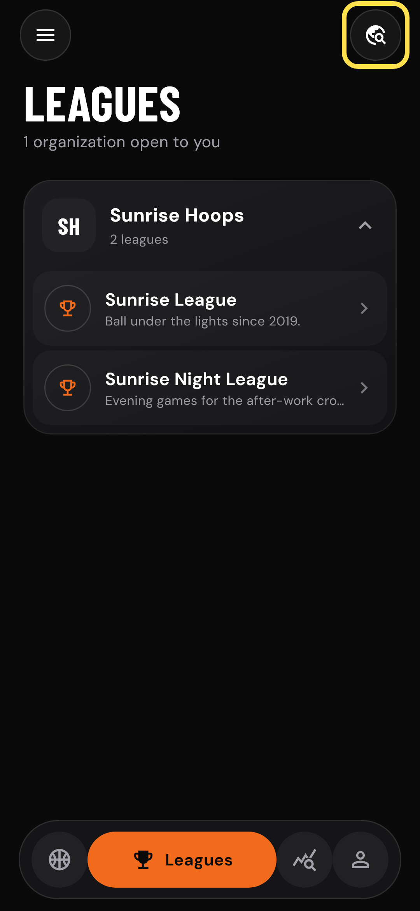

**Step 16.** **FIND A LEAGUE** lists the leagues whose organizers chose to list them. Search by league, city, court or division, or pick an area. A listed league shows its court, its game days, what it is looking for and how to join, with **Ask to join** where the league gives a link.

In the demo no league is listed, so the page says **No league is listed yet**.

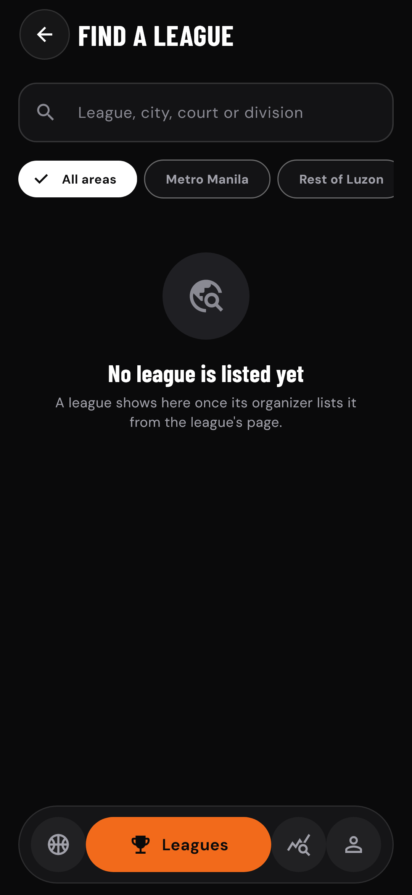

---

## 6. A season's schedule on a calendar

My Schedule shows only your own games. To see every game of a season, open the season.

**Step 17.** Tap the back arrow, then tap **Sunrise League**.

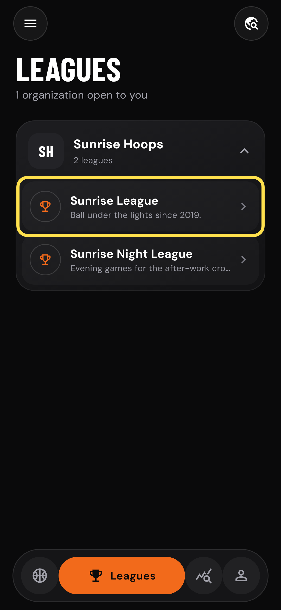

**Step 18.** Tap the season (**2026 Season 1**), then the **Schedule** tab. Games are listed by round. To see them on a month's calendar, tap the **calendar** button.

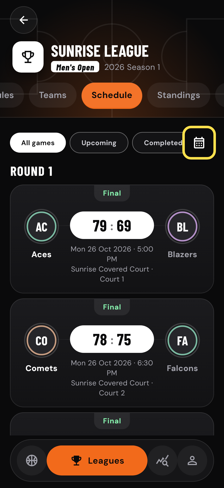

**Step 19.** Days with games are marked with how many games there are, and today has an orange frame. Under the calendar are the month's games (**IN NOVEMBER**). Tap a day to list only its games, and use the arrows to change month. The list button (where the calendar button was) goes back to the list by round.

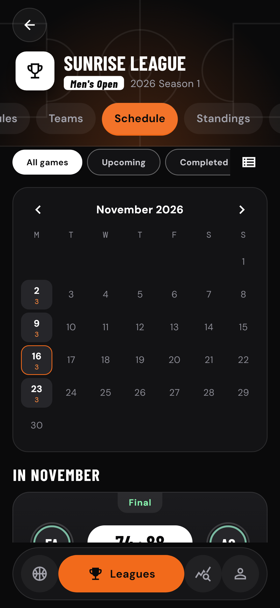

> The season's other tabs are open to you too: **Teams**, **Standings**, **Leaders** and **Season**. The [team manager's guide](../team-manager/README.md#7-your-teams-games-results-standings-and-leaders) shows them.

---

## 7. Follow a team

**Step 20.** On the season's page, tap **Teams**, then any team. On the team's page, tap **Follow this team**.

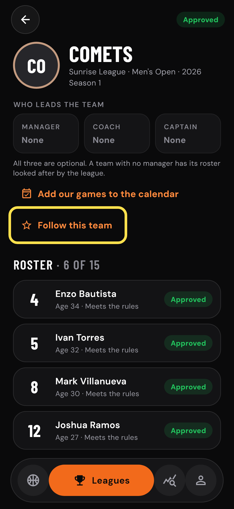

**Step 21.** The star fills in and the button says **Following**. Tap it again to stop following.

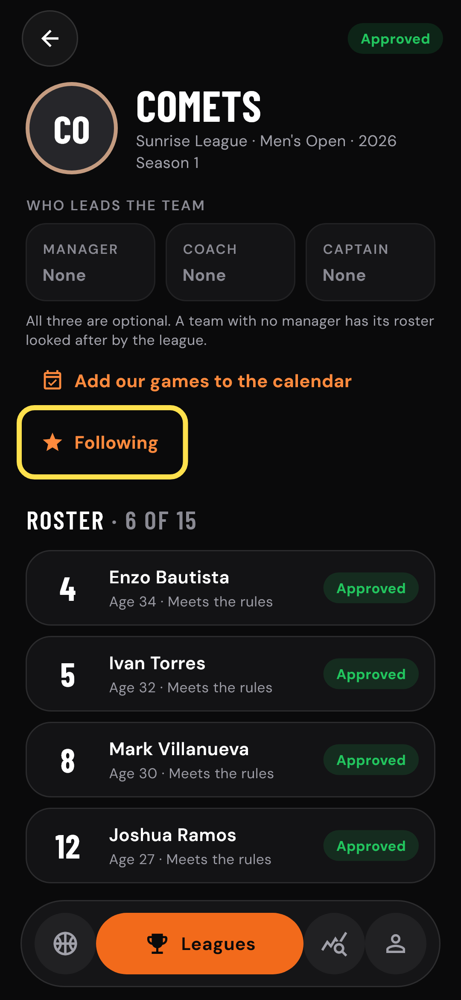

> **Add our games to the calendar** on a team's page puts all of that team's games in your phone's calendar.

---

## 8. Your profile and photo

Your name, photo, password and sign-out are on the **Profile** tab (the person at the bottom right). The getting-started guide explains it: see [Your profile](../getting-started/README.md#your-profile).

If your league charges players fees through LigaPass, Profile also shows **My league fees**: what you owe and what you have paid.

---

## If something goes wrong

| What you see | What to do |
|---|---|
| Home has no **Next game** card | You have no games to come. The card comes back once your team's next game is on the schedule. |
| My Stats says **No playing record on this account** | Your team hasn't added you with your account's email address yet. Ask your team manager to add it, or add an email on Profile that matches the one your team has. |
| A game is missing from My Stats | My Stats counts only confirmed games. A game you played waits on My Schedule under **Played · awaiting confirmation** until the commissioner confirms it. |
| A game in My Schedule doesn't open | You can open a game only in a league you have access to. |
| **Find a league** lists nothing | No league has listed itself yet. Ask a league's organizer, or try another area. |

---

*These pictures were drawn from the app itself with the made-up demo league.*

[All guides](../README.md)
