# Keep score of a game in LigaPass

This guide is for the **scorer**: the person at the scorer's table who checks the players in, runs the game clock and records every play on a phone. It takes you through one whole game in the app's built-in demo, from tonight's list of games to handing in the result with the Best and the Notable Player of the Game. You don't need a league or an account.

In the pictures, a **yellow ring** marks what to tap next.

**Contents**

1. [Before you start](#before-you-start)
2. [Game Day: your games](#1-game-day-your-games)
3. [Check the players in](#2-check-the-players-in)
4. [Pick the starting five and tip off](#3-pick-the-starting-five-and-tip-off)
5. [The scorer console](#4-the-scorer-console)
6. [Run the game clock](#5-run-the-game-clock)
7. [Record the plays](#6-record-the-plays)
8. [Timeouts and substitutions](#7-timeouts-and-substitutions)
9. [Put a mistake right](#8-put-a-mistake-right)
10. [End a quarter](#9-end-a-quarter)
11. [Overtime and the end of the game](#10-overtime-and-the-end-of-the-game)
12. [Hand in the result](#11-hand-in-the-result)
13. [Going live](#12-going-live)
14. [If something goes wrong](#if-something-goes-wrong)
15. [About the demo](#about-the-demo)

---

## Before you start

Open LigaPass, tap **Try the demo — no account needed**, then **Start the demo**, and choose **SCORER** (Jun Bautista). No password is needed. [Try the demo](../getting-started/README.md#try-the-demo) in the getting-started guide shows these steps in full.

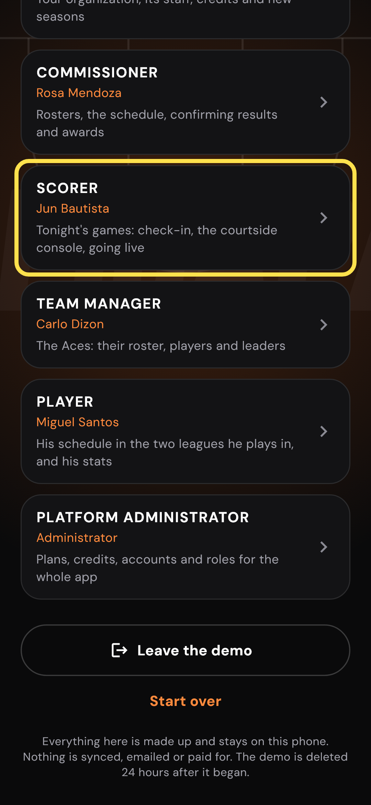

In the demo, Jun Bautista has tonight's three games of the made-up Sunrise League to score. This guide scores the first one, **Stingers v Aces**.

**Tips for a real game:**

- **Charge the phone** before the game, or keep it on a charger at the table.
- **Put the phone on a stand** so both hands are free.
- **Hold it sideways.** The console is made for it: all ten players and every key fit on one screen.

---

## 1. Game Day: your games

**Step 1.** On Home, tap **Game Day**.

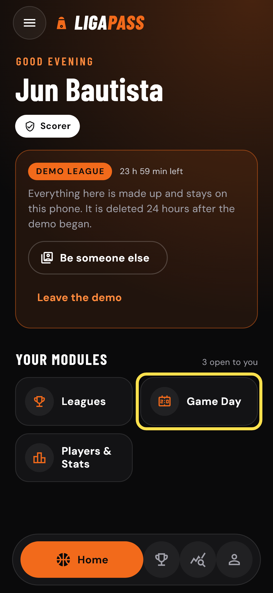

**Step 2.** Game Day lists the games you score, in groups:

- **Live**: a game being played, with its score and a **Back to the console** button.
- **Up next**: games still to play, with the time, the teams, the day and the court. The button on the right is your next step: **Check-in**, or **Tip-off** once check-in is done.
- **Awaiting confirmation**: games you have handed in that the commissioner has not confirmed yet.
- **Postponed or stopped**: games that were put off or stopped.

Right now the demo's games are all under **Up next**. Tap tonight's first game, **Stingers v Aces**, to open its page. (Tapping **Check-in** on the row takes you straight to check-in.)

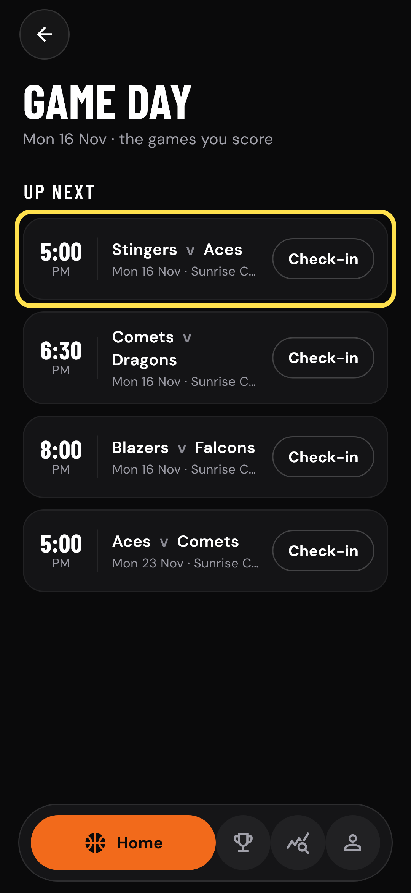

**Step 3.** The game's page shows the matchup and the scorer: you. Scroll down to **Game day** and tap **Check in players**.

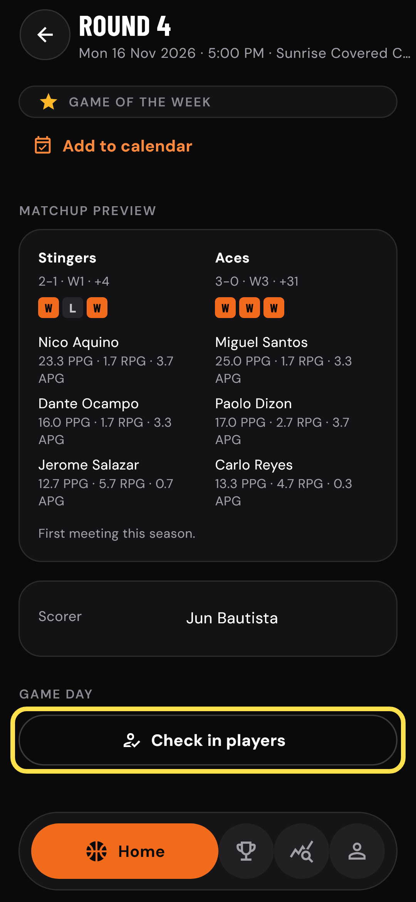

---

## 2. Check the players in

**Step 4.** Check-in shows one team at a time, the **HOME** team first. The first time you open it, everyone who may play is already ticked, and the count says how many are here: **6 OF 6 HERE**. Tap a player who is not at the court to untick them. Here, #33 Arvin Pascual.

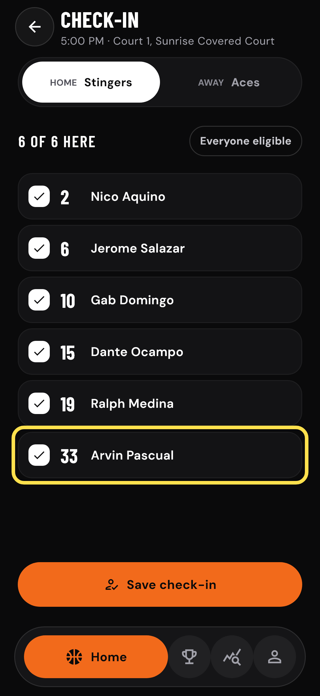

**Step 5.** The count drops to **5 OF 6 HERE**. Tap the player again to tick them back, or tap **Everyone eligible** to tick everyone who may play. Then tap **AWAY** at the top to see the other team. Your ticks are kept when you switch.

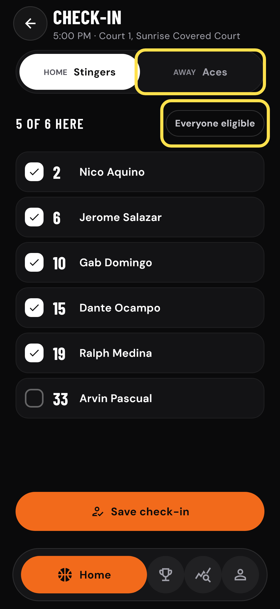

**Step 6.** Check the away team the same way, then tap **Save check-in**. This saves both teams.

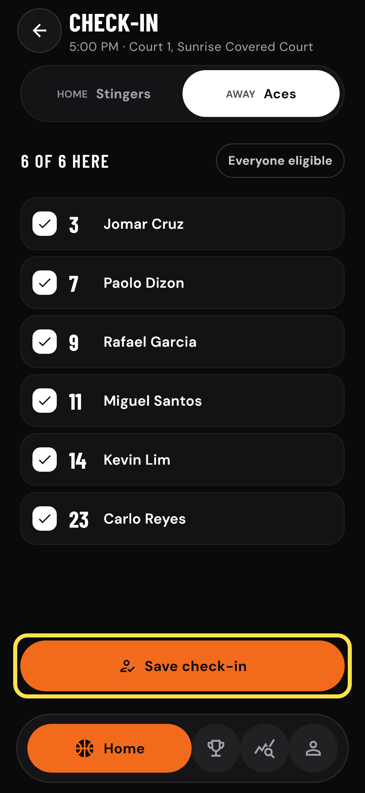

> **Players who can't play.** Only players the commissioner has approved are on the list. If some of a team's players are still waiting for review or were never submitted, a note under the list says how many. A player who is on the list but can't play in this game (for example because of the league's age rule) has a red line, **Cannot play today:**, with the reason, and can't be ticked. Everyone in the demo is approved and may play, so you won't see these there.

**Step 7.** Back on the game's page, **Game day** now has **Change check-in**, to fix the ticks before tip-off, and **Start game**. (On Game Day, the game's button now says **Tip-off**. It does the same.) Tap **Start game**.

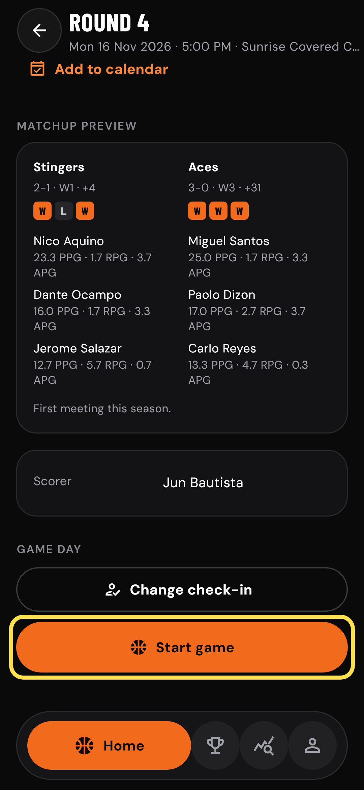

---

## 3. Pick the starting five and tip off

**Step 8.** **Starting five** opens. The first five players of each team by number are ticked. If someone else starts, untick a starter first. Here, #19 Ralph Medina starts on the bench. While five are ticked, the other players are greyed out.

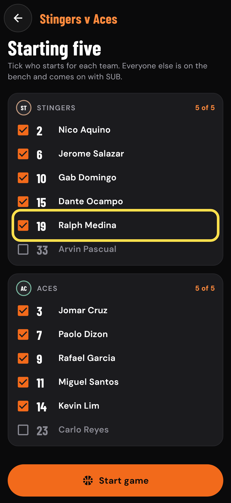

**Step 9.** The team now shows **4 of 5**, the message **Pick 5 starters for Stingers.** appears, and **Start game** waits. Tick the player who starts instead: #33 Arvin Pascual.

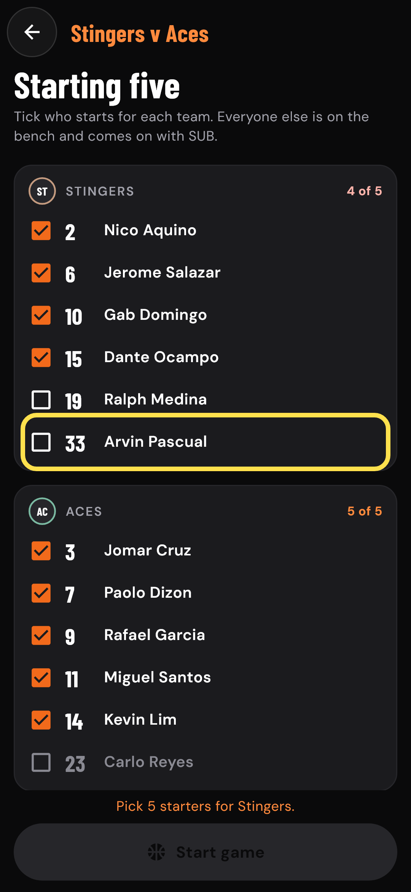

**Step 10.** **Turn the phone sideways** and keep it that way. Tap **Start game**. The first quarter (Q1) starts. Everyone who did not start is on the bench and comes on with **SUB**.

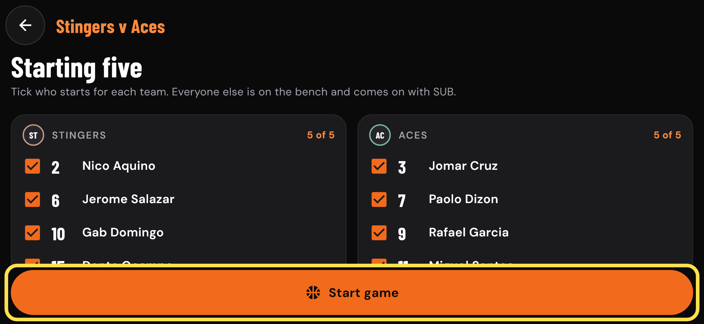

---

## 4. The scorer console

**Step 11.** This is the scorer console. Across the top, from left to right:

- the back arrow (**Leave the console**),
- the home team with its **Fouls** (this quarter), **Timeouts** and **Turnovers**, and its score,
- the **game clock** with the period (**Q1 10:00**),
- the away team's score and its **Fouls**, **Timeouts** and **Turnovers**,
- **End Q1**, the camera (**Go live**), **Play by play** (the list) and **Undo** (the curved arrow).

Down each side are the five players of each team on the court: number, name, and their points (**P**) and fouls (**F**) so far. Under them are **TEAM** (for a timeout) and **SUB** (with how many are on the bench). The keys are in the middle, and under them a line with the last thing recorded.

When the ball goes up, tap the **▶** button on the clock (**Start the clock**).

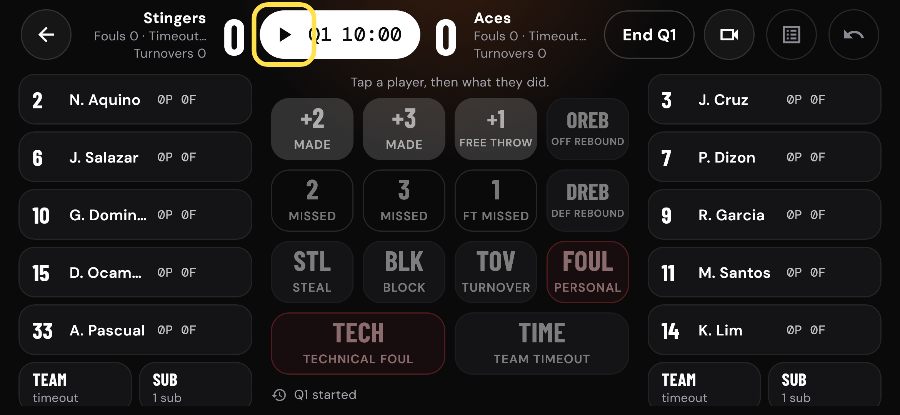

**Step 12.** Held upright, the console has the same parts. The buttons are along the top, then the clock, then the two scores with each team's fouls, timeouts and turnovers, and a line **Saved on this device** with the number of things recorded. The players are in two columns above the keys; scroll them to see the rest. Sideways, all ten players are on screen at once, which is why it is easier to score that way.

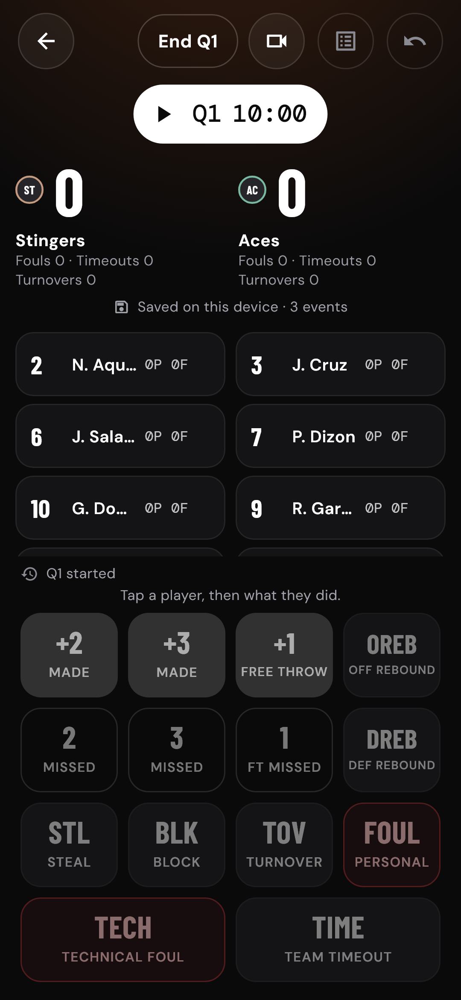

---

## 5. Run the game clock

**Step 13.** A running clock is orange and counts down. Tap **❚❚** (**Stop the clock**) when play stops, and **▶** again when it restarts. You can record plays whether the clock is running or not.

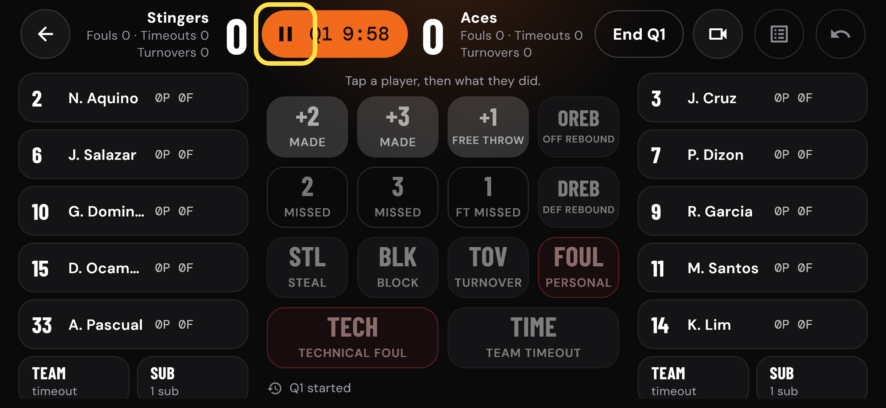

**Step 14.** If the time is wrong, tap the time itself. **Game clock** opens. Move the time with **-1:00**, **-0:10**, **-0:01**, **+0:01**, **+0:10** or **+1:00**, or tap **Back to 10:00**. Then tap **Set the clock**.

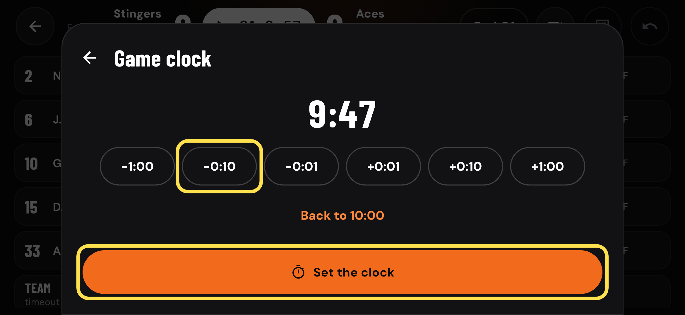

When the clock reaches 0:00 it turns red and the console says **Time — end Q1 when play has stopped.** The quarter only ends when you tap **End Q1** ([step 26](#9-end-a-quarter)).

---

## 6. Record the plays

**Step 15.** Every play is two taps: **the player, then what they did**. Tap the player's row: it turns orange and the keys light up. Then tap the key. Here #11 M. Santos scores a two: tap him, then **+2**.

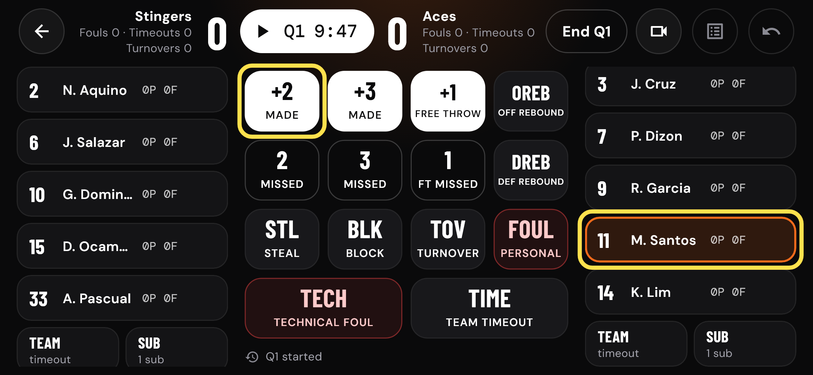

The keys:

| Key | What it records |
|---|---|
| **+2** MADE, **+3** MADE | A two or a three that went in |
| **+1** FREE THROW | A free throw that went in |
| **2** MISSED, **3** MISSED, **1** FT MISSED | A missed two, three or free throw |
| **OREB** OFF REBOUND, **DREB** DEF REBOUND | An offensive or a defensive rebound |
| **STL** STEAL, **BLK** BLOCK, **TOV** TURNOVER | A steal, a block, a turnover |
| **FOUL** PERSONAL | A personal foul |
| **TECH** TECHNICAL FOUL | A technical foul |
| **TIME** TEAM TIMEOUT | A timeout ([step 20](#7-timeouts-and-substitutions)) |

Tapped the wrong player? Tap the right one, or tap the same player again to let go of them.

**Step 16.** After a made two or three, **ASSIST?** appears above the keys with the shooter's teammates on the court. If someone passed for the basket, tap their name. Here, #7 Paolo Dizon. If nobody did, tap **×** (**No assist**), or just carry on with the next play: you never have to answer.

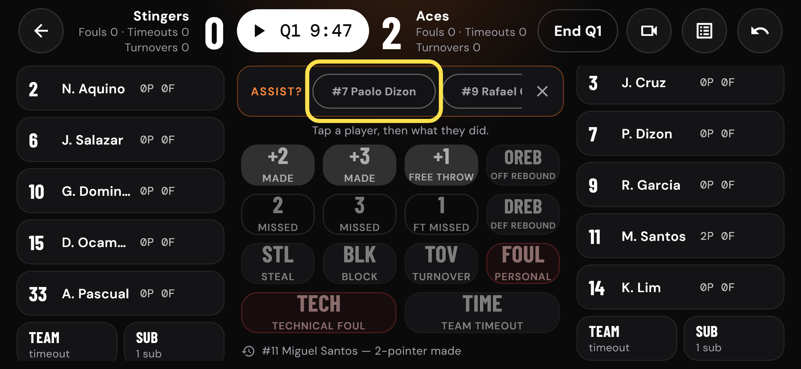

**Step 17.** After a miss, **REBOUND?** appears in the same way. The shooting team's players are marked **O** (an offensive rebound), the other team's **D** (a defensive rebound). Swipe the strip sideways to see everyone. Here #2 Nico Aquino missed a three (**3** MISSED) and #7 Paolo Dizon took the rebound: tap **D #7 P. Dizon**. As with assists, you can carry on without answering, and record a rebound later with **OREB** or **DREB**.

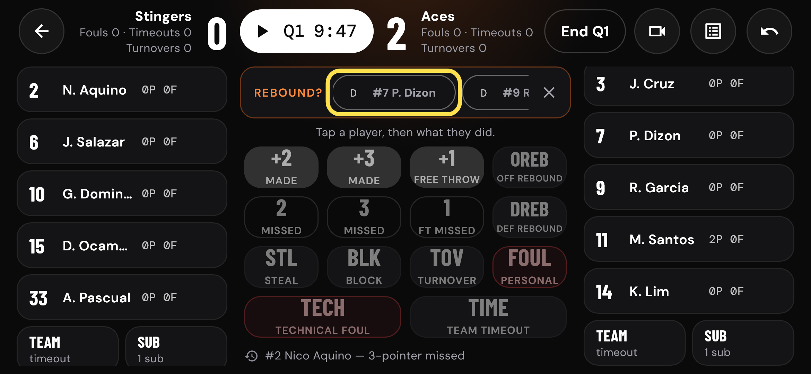

**Step 18.** A foul works the same way: tap the player who fouled, then **FOUL** (a personal foul) or **TECH** (a technical foul). The player's **F** goes up, and so do the team's **Fouls**.

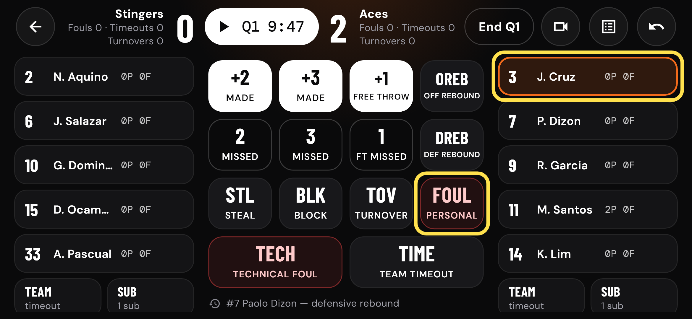

**Step 19.** Team fouls count per quarter. From a team's fifth foul in a quarter, a red **PENALTY** badge shows by its score, and the console says who shoots, for example **PENALTY — Aces has 5 team fouls. Stingers shoots free throws.** Record the free throws with **+1** or **1** FT MISSED. The badge is a reminder: it doesn't add any free throws by itself.

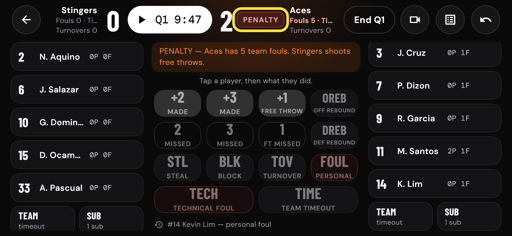

> **Fouling out.** At five personal fouls (technical fouls don't count) a player is out of the game and leaves the court at once. If the team has anyone on the bench, its list of players opens by itself, and nothing more can be recorded until someone comes on: tick who comes on and tap **Save**.

---

## 7. Timeouts and substitutions

**Step 20.** For a timeout, tap the team's **TEAM** button. The console says **A team can only call a timeout.** and **TIME** (TEAM TIMEOUT) turns orange. Tap it. The team's **Timeouts** go up by one.

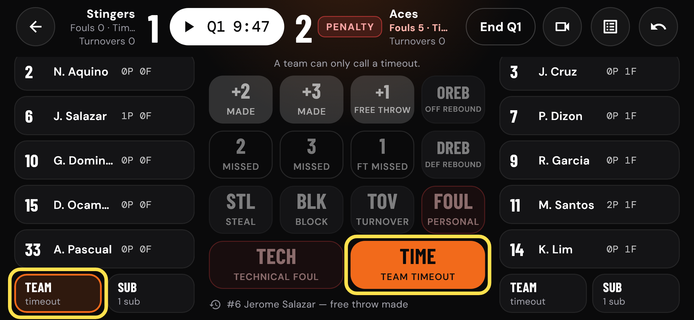

**Step 21.** To change players, tap **SUB** under the team. It says how many are on the bench (here **1 sub**).

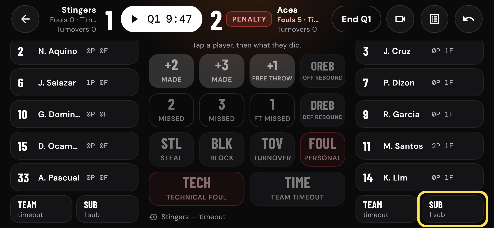

**Step 22.** The team's list opens (**Aces — on court**) with each player's points and fouls. The five on the court are ticked, and it says **5 of 5 on court**. First untick who is coming off. Here, #3 Jomar Cruz.

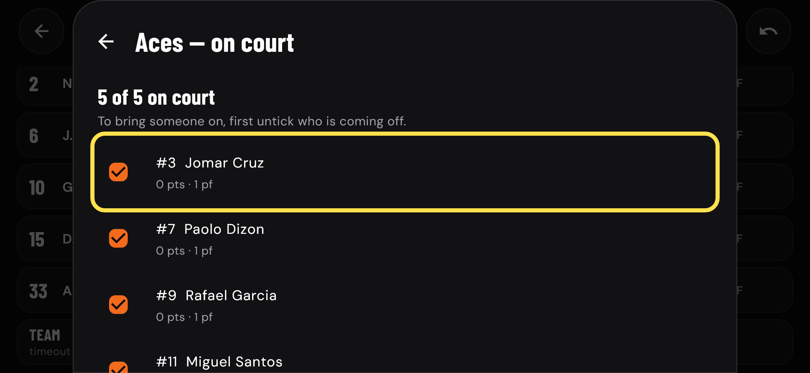

**Step 23.** Then tick who is coming on (#23 Carlo Reyes) and tap **Save**. You can change several players at once before saving. If a team has to play with fewer than five, the button says **Continue with 4**.

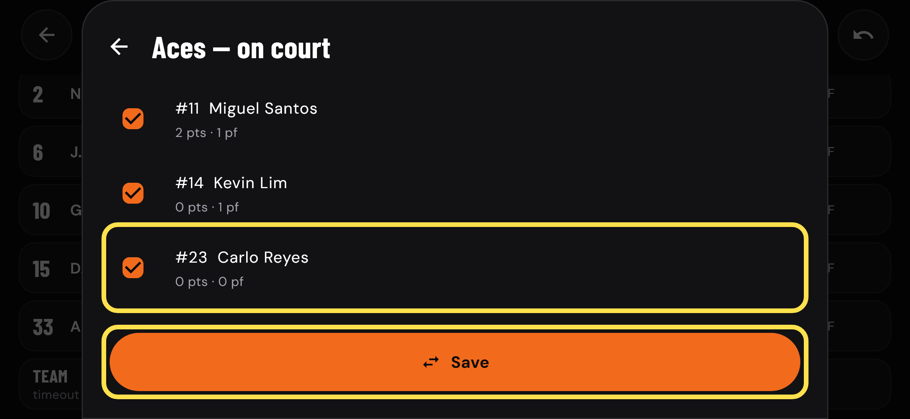

---

## 8. Put a mistake right

**Step 24.** **Undo** (the curved arrow at the top right) takes back the last thing you recorded. The line under the keys shows what that is. Here, #10 Gab Domingo's basket was recorded as a three but was a two: tap **Undo**, and the console says **Taken back: #10 Gab Domingo — 3-pointer made**. Then record the two.

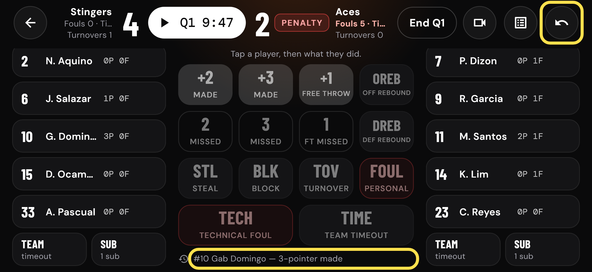

**Step 25.** To take back something earlier, tap **Play by play** (the list button at the top). Everything recorded is listed, newest first, with the quarter and the time on the clock. Tap **Take back** next to the wrong one. Here, the steal was not Kevin Lim's. Taking something back does not erase it: the record keeps the original and the correction.

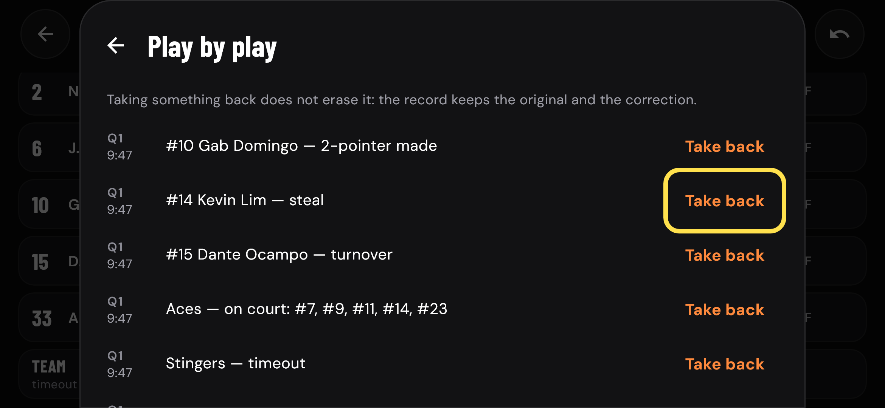

---

## 9. End a quarter

**Step 26.** The line above the keys confirms what was taken back. Record the play again correctly if needed. When the quarter is over, tap **End Q1**.

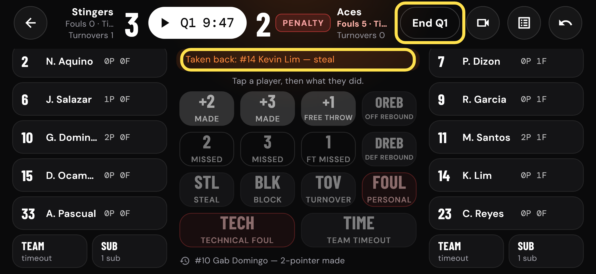

**Step 27.** **Q1 ENDED** appears over the keys, and the clock says **End of Q1**. When play starts again, tap **Start Q2**. The clock is set back to the full quarter.

- **Ended it too soon?** Tap **Resume Q1**. The quarter carries on, with the clock stopped where it was. Once Q2 has started, Q1's end stays.

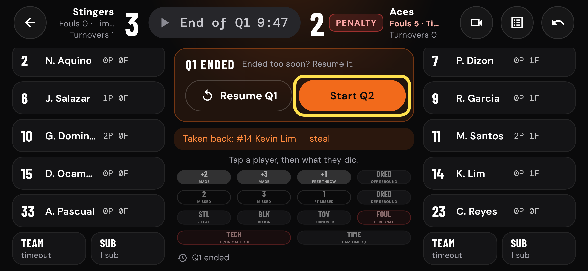

**Step 28.** You can leave the console at any time, for example during a break: tap the back arrow (**Leave the console**). Nothing is lost: every play is saved on the phone as you record it. Game Day then shows the game under **Live** with its score. Tap **Back to the console** to carry on.

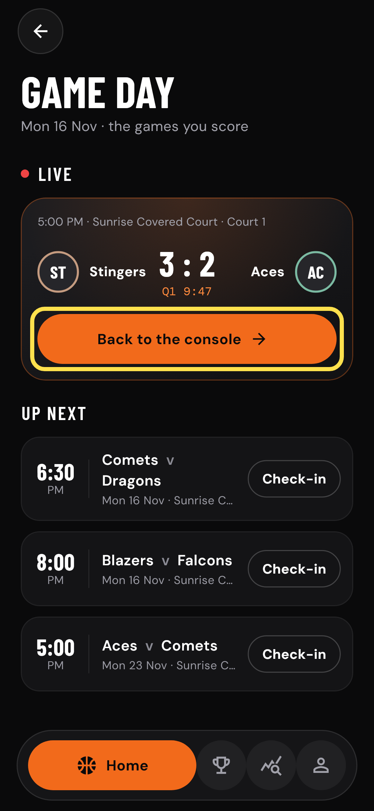

---

## 10. Overtime and the end of the game

**Step 29.** Play the other quarters the same way: **Start Q2** … **End Q2**, **Start Q3** … **End Q3**, **Start Q4** … **End Q4**. After Q4 the banner offers **Start OT1**. If the score is level, as here (37–37), tap **Start OT1** for overtime. Overtime is 5 minutes in the demo, and ends with **End OT1**.

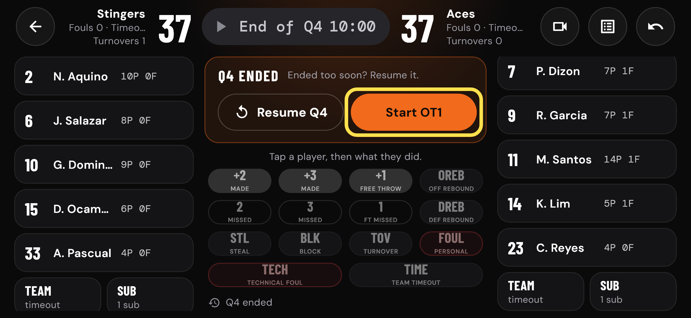

**Step 30.** When the last period has ended and one team is ahead, the game is over. The banner still offers one more period (here **Start OT2**): leave it. Tap the back arrow (**Leave the console**).

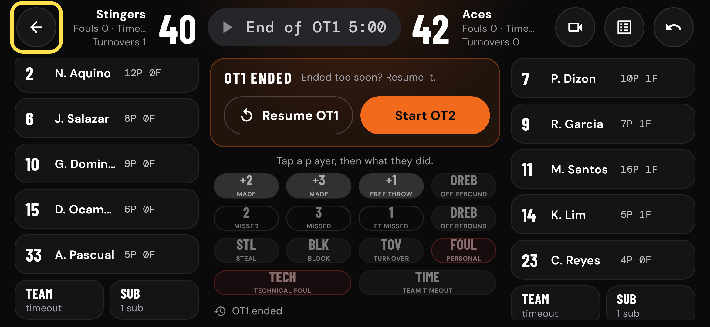

---

## 11. Hand in the result

**Step 31.** On Game Day, tap the game's card (not **Back to the console**) to open its page. Under **Result**, tap **Submit result**. Below it is the box score, marked **Provisional** until the commissioner confirms the result.

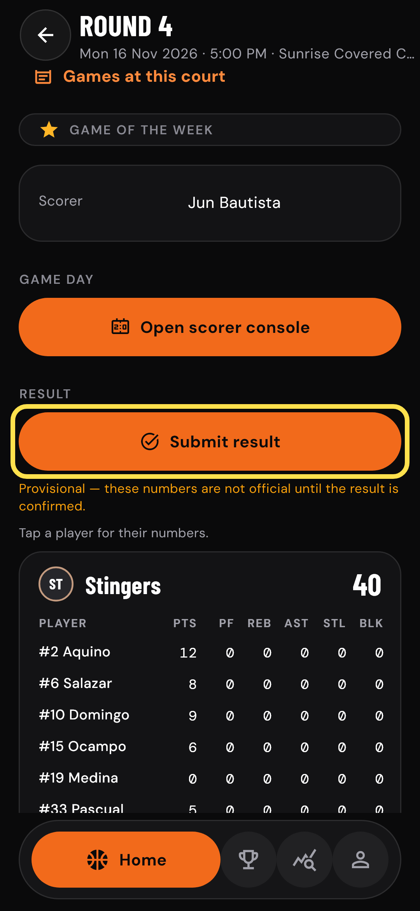

**Step 32.** **Submit result** opens with the final score. Everyone who was on the court is ticked. Untick anyone who stayed on the bench all game (it won't count as a game they played) and tick anyone who is missing. A player with a statistic played and stays ticked. Here, #19 Ralph Medina never came on, so he is not ticked.

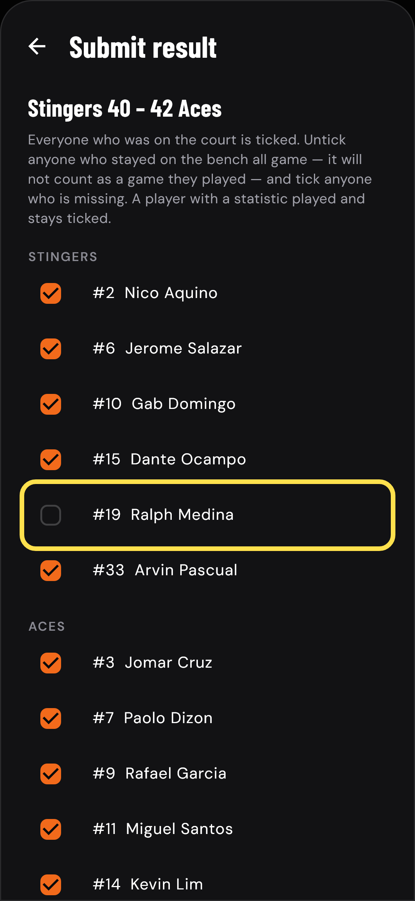

**Step 33.** Scroll down to the players of the game:

- **BPG**, the **Best Player of the Game**, is one of the winners (here the Aces).
- **NPG**, the **Notable Player of the Game**, is one of the defeated team (here the Stingers).

Each list has the team's players who played, best first, with their points, rebounds and assists. One player is already chosen from the box score; tap another player to change it.

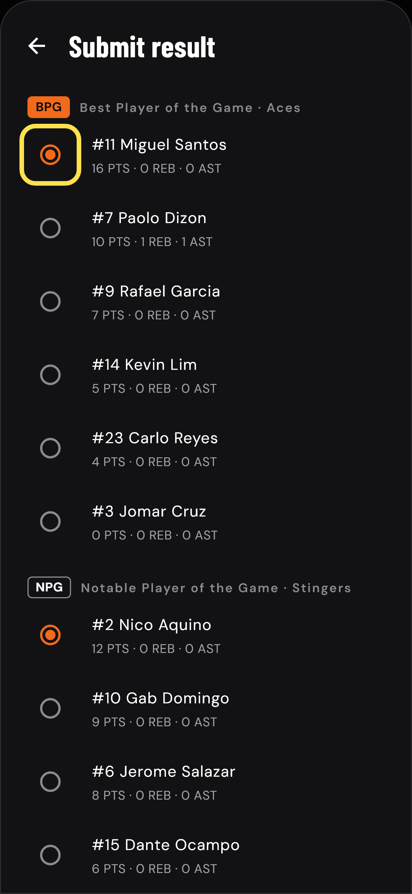

**Step 34.** Check the **NPG** too, then tap **Submit result** at the bottom.

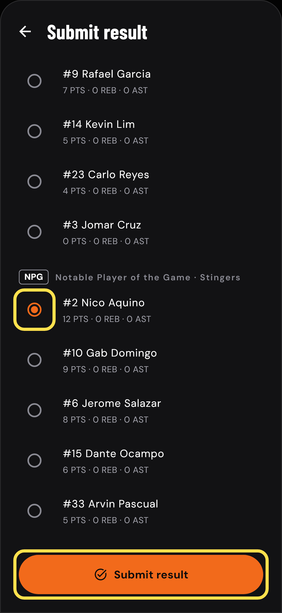

**Step 35.** The page says **Submitted. Waiting for the commissioner to confirm it.** Under **PLAYERS OF THE GAME** are your BPG and NPG, "Named by the scorer. Official once the result is confirmed."

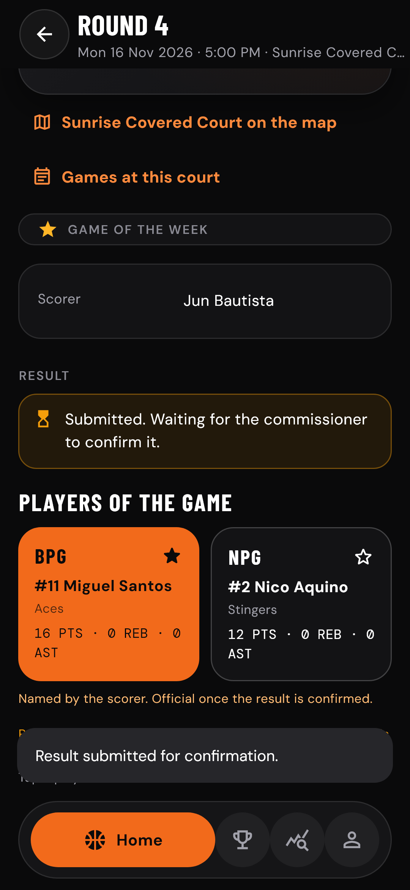

**Step 36.** On Game Day, the game has moved to **Awaiting confirmation**, marked **PENDING**. Your part is done. Nothing counts in the standings or the players' statistics until the commissioner confirms it. If the commissioner finds a mistake, they can send the game back to you: it is open again, and you put it right from the game's page with **Open scorer console** and **Play by play** ([step 25](#8-put-a-mistake-right)), then submit it again.

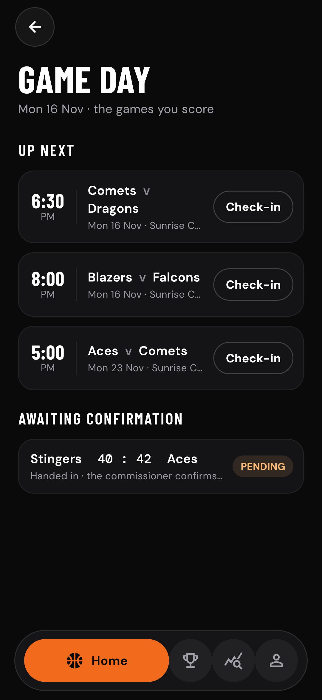

> In a season whose plan doesn't include the players of the game, the Submit result sheet has only the ticks.

---

## 12. Going live

On an Android phone, and on a league plan that includes it, the scorer can stream the game to Facebook or YouTube from the console's camera button (**Go live**) and keep scoring while it streams. The scoreboard is drawn over the picture. See [Try live streaming in the LigaPass demo](../live-stream-demo/README.md).

---

## If something goes wrong

| What you see | What to do |
|---|---|
| The keys are dim and nothing happens | Tap a player first, then the key. For a timeout, tap the team's **TEAM** first. |
| **A team can only call a timeout.** | **TEAM** is selected. Tap a player instead, or tap **TIME** for a timeout. |
| You recorded a wrong play | Tap **Undo** for the last one, or **Play by play** → **Take back** for an earlier one ([part 8](#8-put-a-mistake-right)). |
| You ended a quarter too soon | Tap **Resume Q1** (or whichever quarter it was) before starting the next one. **Undo** does the same. |
| **SUB** is orange and says **needed**, and nothing can be recorded | A player has fouled out. The message above the keys says who must be replaced. Tap **SUB**, tick who comes on and tap **Save**, or **Continue with 4** if the team plays short. Taking the fifth foul back also puts the player back in the game. |
| **Start game** is grey on **Starting five** | Each team needs five starters ticked (or all its players, if it has fewer). The line above the button says which team is short. |
| A player is missing from check-in | Only approved players are listed. Ask the commissioner to approve them. |
| The game's page says **This game is assigned to another scorer.** | Only the scorer assigned to the game can check in and score it. Ask the commissioner. |
| **Submit result** stays grey with no players of the game to choose, or the app says **The score is level at …** | A result needs a winner. Go back to the console and play overtime (**Start OT1**). If the game can't be finished, the commissioner can abandon it. |
| **End the period before submitting the result.** | Go back to the console and tap **End Q4** (or **End OT1**), then submit. |
| The clock is wrong | Tap the time on the clock and set it ([step 14](#5-run-the-game-clock)). |

---

## About the demo

- **A made-up league.** Sunrise League has six teams of six players, three weeks of games already played and confirmed, and tonight's three games waiting for the scorer. Every feature is on.
- **Saved on this phone only.** Nothing is synced, emailed or paid for. The demo is deleted 24 hours after you start it.
- **See the other side.** To confirm the result you handed in, tap **Be someone else** on Home and choose **COMMISSIONER**.

---

[All guides](../README.md)
