# Share your league on social media

LigaPass makes ready-to-post pictures of your league: final scores, the standings, the leaders, season awards, a player's own card and a set of Story slides. It also prints certificates for everyone who played. Each picture carries the league's name and season, and opens straight in the phone's share sheet, so you can post it to Facebook, Instagram or Messenger, or save it to the phone.

In the pictures, a **yellow ring** marks what to tap next.

**Contents**

1. [What you need](#what-you-need)
2. [A final score](#1-a-final-score)
3. [The day's finals at once: Game Day pack](#2-the-days-finals-at-once-game-day-pack)
4. [The standings](#3-the-standings)
5. [The leaders](#4-the-leaders)
6. [Season awards](#5-season-awards)
7. [A player's card](#6-a-players-card)
8. [Story slides](#7-story-slides)
9. [Certificates](#8-certificates)
10. [If something goes wrong](#if-something-goes-wrong)
11. [Good to know](#good-to-know)

---

## What you need

- **LigaPass on an Android phone**, from Google Play.
- **A season whose plan includes share cards, story slides and certificates.** In a season without them the buttons don't show, and whoever runs the league sees which plan the season is on.
- **Confirmed results.** Every picture is made from results the commissioner has confirmed, so a game still waiting for confirmation isn't on them yet.
- **Anyone who can open the season can share**, players and team managers included. Certificates are the exception: only whoever runs the league can make them.

> **Try it in the demo.** On the sign-in screen, tap **Try the demo**. Every plan feature is on there, and it has three weeks of confirmed games. These pictures were drawn from the app with the made-up demo league, opened as its commissioner.

---

## 1. A final score

**Step 1.** Open a game that has finished and been confirmed. In a season, tap **Schedule**, then a game marked **Final**. Below the score, tap **Share the final**.

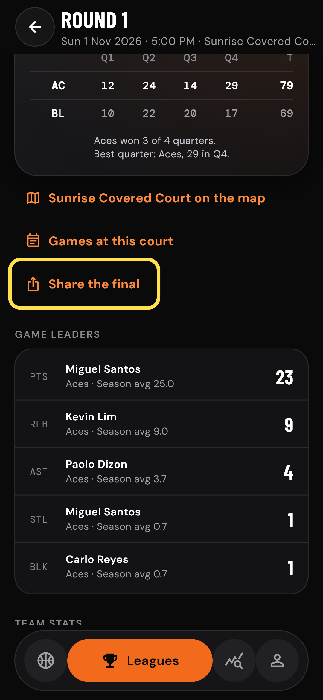

**Step 2.** The phone's share sheet opens with this picture. Choose where to post it.

The picture shows the score, each team's best scorer and the **Player of the Game**. It is sized for a Facebook post or a link preview.

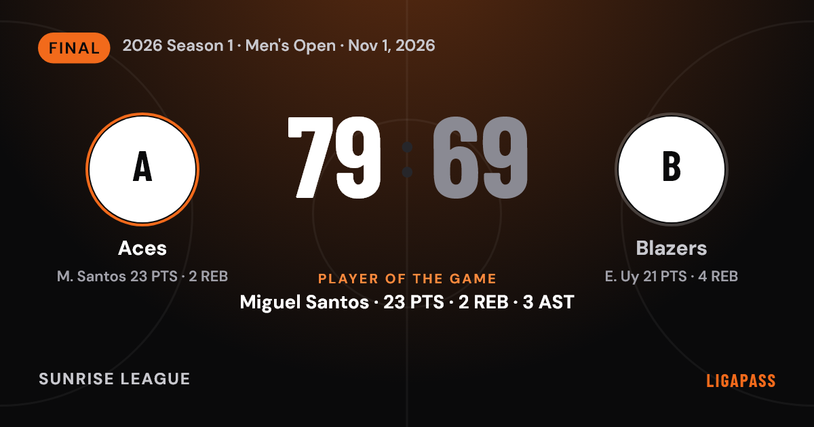

---

## 2. The day's finals at once: Game Day pack

**Step 3.** In a season, open the **Season** tab and scroll to **SHARE & EXPORT**. Everything in this guide except the final score and the player's card starts here.

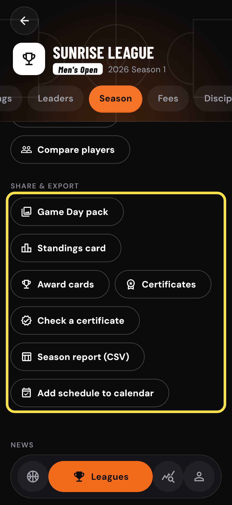

**Step 4.** Tap **Game Day pack**. LigaPass makes a final-score picture for **every confirmed game of the latest game day**, all at once, so you can post the whole day in one go.

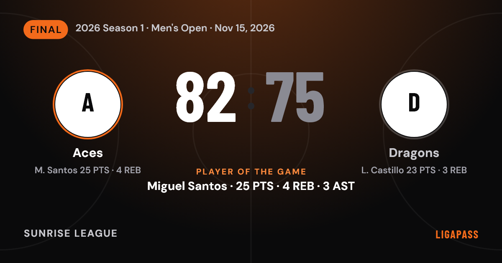

---

## 3. The standings

**Step 5.** Under **SHARE & EXPORT**, tap **Standings card** for the season's table as a picture, sized for a portrait post.

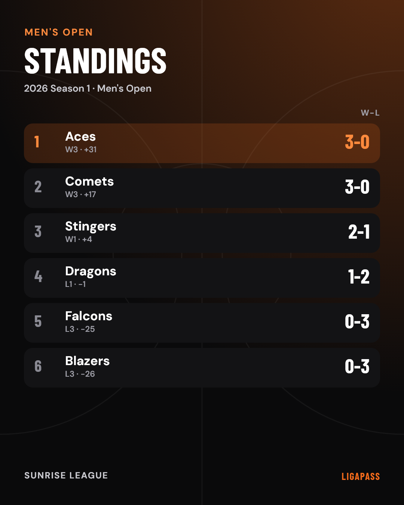

---

## 4. The leaders

**Step 6.** Open the **Leaders** tab and choose a statistic, for example **PPG** (points per game). Tap **Share**.

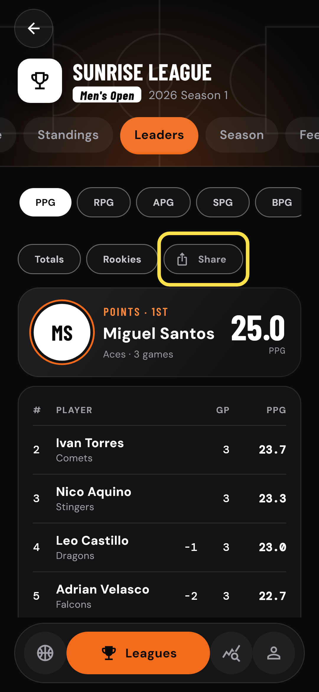

**Step 7.** The picture ranks the leaders in that statistic.

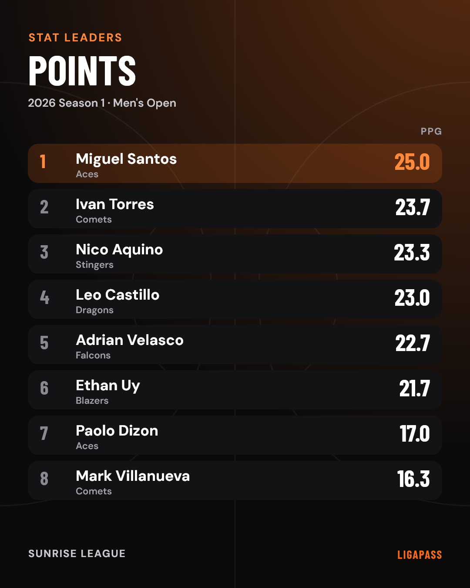

---

## 5. Season awards

**Step 8.** Once the commissioner has confirmed the season's awards, **Award cards** appears under **SHARE & EXPORT**. Tap it for one square picture per award: the MVP, the Mythical Five, the scoring champion and the others the season gave.

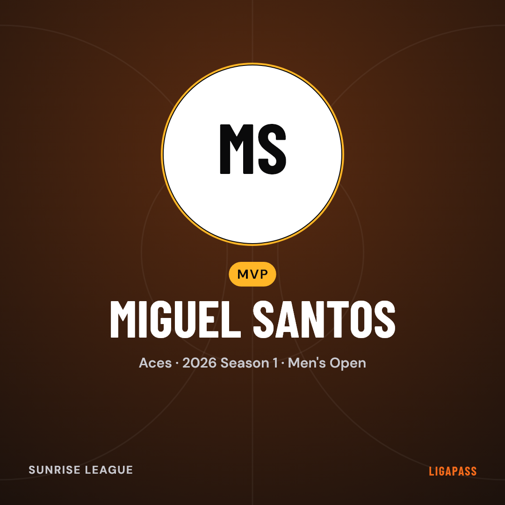

---

## 6. A player's card

**Step 9.** Open a player's page, for example by tapping a name on the **Leaders** tab. Players open their own page from **Profile**, under **My playing record**. Tap **Player card**.

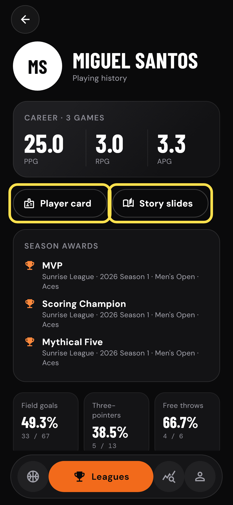

**Step 10.** Choose one of four designs. Each shows the player's season averages.

- **Jersey:** the number big behind the name.
- **Split panel:** the photo on one side, the numbers on the other.
- **Stat sheet:** every number in a grid.
- **For Stories:** tall, for a Facebook or Instagram Story.

Tap a design to share it.

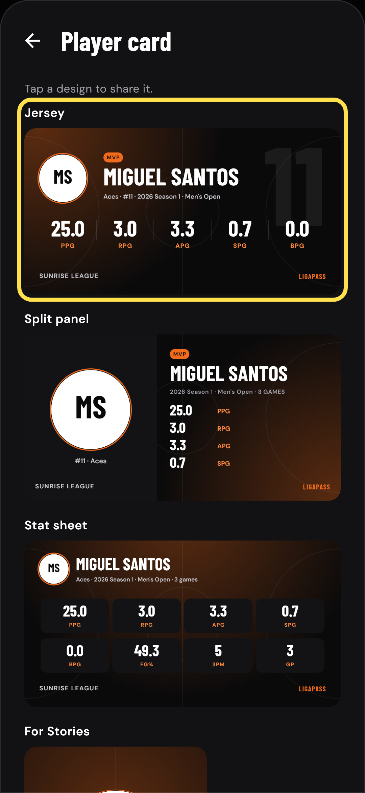

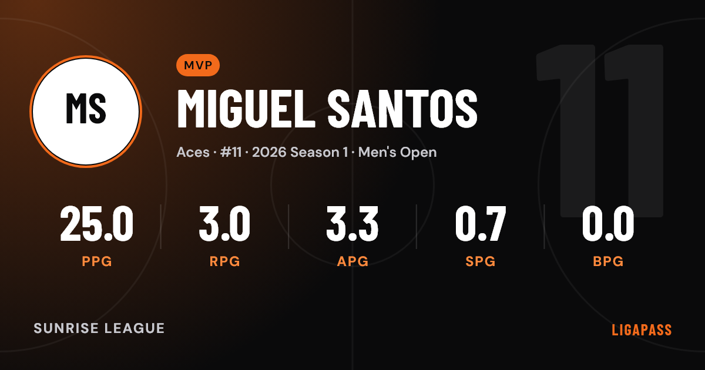

A player with a profile photo has it on the card. Without one, the card shows their initials.

---

## 7. Story slides

**Step 11.** On the player's page, tap **Story slides**. LigaPass makes **five tall slides** about the player's season: their season so far, their best game, their shooting, their milestones, and their honours. All five open in the share sheet. Post them as a Story, or save them to the phone and post them one at a time.

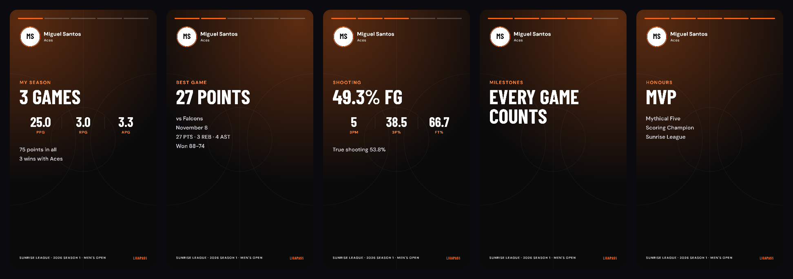

---

## 8. Certificates

Only whoever runs the league can make certificates.

**Step 12.** Under **SHARE & EXPORT**, tap **Certificates** and choose the paper: **A4**, **Letter** or **Short bond**.

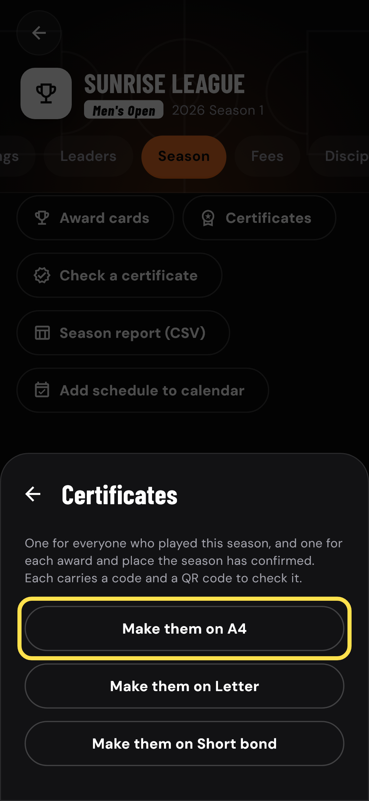

**Step 13.** LigaPass makes one PDF with a certificate for **everyone who played this season**, and one for **every award and place** the season has confirmed. Print it, or send it in a chat. Each certificate has its own **code** and a **QR code**.

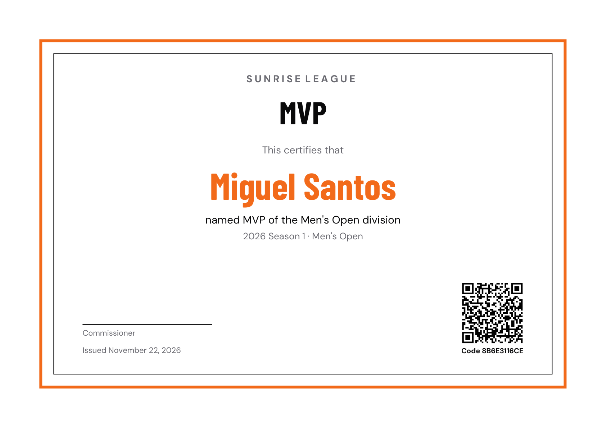

**Step 14.** To check that a certificate is real, tap **Check a certificate** and type its code. LigaPass says whether this season issued it, and to whom. The QR code holds the same code and the certificate's title and name, so anyone can scan it with their phone's camera to read them.

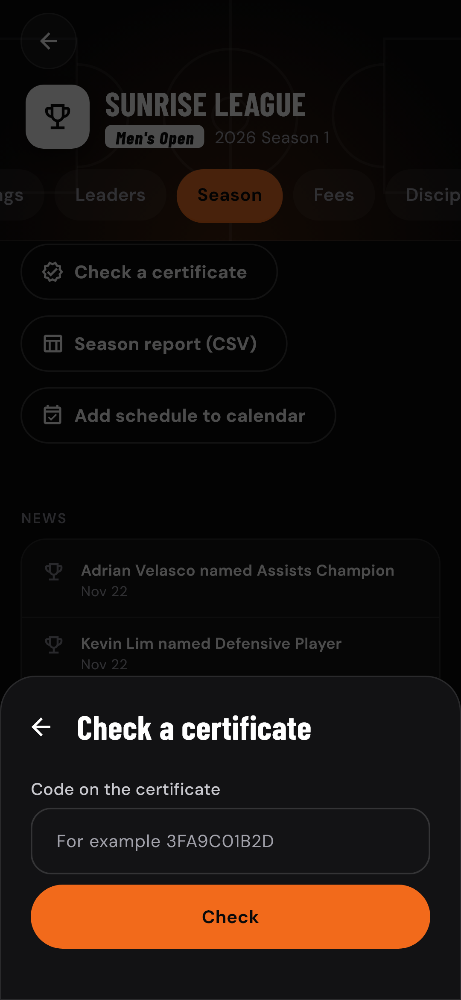

### Also under SHARE & EXPORT

- **Season report (CSV):** the season's numbers as a spreadsheet, for Excel or Google Sheets.
- **Add schedule to calendar:** the season's games still to come, added to the phone's calendar.

---

## If something goes wrong

| What you see | What to do |
|---|---|
| There is no **Share** button, and no **SHARE & EXPORT** buttons apart from the report and the calendar | The season's plan doesn't include share cards. Whoever runs the league sees which plan it is on. |
| **"No confirmed final to post yet."** | No game of this season has been confirmed yet. Ask the commissioner to confirm the results. |
| **"No confirmed game this season to put on a card."** | The player hasn't played in a confirmed game this season. |
| There is no **Award cards** button | The season's awards haven't been confirmed yet. |
| There is no **Certificates** button | Only whoever runs the league can make them, and only once a game has been confirmed. |
| **Share the final** isn't on a game's page | The game hasn't been confirmed yet. Only a **Final** game has it. |

---

## Good to know

- **Each picture is the right size for where it goes:**

  | Picture | Size | Made for |
  |---|---|---|
  | Final score, Game Day pack | 1200 × 630 | A Facebook post or a link preview |
  | Standings, leaders | 1080 × 1350 | A portrait post |
  | Award cards | 1080 × 1080 | A square post |
  | Player card (Jersey, Split panel, Stat sheet) | 1200 × 630 | A post |
  | Player card (For Stories), Story slides | 1080 × 1920 | A Story |

- **Your sponsors are thanked.** If the league shows sponsors on its live streams, the pictures name them at the foot ("Supported by …").
- **LigaPass doesn't post anything by itself.** The pictures are made on your phone and go only where you choose in the share sheet.
- **Pictures always match the confirmed results.** Make a new one after the next game is confirmed and it includes that game.

---

*These pictures were drawn from the app itself, using the made-up demo league.*

[All guides](../README.md)
