# Manage your team in LigaPass

This guide is for a **team manager**: the person who looks after a team's roster in a league. It shows how to find your team, add a player and send him to the commissioner for approval, follow where each player stands, put on a team logo, and read your team's games, standings and leaders. It uses the app's built-in demo, so you don't need a league or an account. In the demo you are **Carlo Dizon**, the manager of the **Aces** in Sunrise League.

In the pictures, a **yellow ring** marks what to tap next.

**Contents**

1. [Before you start](#before-you-start)
2. [Find your team](#1-find-your-team)
3. [Your team's page and roster](#2-your-teams-page-and-roster)
4. [Add a player](#3-add-a-player)
5. [Send players for approval](#4-send-players-for-approval)
6. [Add your team's logo](#5-add-your-teams-logo)
7. [Who leads the team, and attendance](#6-who-leads-the-team-and-attendance)
8. [Your team's games, results, standings and leaders](#7-your-teams-games-results-standings-and-leaders)
9. [What a team manager can and can't do](#what-a-team-manager-can-and-cant-do)
10. [If something goes wrong](#if-something-goes-wrong)

---

## Before you start

Open LigaPass, tap **Try the demo — no account needed**, then **Start the demo**. Choose **TEAM MANAGER** (Carlo Dizon). No password is needed. [Try the demo](../getting-started/README.md#try-the-demo) in the getting-started guide shows these steps in full.

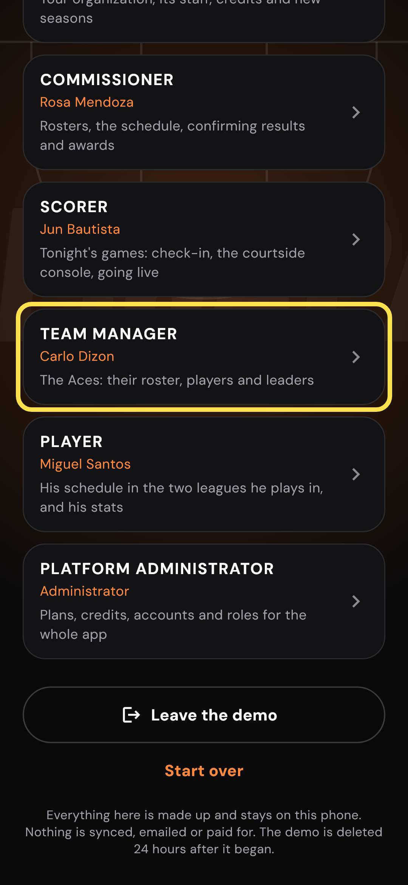

> In a real league you sign in with your own account. The league's owner or commissioner adds you to the league and names you as your team's manager.

---

## 1. Find your team

**Step 1.** On Home, tap **Leagues**. (The trophy at the bottom of the screen opens the same page.)

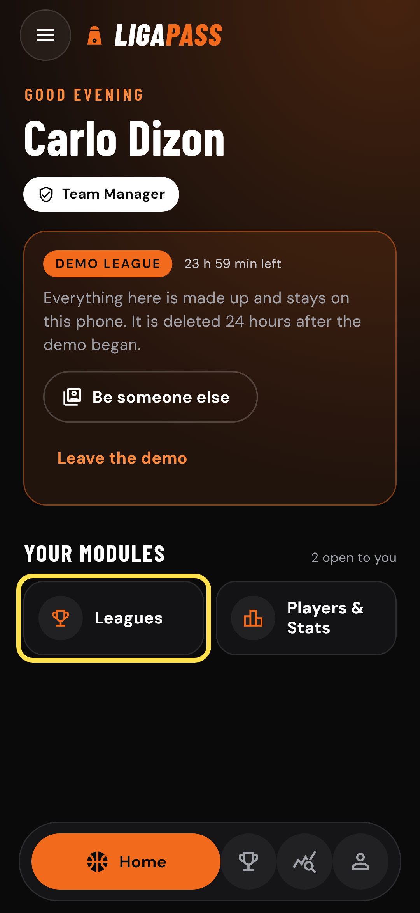

**Step 2.** Your league is listed under its organization. Tap **Sunrise League**.

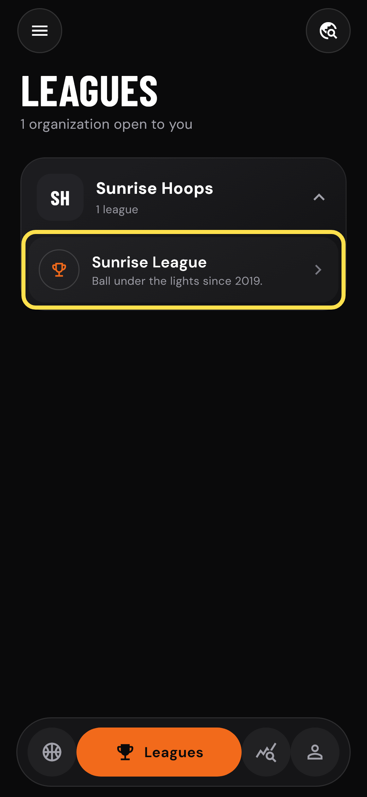

**Step 3.** Under **DIVISIONS**, tap the season your team plays in: **2026 Season 1** of Men's Open.

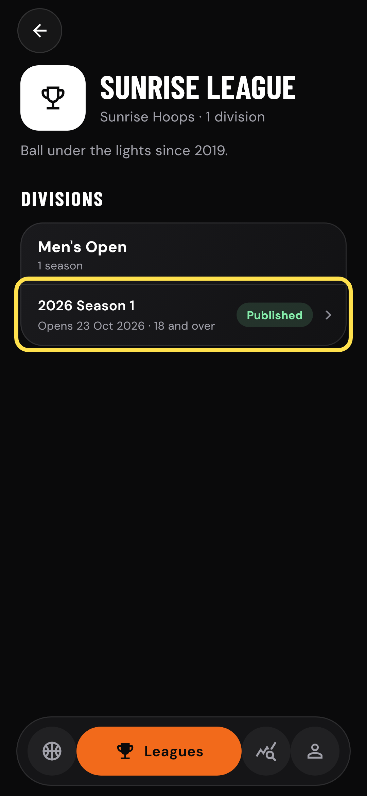

**Step 4.** The season opens on its **Rules** tab. Tap **Teams**.

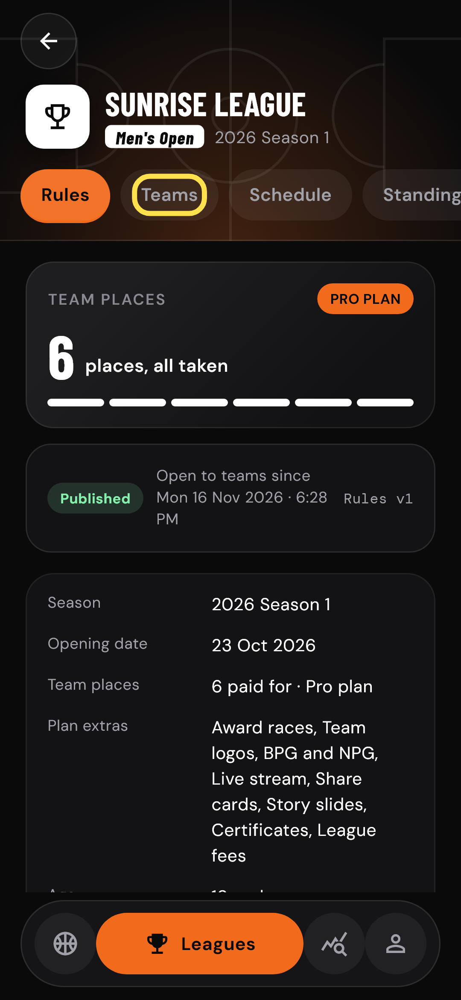

**Step 5.** You see only the teams you manage. Tap **Aces**.

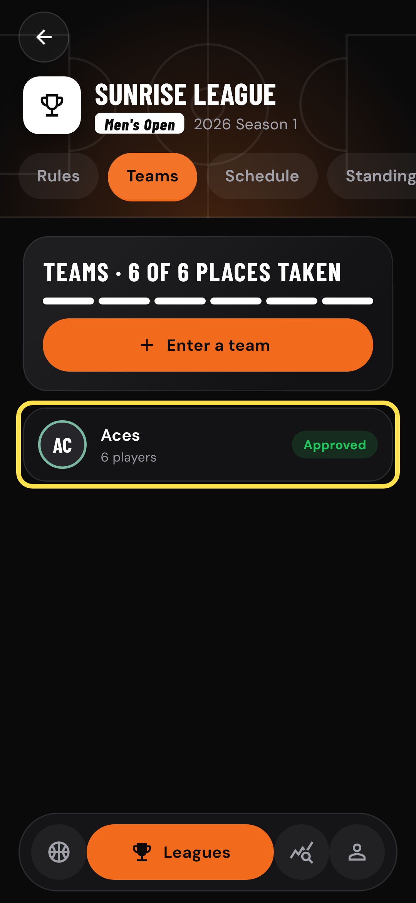

> **Enter a team** on this tab is for entering another team you manage into the season. The commissioner then approves it.

---

## 2. Your team's page and roster

**Step 6.** This is your team's page. At the top right is the team's own standing in the season (**Approved**). Below the name you find:

- **Add logo**: see [part 5](#5-add-your-teams-logo).
- **WHO LEADS THE TEAM**: the manager, the coach and the captain.
- **Add our games to the calendar**: puts all your team's games in the phone's calendar.
- **Follow this team**.
- **ATTENDANCE**: practices and meetings, and who came.

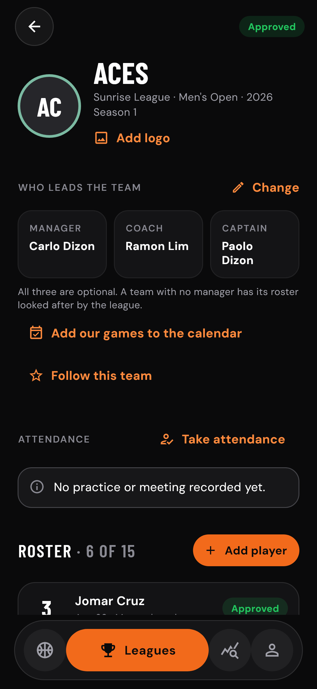

**Step 7.** Scroll down to the **ROSTER**. **6 OF 15** means the team uses 6 of the 15 places the season allows. Each player shows:

- the jersey number and name,
- their age and whether they meet the season's rules (**Meets the rules**, **Information missing**, **Does not meet the rules** or **Needs the commissioner's judgement**),
- **Captain ball**, **Coach**, **Has an account** or **Invited to sign up** where that applies,
- where they stand on the right: **Draft**, **In review**, **Approved**, **Rejected** or **Review again**.

To add someone, tap **Add player**.

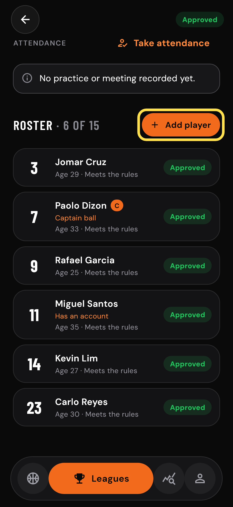

---

## 3. Add a player

**Step 8.** The **Add player** form opens.

- **A player you already have**: for someone your league already has, or someone who signed up to LigaPass on their own, type at least 3 letters of their name and pick them. Leave it empty to add someone new.
- Type the **First name** and **Last name**.
- Tap the **Date of birth** field.

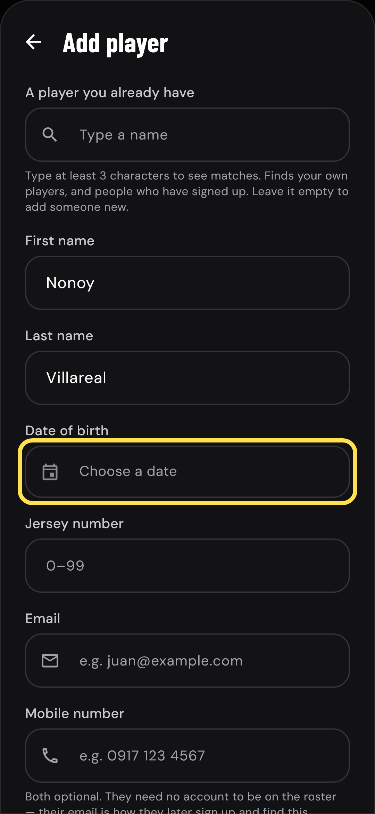

**Step 9.** A calendar opens. For a birthday years back it is quicker to type it: tap the **pencil**.

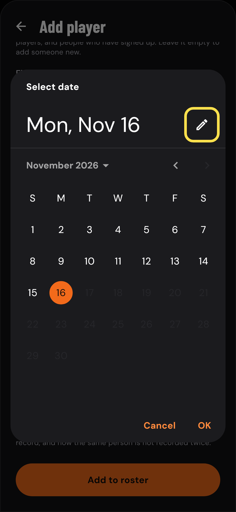

**Step 10.** Type the date in the order your phone uses (here month/day/year: 03/14/1998) and tap **OK**.

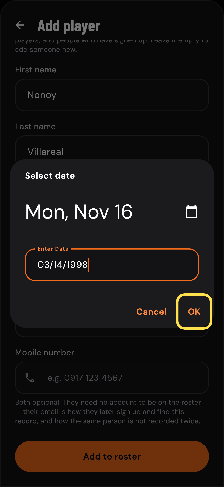

**Step 11.** Type the **Jersey number** (0 to 99). **Email** and **Mobile number** are optional. Then tap **Add to roster**.

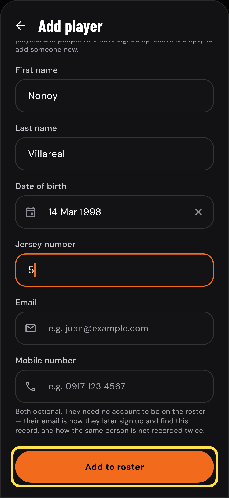

> **Email and invitations.** A player doesn't need an account to be on the roster. If you type their email, the box **Email them an invitation to sign up** appears, ticked: LigaPass emails them a way to sign up, and their games and stats then show up in their own app. In the demo nothing is emailed.

---

## 4. Send players for approval

A player you add starts as a **Draft**. When you send him in, he waits **In review** until the commissioner approves or rejects him.

**Step 12.** The new player is on the roster as **Draft**, and the line under his name already says whether he meets the season's rules. At the foot of the roster, tap **Submit 1 for review**. (The number is how many drafts you are sending.)

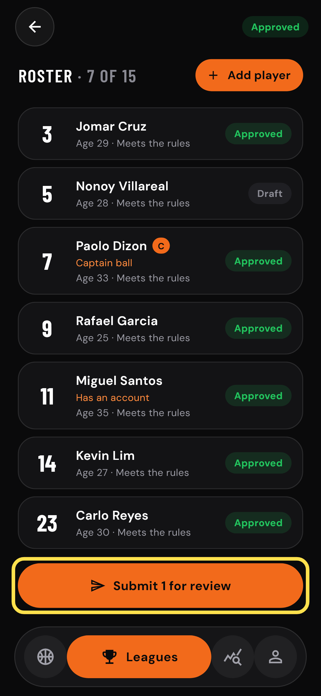

**Step 13.** The message **Sent to the commissioner.** shows, and the player's pill turns **In review**. Tap the player to see his details.

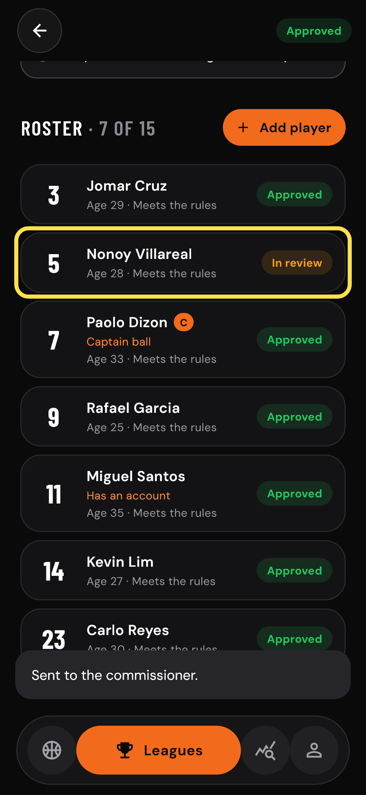

**Step 14.** His sheet shows where he stands, his date of birth and age, his jersey number, his email and mobile, whether he has his own account, and whether he meets the rules. **Edit player** changes his details. Tap the back arrow to close the sheet.

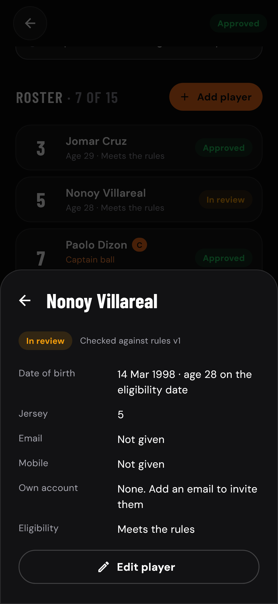

**Step 15.** Once the commissioner has approved him, his pill turns green: **Approved**. Only approved players can be checked in for a game.

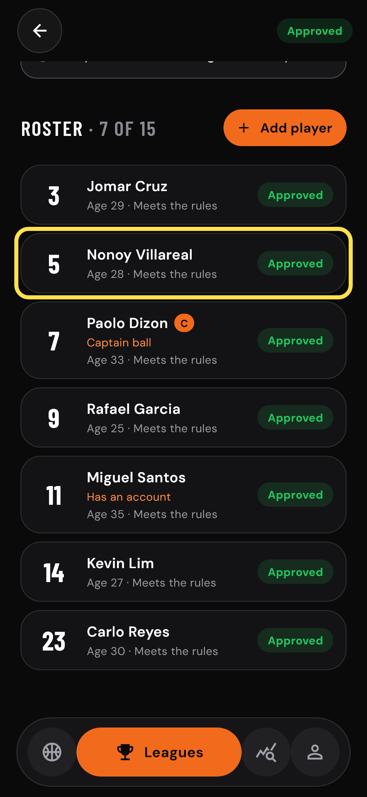

- **Rejected**: the commissioner turned the player down. Tap him to read the **Reviewer's note**.
- **Review again**: something the approval rested on changed (for example his date of birth was edited, or the season's rules changed), so the commissioner has to look at him again.
- You can't approve your own team's players. Someone else in the league does that.

---

## 5. Add your team's logo

Team logos come with the league's plan. Where they are on, you see **Add logo** under the team's name.

**Step 16.** Scroll back to the top of your team's page and tap **Add logo**. The phone's photo gallery opens. Choose the picture.

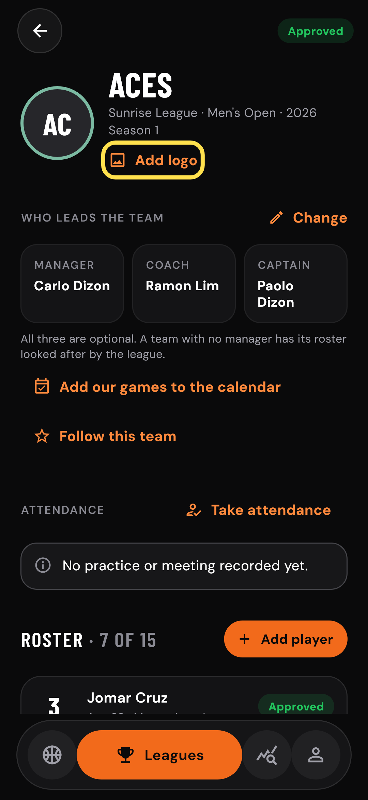

**Step 17.** The message **Logo saved.** shows and the logo replaces the team's initials. The button now says **Change logo**. The logo shows wherever your team does: the team list, the schedule, the standings, game pages and box scores.

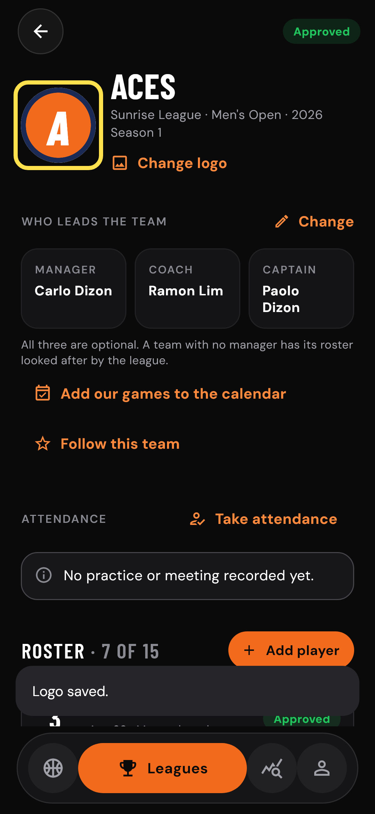

> The logo must be a PNG, JPEG, GIF or WebP picture. LigaPass makes it small by itself, so a big photo is fine.

---

## 6. Who leads the team, and attendance

**Step 18.** Next to **WHO LEADS THE TEAM**, tap **Change**. Choose the **Captain ball** from your players, and the coach: **No coach**, **One of the players**, or **Someone who does not play** (then type the **Coach's name**). Tap **Save**. None of these is required.

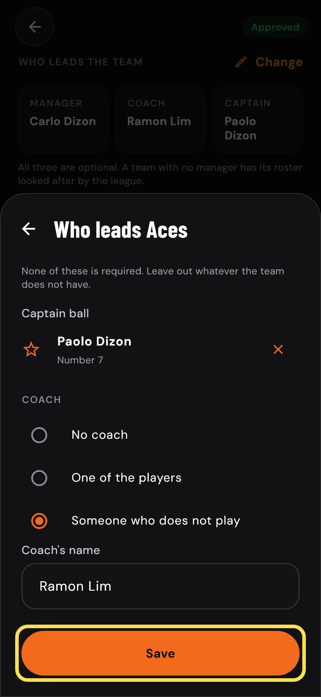

**Step 19.** Next to **ATTENDANCE**, tap **Take attendance**. Choose the date (**When**) and what it was (**Practice**, **Game**, **Tryout**, **Meeting** or **Other**). Everyone on the approved roster starts ticked: untick whoever wasn't there, then tap **Save**. The Attendance card then counts how many sessions each player came to.

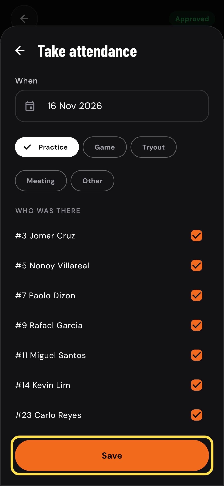

> **Team fees.** If your league charges your team fees through LigaPass, a **Team fees** card on this page shows what was charged and paid. The league records payments; you only read them here.

---

## 7. Your team's games, results, standings and leaders

**Step 20.** Go back (the arrow at the top left) to the season's page and tap **Schedule**. Games are listed by round. The chips show **All games**, **Upcoming** or **Completed**, and the calendar button shows the games on a month's calendar. Tap one of your team's games.

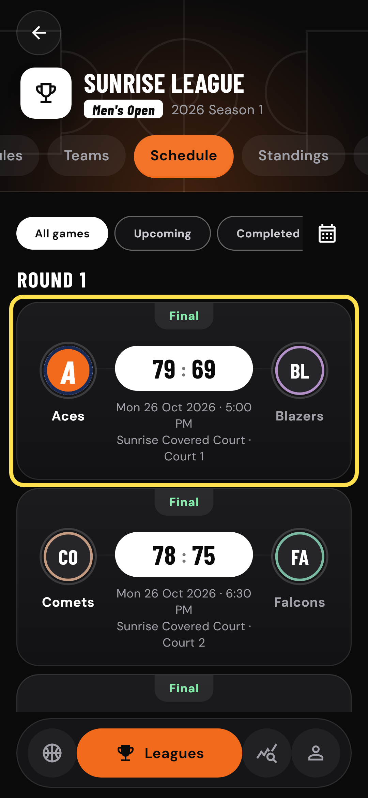

**Step 21.** A played game shows **Final · Confirmed** once the commissioner has confirmed the result, the score by quarter, and the **GAME LEADERS**. **Share the final** makes a picture of the result to share.

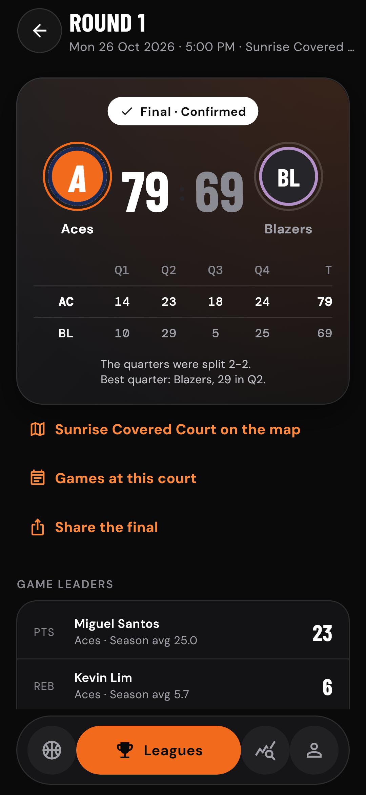

**Step 22.** Scroll down for the box score of each team. Tap a player for all of his numbers in that game.

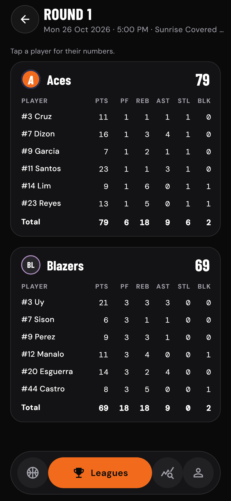

**Step 23.** Go back and tap **Standings**. Your team is highlighted. Each row shows games played (**P**), wins (**W**), losses (**L**), the point difference (**DIFF**) and points (**PTS**), and under it the team's streak and its last games.

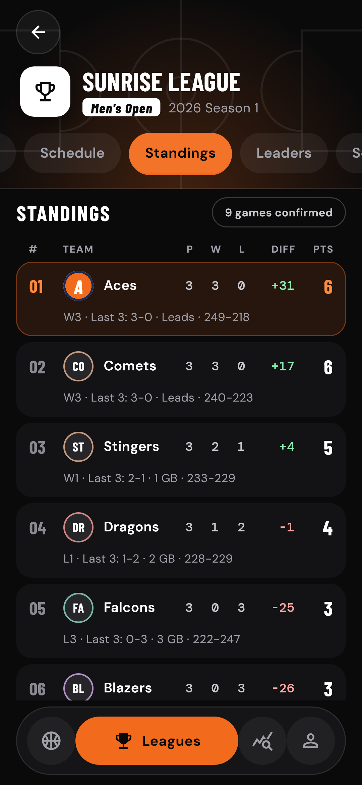

**Step 24.** Tap **Leaders**. The season's award races (**MVP**, **Defense** and more) and the statistical leaders are here. Slide the chips sideways to see them all. The **Season** tab, at the end, gathers the latest results, the games coming up and the season's news.

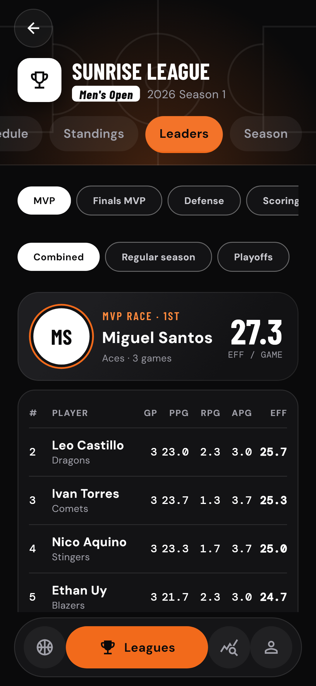

---

## What a team manager can and can't do

| You can | Someone else does it |
|---|---|
| Add players to your team and edit them | Approving or rejecting players (the commissioner) |
| Send drafts in with **Submit for review** | Approving your team into the season |
| Add or change the team logo | Making the schedule and recording results |
| Choose the captain and the coach | Charging and recording fees |
| Take attendance | |
| Read every game, box score, the standings and the leaders | |

You see and change only the teams you manage. Other teams' pages are read-only for you.

---

## If something goes wrong

| What you see | What to do |
|---|---|
| Your team isn't on the **Teams** tab | You see only the teams you are the manager of. Ask the commissioner to name you as the team's manager. |
| There is no **Add player** button | You are not this team's manager, or the team has withdrawn from the season. |
| There is no **Submit for review** button | You have no players in **Draft**. Players already **In review** wait for the commissioner. |
| A player says **Information missing** | Tap him, then **Edit player**, and fill in what's missing (often the date of birth). |
| There is no **Add logo** button | The league's plan doesn't include team logos. |
| "The photo picker could not be opened" | Close LigaPass, open it again and try once more. If it keeps happening, check in the phone's settings that LigaPass may use your photos. |

---

*These pictures were drawn from the app itself with the made-up demo league. The Aces logo is made up too.*

[All guides](../README.md)
